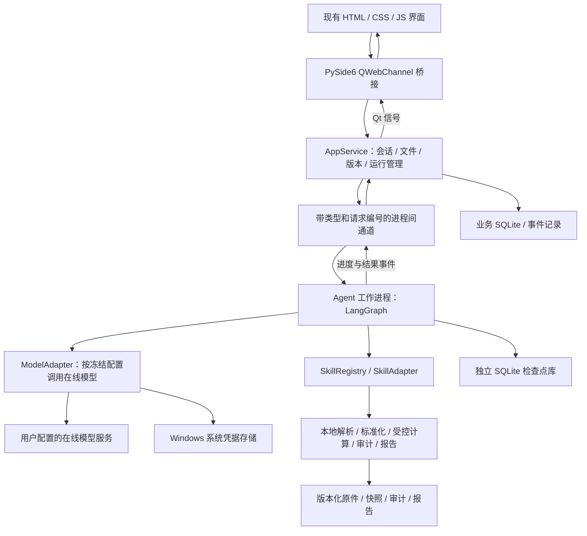
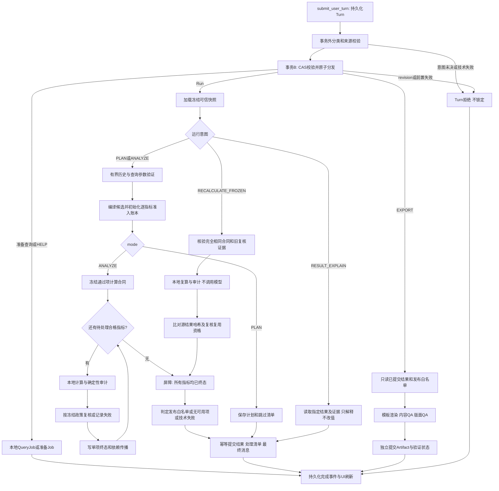

# Insight Agent 接口与 LangGraph Agent 方案

方案版本：V1.1（功能覆盖规格），日期：2026-10-29。本文保留设计基线；实现已推进至 1.0.0-rc1，当前代码、测试和外部待验收条件见 [交付验收记录](acceptance-2026-10-29.md)。第 12 章及 [规则契约](contracts/README.md) 是实现和验收的细化依据；设计条款及历史评审分数本身不代表实测通过。

后续设计：2026-10-30 的 [LangGraph 节点重设计](langgraph-redesign-2026-10-30.md) 规定以用户问题和数据为主导的统一查询规划；指标库仅作为可选的口径解释和术语参考，只有用户明确采用或 Word 文档明确要求时才形成约束。主图、规划/执行子图及恢复约定以后续方案为准；该补充是待实施设计，当前运行代码仍沿既有链路执行。

## 1. 本次范围与设计依据

按本轮确认的要求设计：

- 使用 **Python 3.11 x64**；不再兼容 Windows 7，目标为 Windows 10/11 x64。
- **桌面单机运行，接入在线大模型**：文件解析、指标计算、存储和报告生成在本机完成；模型推理由用户在设置中配置的在线服务提供。按本轮新要求替代此前的“完全离线”约束，不要求部署本地模型。
- 复用当前 PySide6 / Qt WebEngine 三栏界面。本轮不修改应用代码、启动配置或依赖文件。
- 对话输入区支持 **Ctrl+V 粘贴资源管理器中复制的本地文件**，导入后自动识别“数据文件 / 指标说明”等业务用途；保留文件选择和拖放入口，三种方式共用接入流程。
- Agent 参考 `D:/手术数据/方案/手术室指标工具_LangGraph_Agent完整方案.md` 的 V1.2 设计，以当前 UI 的会话与版本约束为产品边界。

主要参考资料：

1. [当前 UI 设计说明](D:/DataMind/.design-reference/Insight_Agent_UI_设计说明.md)。
2. [手术室 LangGraph Agent 完整方案](D:/手术数据/方案/手术室指标工具_LangGraph_Agent完整方案.md)，重点参考第六至十一章、第十三章、第十五至十九章。
3. `D:/手术数据/skills/` 下四个 Skill 的职责和输入输出说明。

参考目录中的旧版设计说明和现有 Skill 仍有“待确认”“报告保留不可计算项”的表述；V1.2 完整方案已调整为“歧义项直接跳过、正式报告仅包含通过复核的指标”。本方案采用后者。参考资料中的命令和示例只作为设计材料，不在本轮执行。

### 1.1 与参考方案的承接和差异

| 项目 | 参考方案 | 本工程采用的方案 |
| --- | --- | --- |
| Python | 3.12 | 按本轮要求改为 3.11 |
| 产品入口 | 长期任务工作区，统一上传 | 对话输入区统一接收粘贴、选择和拖放的混合附件；保留指标定义库维护入口 |
| 数据补传 | 同一任务产生新数据版本 | 首问后锁定会话；增删、更换 Excel 必须新建会话 |
| Word 变更 | 生成新的配置和运行 | 定义库形成新版本；历史会话继续引用原发布版本 |
| Agent | 一个主图、四个功能 Skill | 保留；AI 专业角色节点不等于多个自治 Agent |
| 语义不明 | 跳过，不等待确认 | 保留；在处理清单中解释，不输出猜测值 |
| 模型 | 可接院内或外部服务 | 在线模型；设置中维护多套服务商、地址、Key 和模型配置，明确选择默认配置 |
| 图线程 | 每次运行独立线程 | 保留；会话历史由业务数据库维护 |

### 1.2 必须维持的业务约束

1. 一个会话对应一个独立的逻辑数据集；底层可按文件哈希复用只读存储，但不得混用不同会话的业务记录。
2. 第一条 **PLAN / ANALYZE 执行型问题**受理时原子锁定 Excel 文件清单及内容哈希、具体 Word 版本及规则快照。V1.1 明确细化：查看文件、检查定义、附件状态、帮助和打开设置不属于首次分析，不锁定；首个 PLAN 仍锁定。分析失败也不自动解除锁定。
3. 对话中“换数据”“改定义”“基于当前配置新建”均产生新的会话绑定，不修改历史绑定。
4. 已发布 Word 版本不可覆盖；解析器升级也不得重写已发布的结构化规则。修订或重新解析后发布新版本。
5. 每次运行另行冻结字段映射、统计窗口、算子等计算合同；不同问题可以使用不同窗口，但不得改变原文件和业务定义。
6. 文件接入、规则明确、数据满足、计算完成、结果可发布是不同状态。
7. 指标有歧义、缺关键数据、映射不唯一、分母为零或审计失败时跳过受影响项；其他合格项继续。
8. 跳过项只存原因和证据，不生成数值对象。没有可发布指标时不生成空白正式报告。
9. 新建会话可先处于附件不完整的草稿状态；首次 PLAN / ANALYZE 前必须完成所需附件路由、数据准备和已发布定义绑定。粘贴文件只触发接入与识别，不自动发送问题、执行计算、发布定义或生成报告。

## 2. 本地业务与在线模型架构

建议先实现内部服务接口，不强制增加 FastAPI、本地 HTTP 服务或网络端口。以下接口清单同时给出可选 HTTP 映射，便于以后扩展；它们是应用自定义接口，不是 LangGraph 自带 API。

当前 `insight_agent/desktop.py` 使用 `file://` 加载界面，并关闭了本地页面访问远程 URL 的能力。现有桥接仅提供文本复制，尚无文件粘贴或业务调用。沿用 QWebChannel 扩展原生剪贴板与业务桥接更贴合当前结构；若以后改用 HTTP，应有意识地改为同源页面/API，处理端口、来源和本机访问令牌，不能直接认为当前页面已经能调用 HTTP/SSE。

UI 线程只处理展示和快速分发。Excel 扫描、模型推理、全量计算、Word 转换和渲染放在工作进程；进程通过结构化消息通信，不共享 Qt 对象、数据库连接或打开的工作簿。

### 2.1 建议组件

| 组件 | 选择及边界 |
| --- | --- |
| 运行环境 | Python 3.11 x64；锁定验证后的补丁版本及依赖 |
| 桌面 UI | 保留 PySide6 / Qt WebEngine |
| 编排 | LangGraph `StateGraph`；按业务阶段显式分支 |
| 输入输出校验 | Pydantic + JSON Schema |
| Excel | openpyxl / pandas；`.xls` 使用经过验证的 xlrd 适配器 |
| 指标计算 | 受控 Python 算子；规模增加后再评估 DuckDB |
| Word | python-docx 处理 `.docx`；`.doc` 走内置 `doc2txt`/Antiword 与 `olefile` 纯 Python 文本解析适配器 |
| 存储 | SQLite 业务库 + 独立 SQLite 检查点库 + 版本化本地文件 |
| 模型 | ModelAdapter + 服务商/协议适配器；在线 API、流式响应、结构化输出和工具能力逐配置验证 |
| 打包 | PyInstaller onedir；包含 Qt WebEngine 资源、Skill、模板、Schema 和迁移文件 |

在线模型由 Python 工作进程调用，HTML/JS 不直接请求模型服务，也不长期保存 API Key。通过 ModelProfile 管理服务商、协议、地址、模型和调用参数；Key 单独存入 Windows 系统凭据存储。UI 资源、文档解析、计算和报告组件仍随安装包本地部署。

## 3. 核心对象和版本关系

| 对象 | 主要字段 | 约束 |
| --- | --- | --- |
| AttachmentBatch / Attachment | id、sessionId、source、fileRef、sha256、state、routingRevision | 统一记录粘贴/选择/拖放；原件先暂存，按已校验用途登记业务引用 |
| DataSet | id、revision、files、validationState、lockedAt | 会话级逻辑隔离；锁定后文件清单不可变 |
| DataFile | id、sha256、actualFormat、size、parseState、profileRef | 保存原件副本，不能长期依赖用户原路径不变 |
| FileProfile / RouteDecision | 文件用途、证据、Sheet、字段、扫描覆盖、解析能力、原因码、策略/模型版本 | 格式、业务角色、解析能力分别记录；决策绑定附件、内容哈希和意图修订 |
| Definition | id、name、latestPublishedVersionId | 同一文档的长期标识；支持多个文档 |
| DefinitionVersion | id、versionLabel、wordSha256、rulesDigest、parserVersion、status | 草稿/已发布/停用；已发布内容不可变 |
| MetricDefinition | metricId、表达式、字段依赖、窗口规则、单位、原文定位、明确性结论 | 只允许明确且受支持的规则进入执行候选 |
| MappingRevision | id、digest、字段映射、依据、验证状态 | 不覆盖旧映射；运行引用具体版本 |
| ChatSession | id、code、title、state、dataSetId、definitionVersionId、revision、lockedAt | 支持 DRAFT；首问前补齐绑定；引用具体版本，不能只保存“最新版”或版本展示文字 |
| ModelProfile / ModelProfileRevision | id、displayName、providerId、protocol、baseUrl、modelId、parameters、revision、credentialRef | 非敏感配置版本化，Key 在系统凭据中；同一服务商可保存多套配置 |
| AgentMessage | id、sessionId、role、content、resultRef、createdAt | 业务消息是对话历史的权威记录 |
| AnalysisRun | id、sessionId、mode、status、inputManifestRef、routingManifestRef、modelProfileSnapshotRef、contractHash、threadId | 一个问题/一次计划对应一个运行，引用不可变路由和非敏感模型配置快照 |
| ComputationContract | 文件/路由/规则哈希、映射、字典、窗口、时区、精度、引擎/算子版本 | 一经冻结不可被反思节点原地改写 |
| MetricResult / SkipRecord | 结果及来源，或跳过原因及证据 | 数值结果与跳过记录分开 |
| Artifact | id、runId、contentHash、kind、verificationState | 只引用本次可发布结果生成，历史产物不覆盖 |

Word 原文哈希与结构化规则哈希必须分别保存。同一 Word 经不同解析器可能产生不同规则，只有原文哈希不足以复现历史结果。除解析器外，还应记录字段字典、Skill、模型、提示模板、语义筛选策略和计算引擎版本。

已锁定会话沿用已固定的数据解析快照和映射基线，不能因为程序更新就自动改用新的解析器或分类字典。确需更正时新建会话；每次运行的合同再记录实际使用的基线与查询参数。

## 4. 接口清单

首版接口以 Python 服务方法实现，由 AppService、QWebChannel 和工作进程事件接入。HTTP 映射统一以 `/api/v1` 为前缀，仅作为契约表达。长任务返回 `operationId`、`jobId` 或 `runId`，不在 UI 调用中等待完成。

### 4.1 数据集、文件与解析

| 内部接口 | 可选 HTTP 映射 | 输入 / 输出与规则 |
| --- | --- | --- |
| create_dataset | `POST /datasets` | 创建未锁定的独立数据集，返回 id、revision |
| import_dataset_files | `POST /datasets/{id}/files` | 接收已校验为数据且能力支持的受控文件引用；复用附件暂存原件及哈希，返回文件列表和处理任务，不重复复制 |
| remove_dataset_file | `DELETE /datasets/{id}/files/{fileId}` | 仅未锁定时允许；校验数据集 revision |
| get_dataset | `GET /datasets/{id}` | 文件清单、实际格式、大小、Sheet 数、逐文件处理状态、可用性及问题 |
| prepare_dataset | `POST /datasets/{id}/preparations` | 内容画像、用途和能力校验、字段识别、覆盖及冲突检查；返回 jobId |
| get_dataset_schema | `GET /datasets/{id}/schema` | Sheet、列 ID、原列名、类型、脱敏样例、覆盖和扫描范围 |
| get_field_mappings | `GET /datasets/{id}/field-mappings` | 候选/已验证映射、版本、歧义和受影响指标 |
| update_field_mappings | `PATCH /datasets/{id}/field-mappings` | 用户主动维护且尚未锁定时创建映射新版本；不能把模型建议直接当作已验证映射 |
| get_job / get_job_events | `GET /jobs/{id}`、`GET /jobs/{id}/events` | 文件解析、定义解析、导出等任务的状态和事件 |
| get_file_preview / open_original | `GET /files/{id}/preview`、`GET /files/{id}/content` | 受控预览或原件副本；不对模型开放任意磁盘路径 |

原生选择文件、剪贴板、折叠面板和弹窗开关不需要业务 HTTP 接口。“上传”在单机版实际是导入并保存受管理副本。未关联会话的暂存数据集需有清理策略，避免取消弹窗后长期遗留原件。

**处理边界：**

- 对话输入区提供统一混合附件入口；定义库仍可单独上传。入口只提供用途提示，所有文件均检查真实格式与内容，不仅看后缀和文件名。
- 按 DATA_FILE / METRIC_DEFINITION / MIXED / UNKNOWN / OTHER 分流；细则见 4.1.1。用途识别不替代解析能力校验或逐指标可计算性判断。
- 原件接收成功不代表解析成功，解析成功不代表数据满足指标要求。
- 单文件失败独立展示；其他文件可以继续解析。创建或分析只使用明确接入的文件集合，并清楚告知排除项；不静默把失败文件当作有效输入。
- 锁定后若要修正映射或来源，通过新会话和新的映射版本处理；历史结果不重写。

### 4.1.1 Ctrl+V 附件入口、自动识别与 Skill 边界

**职责选择：不新增独立业务 Skill。** Ctrl+V 是原生桌面交互，附件暂存是业务服务；内容画像与用途识别由上传路由子图负责，按需调用已配置的在线模型。路由通过后再调用现有 `surgery-excel-ingest` 或 `surgery-word-spec`。四个业务 Skill 数量保持不变，与参考方案 3.4 的上传路由设计一致。路由提示模板、输出 Schema 和策略应单独版本化，便于以后复用，但不必为此增加一个可任意调用的 Agent 或 Skill。

| 层次 | 职责 | 是否属于 Skill |
| --- | --- | --- |
| PySide6 / QWebChannel | 输入区粘贴事件、原生剪贴板文件列表、生成受控文件引用 | 否 |
| AttachmentService | 原件暂存、大小/格式检查、内容哈希、重复附件处理、状态落盘 | 否 |
| UploadRoutingGraph | 轻量画像、规则优先判断、按需 AI 角色提议、证据与能力校验、保存路由 | 否，属于有固定步骤的编排子图 |
| 数据接入 Skill | 已分流数据文件的字段理解、映射与标准化 | 是，复用现有数据 Skill |
| 指标说明 Skill | 已分流定义文件的规则提取、歧义识别与原文定位 | 是，复用现有定义 Skill |

**粘贴交互：**

1. 支持在资源管理器复制一个或多个本地文件后，在对话输入区按 Ctrl+V；以 PySide6 原生剪贴板 MIME/本地 URL 读取为主，不依赖浏览器一定暴露资源管理器文件。仅在输入区或附件区处理文件粘贴，避免全局快捷键覆盖其他输入控件的正常粘贴。
2. UI 线程只读取并快照化剪贴板描述，通过受控引用异步导入；文件复制、哈希、画像和推理交给工作进程。多文件逐个显示附件卡片及处理状态，失败项独立展示。
3. 纯文本按普通文本粘贴；复制的文件路径字符串不自动读取磁盘。截图和从 Excel 复制的单元格属于图像/表格剪贴板，本期不等同于复制文件，也不自动启动 OCR 或创建数据文件。
4. 有实际本地文件列表时，接入附件并抑制资源管理器附带的路径文字，避免重复进入输入框；同一粘贴事件只派发一次，防止 Qt 与网页事件重复导入。剪贴板中的“剪切”文件也只复制，不移动或删除源文件。
5. 首版仅接收明确选取的本地普通文件，不递归导入目录，不自动拉取远程 URL/共享盘或虚拟附件。不可访问、空文件、超限和损坏文件分别说明；其他附件继续。保存受管理副本，不能把原路径当成长期业务数据源。
6. 同一草稿内重复粘贴相同内容不重复接入或累计记录；哈希相同可复用存储，但用途说明、替换关系或策略变化必须产生新路由决策。同名不同内容分别保留并提示。

**上传路由流程：**

`附件暂存 → 实际格式探测 → 轻量内容画像 → 规则判断 / 按需在线 AI 提议 → 证据与解析能力校验 → 保存去向和状态`

| 业务用途 | 判断依据示例 | 接入结果 |
| --- | --- | --- |
| DATA_FILE 数据文件 | 具有可定位的业务记录、观测字段及重复行结构 | 对应格式的数据解析器可用时，关联当前草稿数据集并启动数据准备 |
| METRIC_DEFINITION 指标说明 | 统计对象、指标口径、公式、阈值、范围或排除条件 | 对应格式的定义解析器可用时，创建指标定义草稿并解析，不自动发布 |
| MIXED 混合内容 | 同一文件同时包含明细数据与指标规则 | 首版不自动拆分或双重使用，显示未接入原因 |
| UNKNOWN 无法确定 | 扫描不足、证据冲突、内容不可读或提议校验失败 | 保留附件和原因，不进入本次分析输入 |
| OTHER 其他文件 | 历史报告、操作说明等，缺少上述角色证据 | 留存文件记录，不作为数据或定义使用 |

实际格式与业务用途分开保存。例如 Excel 指标要求表可识别为“指标说明”，但首版只有 Word 定义解析器时，显示“指标说明 · 当前格式暂不支持”，不能转成数据接入；Word 明细表同理。首版解析范围仍为 Excel 数据（`.xlsx/.xls`）和 Word 定义（`.docx/.doc`，旧 `.doc` 只提供文本解析），不因为新增粘贴入口而宣称支持 PDF、图片、压缩包或任意格式。

规则有充分证据时直接分流；其余仅向所选在线模型提供结构、脱敏片段及证据引用，不自动上传 Excel/Word 原件或患者明细。出站前执行敏感信息检查，无法可靠脱敏的片段不发送。模型输出需通过角色枚举、证据位置、扫描覆盖、混合内容、意图一致性和格式/角色解析能力校验。分数不能作为自动接入的唯一依据；冲突保留 UNKNOWN，不循环强迫模型二分。上传文档中的命令文字作为文件内容处理，不成为系统指令。

**会话和版本规则：**

- 新建对话先形成 DRAFT，可直接粘贴混合附件；不再要求必须先在弹窗准备好 Excel 才能进入输入框。旧的选择文件方式仍可沿用同一服务。
- 数据文件进入草稿数据集；指标说明进入定义库草稿。通过解析和发布校验后才可绑定其发布版本；“已识别”不等于“已发布”。只有一个合格候选且尚无绑定时可预选，不能暗中覆盖已有绑定。
- 已有定义时再粘贴新定义，或同批出现多份不同定义，应展示版本选择/维护入口；未确定关系时记录 DEFINITION_SELECTION_CONFLICT，禁止按粘贴顺序覆盖，也不把新文件默默当作旧定义分析。用户明确选择沿用原版本时记录新附件本次未采用。这里是用户主动维护配置，不是 Agent 计算中等待语义确认。
- 首问前展示哪些附件已采用、哪些未采用及原因。所需数据、唯一定义绑定及已声明的替换关系未就绪时禁止发送分析；仍在识别的附件也应先处理完成或被明确移除/排除，不能在首问后悄悄接入。
- 首问事务冻结附件路由清单及版本、数据文件和已发布规则快照。已锁定会话仍能粘贴普通文本；文件粘贴提示“当前会话已锁定，请先新建数据对话”，不会导入当前会话，也不会自动创建或复制指标配置。

**新增内部接口及可选 HTTP 映射：**

| 接口 | 映射 | 输入 / 输出与规则 |
| --- | --- | --- |
| DesktopBridge.pasteFilesFromClipboard | 无 HTTP | 输入区粘贴手势触发；读取当前剪贴板快照并生成受控文件引用，不能接受网页任意磁盘路径 |
| stage_attachments | `POST /sessions/{id}/attachments` | 仅 DRAFT；requestId、expectedRevision、source、受控文件引用和可选说明；返回 batchId、attachmentId、jobId，选择/拖放复用 |
| route_attachment_batch | `POST /attachment-batches/{id}/routes` | 暂存完成后自动调度；返回路由任务引用，按文件保存决策及能力状态，幂等执行 |
| list_session_attachments | `GET /sessions/{id}/attachments` | 附件卡片、分类标签、实际格式、处理进度、采用状态、目的地及原因 |
| update_attachment_intent | `PATCH /attachments/{id}/intent` | 仅未锁定；显式用途说明、替换目标或本次不采用；新建决策修订，不把用户标签直接当作已校验角色 |
| remove_session_attachment | `DELETE /sessions/{id}/attachments/{attachmentId}` | 仅未锁定；撤销草稿附件及关联，引用计数清理，不删除共享的已发布版本和历史原件 |

这些接口复用现有的数据接入、定义版本创建/解析/发布和任务事件接口，不再建立第二套解析逻辑。附件不是指标计算结果；UI 展示“已导入 → 识别中 → 数据文件 / 指标说明 → 解析中 → 可用 / 未采用 / 失败”，避免上传成功就显示分析完成。分类标签与处理状态分别展示。

### 4.2 指标定义库与发布版本

| 内部接口 | 可选 HTTP 映射 | 输入 / 输出与规则 |
| --- | --- | --- |
| list_definitions / create_definition | `GET /definitions`、`POST /definitions` | 文档列表、名称说明和最新已发布版本 |
| list_definition_versions | `GET /definitions/{id}/versions` | 历史版本、状态、发布时间、变更摘要和引用会话数 |
| create_definition_version | `POST /definitions/{id}/versions` | Word 文件引用、versionLabel、changeLog；仅创建草稿 |
| get_definition_version | `GET /definition-versions/{id}` | 原件、哈希、解析器、规则快照、指标数及处理状态 |
| parse_definition_version | `POST /definition-versions/{id}/parses` | 只解析草稿，返回 jobId；保留正文/表格条目定位 |
| get_metric_definitions | `GET /definition-versions/{id}/metrics` | 明确项、歧义/不完整项、算子能力和原文证据；支持按 metricId 查询 |
| update_definition_draft | `PATCH /definition-versions/{id}` | 草稿元数据；若支持结构化规则校订，应创建有依据的规则修订并记录来源，不能伪装成原 Word 原文 |
| publish_definition_version | `POST /definition-versions/{id}/publish` | 校验 expectedRevision、规则摘要及解析状态，固化可执行候选集合和跳过清单 |
| disable_definition_version | `POST /definition-versions/{id}/disable` | 禁止新的会话绑定；已锁定会话仍可按原快照分析、复核和追溯，不删除历史内容 |

“发布文档版本”是定义库管理动作，“某项指标能否执行”是自动校验结论。已发布不等于其中每项指标都可计算，也不意味着每次提问都要用户审核。运行中不弹出口径选择窗口；歧义项按参考方案跳过。

新版本不可读或不满足发布条件时保持草稿，不自动顶替当前已发布版本。会话既然明确绑定具体版本，就不再运行时查找“最新 Word”。

### 4.3 会话、消息和上下文

| 内部接口 | 可选 HTTP 映射 | 输入 / 输出与规则 |
| --- | --- | --- |
| list_sessions | `GET /sessions?q=&status=&cursor=&limit=` | 标题/编号搜索、最近会话、分页和归档筛选 |
| create_session | `POST /sessions` | 可先创建 DRAFT，dataSetId / definitionVersionId 可空；若提供则校验归属，首问前再验证有效数据和唯一定义发布版本 |
| get_session | `GET /sessions/{id}` | 标题、编号、绑定、锁定状态、revision、最新运行摘要 |
| update_session | `PATCH /sessions/{id}` | 重命名、软归档/恢复；未锁定时才允许调整定义绑定 |
| get_session_context | `GET /sessions/{id}/context` | 右侧面板聚合数据：文件、规则版本、处理阶段、警告、锁定说明 |
| list_messages | `GET /sessions/{id}/messages?cursor=&limit=` | 历史消息、结构化结果引用、运行状态 |
| get_session_configuration | 可复用 `GET /sessions/{id}` | “基于当前配置新建”只复制 Word 版本选择；要求重新选择 Excel，不静默沿用旧数据集 |

首版输入框草稿可以按会话持久化在本地 UI 设置中，无需专门的远程草稿接口。会话、文件关联、版本和消息必须落盘，应用重启后能够恢复。

不额外提供“先 POST 消息、再 POST 运行”的前端发送流程，避免两个调用只有一个成功。所有输入统一使用 `submit_user_turn`；`start_run` 是其内部事务分发方法，不再单独暴露给前端，细则见 12.2。

### 4.4 分析运行、PLAN、取消和恢复

| 内部接口 | 可选 HTTP 映射 | 输入 / 输出与规则 |
| --- | --- | --- |
| submit_user_turn | `POST /sessions/{id}/turns` | 统一受理问题/显式操作，返回 turnId；见 12.2 的两段事务；`start_run` 为内部创建运行方法 |
| get_run | `GET /runs/{id}` | 当前阶段、计数、状态、结果引用、跳过摘要、技术错误和可恢复性 |
| list_session_runs | `GET /sessions/{id}/runs` | 历次问题/计划/重新生成的运行记录及日志入口 |
| subscribe_run_events | `GET /runs/{id}/events` | 本地信号/IPC 事件；HTTP 版本可映射为 SSE，支持游标补读 |
| cancel_run | `POST /runs/{id}/cancel` | 幂等提交取消请求，在安全边界取消；不能提前显示已停止 |
| recover_run | `POST /runs/{id}/recover` | 故障后继续同一冻结输入和图线程；校验租约、提交日志、图及工具版本 |
| regenerate_answer | `POST /messages/{id}/regenerations` | 携带 sourceMessageId、kind=`explanation` 创建新 runId，保留数值及来源，不重复插入用户问题；重新分析走新 ANALYZE |

`plan` 是产品中的“查看计划”，与开发工具的模式无关。它读取已完成的数据准备快照，只生成可展示的执行计划、依赖、拟执行集合和跳过清单，不发布新规则、不重写标准数据快照、不全量计算指标、不生成正式报告。首个 PLAN 问题同样遵守当前 UI 的首问绑定锁定规则。

每个会话首版最多一个活跃分析运行；同会话第二个执行请求返回 SESSION_BUSY，全局不同会话任务进入持久化队列。不能让两个工作进程同时修改同一会话状态。

**首次执行型问题的原子流程：**先持久化幂等 Turn 受理记录，在事务外完成必要的意图分类；再在单一业务事务中复核 revision、附件路由、准备状态、规则绑定、模型能力和输入哈希，原子创建用户消息、Run、冻结快照、lockedAt 和待执行记录。详见 12.2。分类或前置检查失败时 Turn 可见但不创建孤立的业务消息或锁定；工作进程在事务提交后认领 outbox，UI 用 turnId 查询最终 messageId/runId 和事件游标。

技术恢复与重新分析不同：前者继续原运行，后者创建新运行。业务语义不明不属于技术恢复条件，也不通过不断重试把歧义“修成明确”。

运行 `status` 统一为 QUEUED、RUNNING、SUCCEEDED、SUCCEEDED_WITH_SKIPS、NO_VALID_DEFINITION、NO_ELIGIBLE_METRICS、FAILED、CANCELLED；PLANNING / COMPUTING / AUDITING 等是独立 `phase`，不是 status。PLAN 以 resultKind=`plan` 返回计划，不含正式数值。取消与恢复分别记录 cancelRequestedAt、recoveryRequired；完整转换见 12.6。

### 4.5 结果、引用、处理清单、报告和反馈

| 内部接口 | 可选 HTTP 映射 | 输入 / 输出与规则 |
| --- | --- | --- |
| get_run_results | `GET /runs/{id}/results` | 版本化消息块、KPI、表格、图表、公式和发布白名单 |
| get_run_plan | `GET /runs/{id}/plan` | 目标、窗口、依赖、执行步骤、拟执行项和跳过项；不是内部思维过程 |
| get_processing_records | `GET /runs/{id}/processing-records` | 未接入文件、指标跳过原因、影响依赖及证据；只读，不要求答复 |
| get_citation | `GET /citations/{id}` | Excel 文件/Sheet/行列、过滤范围、Word 版本/条目、合同和来源摘要 |
| get_run_audit | `GET /runs/{id}/audit` | 分子分母、候选/纳入/排除数、覆盖、冲突、勾稽和复核摘要 |
| export_run | `POST /runs/{id}/exports` | docx/pdf/xlsx/csv/运行包等受支持格式、模板和范围；返回 jobId |
| get_artifact / save_artifact | `GET /artifacts/{id}`、`GET /artifacts/{id}/content` | 内容哈希、验证状态、原始数值来源、原生另存为 |
| set_message_feedback | `PUT /messages/{id}/feedback` | 有帮助/无帮助及可选原因；幂等设置，可在第二阶段加入 |

报告不能只导出聊天气泡的 HTML 文本，应从不可变的可发布结构化结果生成。没有有效定义返回 NO_VALID_DEFINITION；没有可发布指标返回 NO_ELIGIBLE_METRICS；两种情况均不生成空白 Word。

docx 内容校验与版面校验分别记录。没有离线渲染器时可以保留“版面未核验”的草稿，但不能标记为完整验收通过的正式报告；PDF 仅在实际存在转换能力时开放。

### 4.6 在线模型设置、启动检查和运维

| 内部接口 | 可选 HTTP 映射 | 内容 |
| --- | --- | --- |
| get_capabilities | `GET /capabilities` | 支持格式、大小/行数上限、结果 Schema、算子、导出和已验证模型能力 |
| get_readiness | `GET /health/ready` | 模型配置及凭据是否存在、上次验证状态、本地数据库/存储/转换器/模板/字体/工作进程是否就绪；区分本地就绪与在线可达 |
| get_settings / update_settings | `GET /settings`、`PATCH /settings` | 默认模型配置 ID、存储位置、预算、模板和资源限制；校验 revision，不返回 Key |
| list_model_providers | `GET /model-providers` | 常见服务商预设、协议适配器、所需基础字段、可选能力和帮助信息，不包含用户密钥 |
| list_model_profiles / create_model_profile | `GET /model-profiles`、`POST /model-profiles` | 多套命名配置；providerId、baseUrl、modelId、参数；新配置可先保存为未就绪状态 |
| get_model_profile / update_model_profile | `GET /model-profiles/{id}`、`PATCH /model-profiles/{id}` | 非敏感配置及 revision、keyConfigured、lastCheckedAt 和能力验证结果；修改后旧验证结果失效 |
| set_model_credential / delete_model_credential | `PUT /model-profiles/{id}/credential`、`DELETE /model-profiles/{id}/credential` | Key 单独写入/删除系统凭据，仅返回是否配置；留空不等于删除，删除是显式动作 |
| check_model_profile | `POST /model-profile-checks` | 指定保存配置/修订或临时表单配置，即时测试并直接返回分类结果；只发送固定无业务数据样例，不创建任务，临时 Key 不落盘 |
| query_provider_models | `POST /model-profiles/{id}/model-queries` | 可选、用户主动触发的模型列表查询；服务不支持时保留模型 ID 手填 |
| set_default_model_profile | `PUT /settings/default-model-profile` | profileId、expectedRevision；校验已启用、凭据存在及必要能力；只影响新任务 |
| disable_model_profile / delete_model_profile | `POST /model-profiles/{id}/disable`、`DELETE /model-profiles/{id}` | 停止新绑定；保留历史非敏感快照，删除凭据前展示活跃运行依赖 |
| export_diagnostics / backup / restore | 阶段3内部接口 | 脱敏诊断、SQLite 一致性备份和受控恢复 |

单机首版不需要为 UI 的账号图标构建登录、组织和多租户系统。若以后开放多人访问，再扩展身份和资源隔离；当前仍需遵守操作系统权限，保护本地敏感明细。

#### 4.6.1 设置页面的字段和操作

首版采用“设置 → 模型服务”：左侧/上方展示已保存配置及默认标记，详情表单维护当前配置。允许同一服务商配置不同模型或不同账号。默认配置共用于文件用途识别、规则理解、规划和复核；暂不要求用户为每个节点分别选择模型，也不作为业务 Skill 实现。

服务商预设建议覆盖 DeepSeek、通义千问/百炼、Kimi/Moonshot、智谱、硅基流动，以及“自定义兼容接口”。预设负责建议地址、鉴权方式和适配器，不代表服务商所有模型均已支持。具体地址、模型 ID 与协议在实施时按官方资料核对，不把过期模型列表写死。原生协议不同的服务使用独立适配器；不能只替换地址便假设调用方式、工具和结构化输出全部兼容。

| 区域 | 字段 | 交互与校验 |
| --- | --- | --- |
| 基础 | 配置名称、服务商 | 例如“日常分析”“备用服务”；预设自动选择适配器 |
| 基础 | API 地址 / Base URL | 预设填充并可编辑；生产默认 HTTPS，禁止把 Key 放在 URL，按适配器拼接路径 |
| 基础 | API Key | 密码输入；保存后只显示“已配置”，不读取全文回显；支持替换和删除 |
| 基础 | 模型名称 / modelId | 可手填服务商实际模型 ID；提供模型查询时可选，但不能强制依赖查询接口 |
| 基础 | 设为默认、启用状态 | 默认配置清楚标记；新任务使用当前默认，界面展示本次所用模型 |
| 高级 | 连接/读取/总超时、最大重试次数 | 有合理默认值和上限，区分网络等待与模型总预算 |
| 高级 | 最大输出 token、temperature、并发/调用预算 | 仅发送适配器及模型支持的参数；不支持项禁用或省略，不能静默导致请求失败 |
| 高级 | 代理与自定义 CA（可选） | 遵循用户显式网络配置；保持证书校验，不在错误日志打印代理凭据 |
| 状态 | 上次测试时间、鉴权/模型可用性、流式/结构化输出/工具能力 | 标记未验证、通过、部分支持或失败，模型/地址/参数变化后重新验证 |

操作包括新增、保存、测试连接、设为默认、停用和删除。测试分为连接/鉴权/模型可用性与 Agent 必需能力验证；“能返回一段文本”不能视为结构化输出已通过。对不支持原生结构化输出的模型，只有兼容解析及严格 Schema 校验经过验收后才可使用。工具调用按所用适配器和节点需要测试，不要求固定工作流的所有节点都使用模型工具调用。

保存只保存配置，不自动调用模型；用户点击“测试连接”时才同步发送最小测试请求并直接显示结果，不创建任务，界面说明测试会请求所选服务。未保存的表单也可以测试，测试不会清空输入框或删除已保存 Key。首次未配置时可进入主界面和导入文件，需要模型的阶段提示去设置；不能因没有 Key 导致应用无法启动。启动就绪检查只读取配置/凭据状态和上次测试，不自动产生付费请求，也不把上次成功当成当前网络必然可用。

#### 4.6.2 Key、运行快照和模型切换

Key 通过受控 QWebChannel 调用交给 Python，写入 Windows Credential Manager（可采用经验证的 keyring 后端）或明确使用当前用户 DPAPI 的凭据组件；不能无提示退回明文。普通数据库只保存 credentialRef 和是否已配置，不把 Key 写入 JSON、源码、Skill、HTML localStorage、LangGraph State/检查点、日志、异常文本、诊断或备份。凭据引用绑定服务商和目标服务源；地址跨服务源变更时重新配置凭据，不能把原 Key 自动转发到新地址，也不能让旧运行取到另一服务源的 Key。输入框清空不删除原 Key；只有替换或删除操作改变凭据。禁止把包含 Authorization 的原始 HTTP 请求写入调试日志。

模型配置属于基础设施，四个 Skill 不读取或管理 Key；工作进程按可信 profileId 获取凭据，模型、上传文档或工具参数不能改写服务地址和鉴权。连接测试和正式调用共用出站适配器；跨域重定向不得转发鉴权头。

上传批次和分析运行在开始时冻结非敏感模型配置快照（profileId、revision、服务商、协议、地址、modelId、参数、能力结果和提示模板版本）。运行途中修改默认配置不影响已有任务。Key 轮换仅影响后续请求的凭据，不改变业务规则；故障恢复可使用同一冻结服务/模型配置下新有效凭据，但不能偷偷切换其他服务商或模型。若原配置凭据已删除或不可用，明确提示配置问题；改用另一模型应建立新任务/运行并保留来源关系。

停用配置只阻止新绑定；历史结果可继续查看。存在活跃运行时不直接删除所依赖凭据，先处理运行或等待结束。首版不自动跨服务商故障转移，避免费用、数据目的地及结果解释在用户不知情时改变。所有 Key 均由用户在设置界面填写，不需要在聊天中提供。

### 4.7 统一请求、错误和事件契约

变更请求统一携带 `requestId`、`expectedRevision` 和业务参数。HTTP 可使用 `Idempotency-Key`；本地桥接使用同等含义的字段。同一幂等键对应不同内容返回冲突。

返回对象建议包含 `status`、`operationId`、`data` 或 `dataRef`、`warnings`、`errors`、`traceId`。长任务返回已受理状态和任务引用；HTTP 对应 202。前端参数校验不能代替业务内核校验。

| 错误/结论码 | UI 行为 |
| --- | --- |
| DATASET_LOCKED | 提示使用新数据创建新会话 |
| DATASET_NOT_READY | 展示未完成的解析阶段，禁止伪装成已就绪 |
| DEFINITION_NOT_PUBLISHED / VERSION_DISABLED | 新会话不能绑定；历史访问按已绑定版本处理 |
| STALE_REVISION / IDEMPOTENCY_CONFLICT | 重新读取状态，不覆盖其他操作 |
| SESSION_BUSY | 展示现有运行，避免重复启动 |
| FILE_UNREADABLE / UNSUPPORTED_FORMAT_ROLE | 定位到文件并说明原因，其他文件保留独立状态 |
| ROLE_UNCERTAIN / MIXED_CONTENT / USER_CONTENT_CONFLICT | 附件用途未通过校验，本次不接入；展示原因，不强制二分 |
| ATTACHMENTS_NOT_READY / DEFINITION_SELECTION_CONFLICT | 显示未完成接入或版本关系；首问前维护，不自动覆盖定义或忽略附件 |
| MODEL_NOT_CONFIGURED / MODEL_AUTH_FAILED / MODEL_NOT_FOUND | 提示到设置补齐配置、检查 Key 或模型 ID；不重复重试配置错误 |
| MODEL_RATE_LIMITED / MODEL_QUOTA_EXCEEDED / MODEL_TIMEOUT / MODEL_UNAVAILABLE | 分别展示限流、额度、超时或服务不可用；仅暂时性故障按预算有限重试，不自动切换其他服务商 |
| MODEL_OUTPUT_INVALID / MODEL_CAPABILITY_UNSUPPORTED | 结构化输出或能力校验失败；不假设所有服务商均支持同一种调用能力 |
| OUTBOUND_REDACTION_FAILED | 内容无法满足出站脱敏要求，不发送该片段，展示受影响阶段和原因 |
| NO_VALID_DEFINITION | 本次不具备生成条件，保留原因，结束运行 |
| NO_ELIGIBLE_METRICS | 无可发布指标，展示处理清单，不生成报告 |
| EVENT_CURSOR_EXPIRED | 改用最终消息和运行快照恢复界面 |

SEMANTIC_AMBIGUITY、DEFINITION_INCOMPLETE、MAPPING_UNRESOLVED、DATA_INSUFFICIENT、DATA_CONFLICT、UNSUPPORTED_OPERATOR、ZERO_DENOMINATOR、AUDIT_FAILED 是逐指标处理结论，通常不应把整个 HTTP 请求或进程标记为异常。

事件建议包含 `eventId`、`seq`、`operationId`、`scopeType`、`scopeId`、`type`、`occurredAt`、`payload`，按作用域递增序号；分析事件附 runId，附件事件附 batchId，先持久化关键事件再发给 UI：

- `run.accepted`、`stage.started`、`stage.progress`、`stage.completed`。
- `attachment.staged`、`attachment.classifying`、`attachment.routed`、`attachment.excluded`、`attachment.failed`；按附件批次保存和重放。
- `file.updated`、`plan.ready`、`metric.skipped`、`audit.ready`。
- `answer.delta`、`result.block.ready`。
- `run.completed`、`run.failed`、`run.cancelled`、`artifact.ready`。

业务事件通过 Qt 信号传递；如将来暴露 SSE，支持 Last-Event-ID / 游标重放、心跳和断线补读。界面断开不等于取消运行，重新订阅不能再次启动运行。阶段进度用真实文件/指标计数，模型推理不能编造精确百分比。

不直接向 UI 透传 LangGraph 原始 state、debug 事件、提示词、患者记录或内部推理。最终消息和结果快照为权威来源，文本增量只用于显示。

## 5. Agent 设计：参考四个 Skill，落到受控业务内核

### 5.1 四个 Skill 的职责

| Skill | AI 参与 | 确定性实现 | 输出契约 |
| --- | --- | --- | --- |
| surgery-word-spec | 理解自然语言、提出结构化规则、识别歧义、比较变更 | 文档提取、原文定位、Schema/语义槽位/算子能力校验 | SpecDraft、MetricDefinition、EligibilityDecision、SkipRecord |
| surgery-excel-ingest | 必要时解释未知字段，提出映射 | 所有 Sheet 读取、表头定位、标准化、关联、去重候选、覆盖/冲突检查 | FileProfile、MappingRevision、DatasetManifest |
| surgery-metric-calc | 将明确合同映射到已有算子，提出执行计划 | 全量筛选、计数、时差、分组、比例和确定性审计 | ExecutionPlan、MetricResult、AuditFinding |
| surgery-word-report | 组织标题和有依据的说明，复核表达 | 从发布白名单取数、模板渲染、数值及版面验证 | ReportArtifact、ReportQA |

LangGraph 不会自动执行 `SKILL.md`。现有参考目录的四个技能主要是指令资料，正式应用需要开发受信任的 SkillRegistry、SkillAdapter、结构化契约及实际业务工具。

Registry 固定允许的 Skill ID、内容哈希、版本、工具白名单及输出 Schema。业务核心模块只有一套；Skill 脚本如保留，只是薄入口，不复制计算逻辑。不能根据上传文档中的路径导入模块或执行脚本。

四类职责复用，领域通过版本化 DomainPack 隔离。首版覆盖当前界面医院运营示例所需基础指标，并用手术室方案验证事件模型；各自规则和独立样本必须齐全，详见 12.16。手术事件、首台/连台字典不能用于推断医院运营口径。

### 5.2 上传路由、两类准备流程与一次分析主图

**统一上传路由：**输入区 Ctrl+V / 选择 / 拖放 → 附件暂存 → 实际格式与内容画像 → 规则 / 按需在线 AI 路由提议 → 证据和能力校验 → 明确角色的受控文件引用 → 对应准备流程。MIXED / UNKNOWN / OTHER 与不支持格式只登记原因，不交给业务 Skill 试算用途。上传路由不是分析主图的动态补传节点。

路由子图使用独立 AttachmentRoutingState，保存批次、原件/画像/决策引用及策略版本，不复用分析运行状态；如启用检查点，线程使用独立命名空间，例如 `upload:{sessionId}:{batchId}:{routingRevision}`。决策及接入写入需要幂等，重启不能重复挂载数据或重复创建定义草稿；附件批次完成不等于全部附件可用。冻结后的分析只读路由清单，不重新读取“最新识别结果”。

**定义版本准备：**Word 原件 → 格式/角色/能力检查 → 正文与表格提取 → 结构化规则草稿 → 语义/证据/算子校验 → 明确项及跳过项 → 定义库发布不可变版本。

**数据准备：**Excel 原件 → 逐文件画像和所有相关 Sheet 扫描 → 数据子类型/表头/字段识别 → 映射候选及验证 → 日期覆盖、重复和冲突检查 → 数据清单。

Word 不需要每次提问重新解析；数据画像和标准化也应按内容哈希及版本缓存。

分析主图及 PLAN、离线复算、解释和导出分支统一见 **12.10**，不维护第二份容易漂移的图。逐指标跳过只写账本，汇总必须等待全部指标终态；PLAN 不进入计算/报告。

对“同比”“前一日”“人数”“首台”“接台”等表达，要能在问题、绑定规则或明确应用参数中找到唯一依据。缺少计数单位、日期归属、边界方向或参照周期时，不由模型凭经验补齐。

### 5.3 受控工具与模型职责

应用内部工具不是 UI API。建议按阶段只开放必要工具，例如：

- `read_definition_metrics`：只查询绑定版本的结构化规则及原文证据。
- `get_dataset_profile`：只读取当前会话数据清单、字段和覆盖。
- `validate_metric_eligibility`：校验语义、能力、依赖与数据条件。
- `compile_metric_plan`：将明确规则编译成已登记的算子组合。
- `execute_metric_plan`：执行经校验且匹配合同的计划。
- `audit_metric_results`：核验集合、分子分母、边界和覆盖。
- `get_evidence_summary`：返回受控来源与审计摘要。
- `render_verified_report`：只接受发布白名单和正式结构化结果。

工具的数据集和定义版本来自可信运行上下文，不能让模型通过随意填写 ID 越过绑定。禁止自动运行模型生成的 Python、Shell、宏或任意表达式；新公式无法映射到受支持算子时返回 UNSUPPORTED_OPERATOR，后续经开发测试扩展。

若引入查询引擎，应限制为批准的数据视图和只读查询，校验语法树、函数、行数和资源预算；仅检查字符串以 SELECT 开头不足以禁止外部文件访问等能力。

AI 用于理解、规划、解释和复核，数字由 Python 全量计算。反思节点不能直接改数字、修改业务口径或改写冻结合同；同合同只允许幂等技术重试。发现计划/引擎需修订时撤销受影响项资格，修订后通过新合同/新运行处理。

## 6. LangGraph 的实现注意事项

### 6.1 会话、运行和检查点分开

- `sessionId`：长期业务会话，绑定数据和规则版本。
- `runId`：一个问题、一个 PLAN 或一次重新生成。
- `thread_id = sessionId + ':' + runId`：本方案采用每次运行独立图线程，延续参考方案的隔离方式。
- 同一运行故障恢复使用原 thread_id；新问题或重新生成使用新的 thread_id。
- 跨轮记忆由业务层提取相关历史问题、结果和摘要传入，不靠复用同一个图线程隐式带入整份旧状态。

使用持久化 checkpointer；InMemorySaver 只适合临时调试。SQLite 检查点适用于单机方案的起点，但仍要验证并发、断电和重启恢复，并串行化写入。业务数据库和检查点数据库职责不同，互相不能替代。

### 6.2 State 主要存引用

建议状态包含 sessionId / runId / mode、inputManifestRef、definitionVersionId、rulesDigest、mappingRevision、dataSnapshotRef、contractHash、questionRef、historyContextRef、planRef、eligibilityRef、skippedRef、resultRef、auditRef、reflectionRef、artifactRef、技术/渲染重试计数。

不保存完整 Excel、患者级 DataFrame、打开的工作簿、数据库连接、模型句柄或大量表格。大对象写受控文件或业务存储，在状态中保留引用和摘要。Pydantic 校验工具边界，不能把 TypedDict 注解等同于运行时校验。

### 6.3 检查点不等于恰好执行一次

节点重试、恢复和中断后重入都可能重复触发节点代码。文件导入、结果落库、最终消息、报告生成分别使用稳定操作键和唯一约束；先写临时产物，校验后原子登记。

业务写入和检查点不天然处于同一个事务。以持久化待执行记录、操作提交日志和启动对账处理“结果已写入而检查点未完成”等情况，不承诺任意故障下恰好执行一次。

首版串行计算，避免过早并行。以后用 Send 并行时，以运行、计划修订、指标和分组主键聚合结果，使用幂等 reducer；不能直接用列表累加重试结果。SQLite 结果统一由单一提交环节写入。

### 6.4 中断不是默认的口径追问机制

按参考 V1.2，自动生成主流程遇到歧义、映射不唯一或数据不足时跳过受影响项，不调用 interrupt 等待用户答复。

如果后续增加独立的用户主动数据来源治理流程，可在独立治理图中使用 `interrupt()` / `Command(resume=...)`。恢复必须校验操作、版本、哈希和用户响应，并使用原图线程。中断节点恢复会从节点开头重跑，中断前的副作用必须幂等，最好移到独立节点；不要用宽泛异常捕获吞掉中断控制异常。

技术故障恢复、取消、业务跳过和人工数据操作是四种不同机制。不能对所有情况都调用 Command(resume=...)，也不能因等待超时而当作用户已同意。

### 6.5 技术重试、资源预算与取消

模型暂时不可用、结构化输出失败等可以按预算有限重试；缺失字段、未支持算子和语义歧义不能靠重试解决。固定复核流程和报告版式修复使用12.10的有限预算，不允许AI改写冻结合同；资源和时间上限见12.19。

限制模型调用量、输入/输出 token、图步数、扫描行数、文件解压量、计算时间、内存和并发。在线模型的结构化输出和工具选择仍须校验；有能力标记不能代替实际输出校验。

在线调用另设连接/读取/总时限、单运行调用预算及并发限制。限流按服务端等待提示和带抖动的退避有限重试；网络及暂时性服务错误可以重试，Key 无效、余额不足、模型不存在等应停止并指向设置。部分响应或超时不证明服务端未计费，本地幂等不能保证在线推理只发生一次。记录供应商请求 ID、尝试次数及实际返回的 token 用量，不把估算当作账单。

取消采用持久化标志和安全节点检查；耗时的模型/转换器/计算调用另有超时和子进程管理。完成提交时再次核验取消状态和工作进程租约，避免已取消任务随后提交成成功。

### 6.6 事件流与版本兼容

将 LangGraph 事件适配为第 4.7 节的业务事件，UI 不绑定底层 debug 结构。当前官方文档对新应用推荐 v1.2 的 event streaming，也保留 stream/astream 的模式接口；开发时锁定实际版本，选择一种经过验证的流式 API，不能混抄不同版本示例。

目前查询到 LangGraph 1.2.18 要求 Python >=3.10，因此 Python 3.11 满足版本下限。正式实施需同时锁定 LangGraph、checkpoint 扩展、langchain-core、Pydantic 和模型适配器，而不是只锁定单个包。

新代码采用适合固定业务流程的 StateGraph。若另需通用工具 Agent，注意当前迁移文档已将旧的 langgraph.prebuilt.create_react_agent 标为弃用；不把旧示例直接作为本工程基线。

### 6.7 图、规则和模型升级

保存 graphVersion、stateSchemaVersion、Skill 哈希、promptVersion、modelProfileRevision、providerId、protocol、baseUrl、modelId、供应商返回的模型版本（如有）、解析器和工具版本；不保存 API Key。在线服务即使使用同一模型名也可能更新，记录可得元数据并保留已校验输出，不承诺文本完全复现。升级后的节点和状态不一定能安全恢复旧检查点，恢复前做兼容检查；不兼容时保留旧运行记录，从原冻结输入建立新运行。

同一合同的确定性数值应可复算，但模型解释文字和 docx 元数据未必逐字节一致。不能把模型温度为零当成完全可重复的保证。

## 7. 结构化回答与可追溯证据

建议结果协议版本化，例如 `schemaVersion = 1.0`，支持：

| 块类型 | 主要字段 |
| --- | --- |
| markdown | 经清理的解释文本，不引入计算结果之外的新数值 |
| kpi | metricId、精确值、displayValue、unit、分子分母、citationIds |
| table | columns、rows、分页/截断说明、行或单元格引用 |
| chart | 受支持的图型、经校验的数据系列、轴、单位和来源 |
| formula | 受控表达式、过滤条件、统计窗口、分子分母及舍入方式 |
| artifact | artifactId、格式、文件名、校验状态 |

不要只让模型输出一段带表格的 Markdown，再从文字反向提取 KPI。前端组件直接渲染经校验的结果对象；解释流中的数字不能先于确定性计算被当作正式事实展示。

每个结果至少可以追溯到：

1. 数据集、原件文件 ID 和 SHA-256。
2. Excel Sheet、字段/列 ID，以及参与记录的来源集合或行范围。
3. 过滤条件、分组、统计窗口、时区、候选/纳入/排除数量。
4. Word 文档及具体版本、规则摘要、metricId、段落/表格条目定位。
5. 字段映射、字典、计算合同、引擎及算子版本。

引用由工具根据实际执行来源生成并校验，不能让模型凭空填写 Sheet 或行号。聚合结果可用“来源集合 ID + 过滤条件 + 行列范围”表达，不必把全部患者级成员逐条发给模型。

指标状态应分维度记录：定义明确性、算子能力、数据覆盖、计算、复核、发布。最终发布要求明确、受支持、数据满足当前定义、计算成功、复核通过且依赖合格。比率保存分子分母和精确表示；缺失不转为 0，JSON 不使用 NaN。

## 8. 手术室领域与文件处理的重点

以下问题来自参考方案，正式迁移时应作为专项验收项：

- 以手术事件标识关联记录，不能用“住院号 → 唯一手术”字典覆盖同一患者多台手术。
- 所有相关工作表和实际表头都要识别，不能固定 sheet1.xml、固定第三行或用文件名决定数据角色。
- 首台、连台和未知分类必须有明确规则；“不符合首台”不自动等于连台。
- 负时差不能统一加一天，必须区分明确跨午夜和时间顺序错误；记录完整日期时间、时区和边界。
- 16:00 计划快照不能由实际完成数据倒推，也不能无规则地用 16:05 的导出替代。
- 人数、台数、去重对象和聚合层级必须来自明确口径；不能改名绕开歧义。
- 日期范围有记录不等于缺失日期为零，覆盖按数据类型、字段、日期分别检查。
- 相同行不总是同一次手术；文件重复、重叠导出、真实重复事件、业务键冲突和更正版本分别治理。
- `.xlsx` 公式的缓存结果可能缺失或过期，openpyxl 不会重算公式。记录计算来源与缓存状态；首版不执行工作簿公式，缓存不可信时拒绝受影响项，处理按12.18。
- `.doc` 不是 `.docx`，不能改后缀后直接用 python-docx 读取。应用使用内置纯 Python 文本解析器，保留原件、解析器版本和快照哈希；不宣称布局、图片文字、修订或嵌入对象等转换保真度。
- Excel / Word 的扩展名检查之外，还要限制实际解压量、行列数和读取时间；不执行宏，不执行单元格或文档中的指令。
- CSV/Excel 审计导出需防止文本被当作表格公式执行。

`D:/手术数据/模拟运行结果/run_simulation.py` 只能作为历史样本和可提取函数来源。它包含固定文件/指标、sheet1 读取、住院号单值关联和硬编码分类等逻辑，不宜直接作为生产引擎；模拟数值也不能直接当作已核准的验收真值。

## 9. 在线模型接入与桌面交付

### 9.1 模型与能力降级

首次理解新的自然语言 Word、复杂提问和未知字段，使用设置中选定的在线模型。不随应用安装本地模型权重或推理运行时。厂商 SDK、协议适配器及其依赖在构建阶段安装并锁定，不因调用模型而在运行时下载 Python 包。

未配置 Key、断网或在线服务不可用时，仍可打开历史会话、查看规则/报告，并按12.7对历史已通过审计的同一冻结合同执行确定性复算；不能宣称无模型仍能自动理解任意新 Word。新任务所需的模型调用显示明确配置或网络错误，已提交的数据和计算结果保留；恢复由用户主动触发，不在后台无限重试计费。

在线调用优先发送指标规则、字段画像、必要的脱敏证据和审计摘要，患者级全量计算留在 Python，不自动上传完整工作簿或原始 Word。提取文本、字段名和用户问题同样可能含身份信息，所有模型出站路径必须经过同一最小化与脱敏组件；身份字段、文件原路径和日志不随请求发送。不能可靠脱敏的内容不发送，记录受影响阶段；仅清除列名并不能证明患者信息已移除。

设置页说明：模型请求将发送至所选服务商，数据原件、指标计算和业务存储保留在本机。测试连接只使用固定虚构样例。每次运行记录服务商/模型、配置修订、请求数量、耗时及服务返回的 token 用量；价格未配置或用量缺失时显示未知，不编造费用。上下文窗口、限流和响应目标根据实际所选模型验证，不承诺任意模型可处理任意长度 Word。

### 9.2 存储、权限和启动

应用资源与用户数据分离：程序目录存放代码、Qt 资源、受信 Skill、模板和 Schema；用户数据目录保存 business.sqlite、checkpoints.sqlite、文件原件、版本化规则、运行合同、审计、报告和备份。

SQLite 启用外键、迁移、合适的 WAL/忙等待设置和串行写入；不要放在网络共享盘。备份使用一致性备份接口并包含关联文件清单，不能只复制仍在写入的单个数据库文件。

本机同样需要最小化敏感数据：普通日志记录 ID、计数、耗时、版本和引用，不默认记录患者姓名、住院号、全文或单元格。默认报告和分享包不包含患者身份明细。

冻结后的 EXE 中 sys.executable 指向应用自身，不应拿来当独立 Python 执行 Skill 脚本。工作进程入口、multiprocessing.freeze_support、Qt WebEngine 子进程资源及模型文件路径都要在打包环境验证。

启动检查分别展示：数据库/文件目录、工作进程、模型配置及凭据状态、Word 转换器、报告渲染器、字体和存储空间。在线状态与本地就绪分别展示，不通过启动时的自动付费调用检查连通性。没有 Office 的设备必须验证选定的本地替代方案，不能在开发机有 Word 就认为目标机也具备转换与渲染能力。

## 10. 建议实施顺序和验收

阶段编号统一与12.15及未完成功能清单一致；原五个工作包归并为以下三个交付阶段，避免排期与验收编号混用。

| 阶段 | 交付内容 | 验收重点 |
| --- | --- | --- |
| 1. 能算对 | Python3.11、AppService/IPC/事件、SQLite、文件托管、Excel/Word本地结构提取、规则Schema、映射/关联/受控算子、两个领域的人工核实小样本规则 | 不含模型猜数；明确规则可独立计算；手工真值、字段/粒度/关联及hash检查通过；幂等/状态基础同步建立 |
| 2. 能跑通 | Ctrl+V/选择/拖放统一接入、自动路由/Word语义提取/定义发布、在线适配器/设置/凭据、四类Skill、Turn/首问锁定/PLAN/多轮、确定性计算/审计/发布、结构化UI/引用、取消与恢复 | 每条用户旅程有成功和失败闭环；锁定/历史隔离/出站最小化/同合同复算/恢复门禁通过 |
| 3. 能交付 | DOCX及已声明格式导出、转换器/字体/版面QA、备份恢复/迁移/保留、一般设置/目录迁移、诊断、onedir交付和干净目标机验收 | 无Python/无Office目标机完成流程；正式报告一致；备份演练/故障注入/资源与中文路径验收通过 |

F29版本差异是范围内已设计的P2后续能力，单独记录交付；更多模型/图表也只能在已验证基础上扩展，不阻塞当前已明确首版能力的完成。

必须覆盖的场景：

1. 同一 Word 同时含明确项和歧义项，只有明确且数据满足的项进入结果和正式报告。
2. 零可发布指标不生成空白 Word；跳过原因可定位。
3. 同文件改名导入、跨周期重叠、多台手术关联、零分母、跨午夜和阈值边界按明确规则处理。
4. 发布新 Word 或升级解析器后，旧会话仍展示原规则和原结果。
5. 重复发送、重新生成、取消、关闭窗口、工作进程崩溃和程序重启不会重复导入或覆盖历史。
6. 在业务提交后、检查点提交前强制退出，启动对账能识别并安全恢复。
7. 模型未配置、Key 无效、额度不足、限流、网络中断或输出非法结构时有明确状态，不伪造成功，不悄悄切换服务商。
8. 报告数值、单位、分子分母和指标集合与最终发布白名单一致；缺失项不显示为零。
9. 断网能启动、查看历史和使用纯本地功能；需要在线模型的新任务明确失败或待重试，不伪装成完整离线 Agent。前端资源、字体和转换器不依赖 CDN。
10. 在实际目标机测试中文路径、目录权限、数据备份、网络代理/证书和在线模型响应；性能目标通过实测确定。
11. 资源管理器复制单个/多个 Excel、Word，Ctrl+V 形成一批附件；纯文本仍正常粘贴；截图、单元格和路径字符串不被误当成本地文件。剪切来源不被移动或删除。
12. 粘贴、选择、拖放使用同一接入逻辑；重复粘贴不重复累计，同名不同内容能区分，关闭应用重启可恢复接入状态；无模型时有足够可信规则的文件仍可分流，其余明确未接入。
13. Excel 指标说明、Word 明细、混合文件、历史报告、误导文件名、损坏和超限文件分别得到正确用途或未接入结论；错误角色不得进入计算或规则发布，不能只验收模型自评分数。
14. 定义识别成功只创建草稿；已有定义、新定义或同批多定义不会互相静默覆盖。路由未完成或定义版本关系未决时不能首问锁定。
15. 已锁定会话粘贴文件时提示先新建独立数据对话；原会话路由清单、数据和规则哈希保持不变，运行中的输入不会被追加，也不会自动创建或复制配置。
16. 常见服务商及自定义兼容接口能新增、编辑、测试、设为默认和停用；自定义模型 ID 可手填，未提供模型列表接口也能配置。
17. Key 保存后不回传全文，不出现在 UI 本地存储、普通数据库、检查点、日志、诊断与备份包；无法写入系统凭据时明确失败，不退回明文。
18. 连接测试不携带业务数据，保存与启动不自动产生付费测试请求；区分鉴权通过与结构化输出/工具能力通过。
19. 运行中修改默认模型只影响新任务；历史快照保持不变，断网恢复不重复写入已提交结果；Key 轮换和配置删除按受控恢复规则处理。
20. 抓取本机出站请求核验：只访问所选模型服务/显式配置的代理，业务模型载荷仅含已脱敏必要信息，不发送完整工作簿、原件或患者身份字段。

## 11. 官方技术依据

以下链接用于开发阶段核对；交付程序本身不依赖访问这些网站。

- [LangGraph PyPI 元数据](https://pypi.org/project/langgraph/)：本轮查询版本 1.2.18，Python 要求 >=3.10。
- [LangGraph Persistence](https://docs.langchain.com/oss/python/langgraph/persistence)：checkpointer、store 和持久化边界。
- [LangGraph Interrupts](https://docs.langchain.com/oss/python/langgraph/interrupts)：中断恢复、thread_id、JSON 载荷与节点重入。
- [LangGraph Streaming](https://docs.langchain.com/oss/python/langgraph/streaming)：流式 API、事件适配与版本选择。
- [LangGraph v1 迁移说明](https://docs.langchain.com/oss/python/migrate/langgraph-v1)：Python 下限与旧预置 Agent 接口弃用。

本文同时作为实现与验收的功能契约。`1.0.0-rc1` 已接入其中的核心接口、文件解析、真实计算和在线模型适配；逐项实现状态、自动化证据和外部验收差距见 [交付验收记录](acceptance-2026-10-29.md) 与 [剩余功能清单](unfinished-features.md)。

## 12. 完整功能覆盖补充

本章把前述原则补成端到端的产品行为、契约、状态和验收要求。若前文简略接口与本章更具体规则冲突，以本章为准；若必须改变既定产品约束，须通过有版本的方案修订明确修改依据，不在实现中自行推断。

### 12.1 功能覆盖边界和端到端用户旅程

首版完整流程限定为 Windows 10/11 x64 单机、Python 3.11、在线模型、Excel 数据、Word 指标说明、本机计算/存储/报告和一个使用者。`.xlsx/.docx` 为首轮必测格式；`.xls/.doc` 仅在目标机转换/解析验收通过后启用。数据查看、可靠分析、结果追溯、失败恢复、模型配置和报告发布均属于首版功能范围；PDF 输入、图像 OCR、多用户和完全离线的新语义理解仍在排除范围。这里的“功能完整覆盖”指在该边界内每条已承诺旅程都有明确的实现职责、状态和验收闭环，不承诺任意自然语言、任意指标文件或任意格式都能自动理解。

完整主旅程：启动和本机 readiness → 创建草稿会话 → Ctrl+V/文件选择/拖放导入混合附件 → 自动按内容画像和路由 → Excel 数据准备、Word 定义解析成草稿 → 在输入区或定义库查看识别结果并显式发布/绑定 → 查看数据和规则准备面板 → 提问；首次执行型意图原子锁定 → 规划/显式 PLAN → 语义筛选、数据准入、受控计算和审计 → 结构化回答与逐项跳过记录 → 按发布白名单生成并验证报告 → 历史追溯、重试/恢复、基于新会话修订输入。

每个阶段均具备：本机可展示的状态；稳定对象 ID；幂等操作键；进度或确定终态；错误码与可采取动作；审计来源；关闭后恢复策略。任何“成功”标签都不能仅表示文件选择完成、模型返回了文字或报告文件成功写出。

### 12.2 对话意图、发送契约与锁定时点

V1.1 将原“第一条消息锁定”细化为“第一条 PLAN / ANALYZE 锁定”。准备性检查可以从面板或同一个输入框进入，不消耗首次分析机会。此处是明确的产品规则修订；首个 PLAN 仍锁定。在线模型只提出枚举意图及参数，AppService 校验权限、来源和白名单，不执行模型给出的节点名或函数。

| intent | 必需条件/行为 | Run/Job | 首次锁定 |
| --- | --- | --- | --- |
| DATASET_INSPECT | 已有数据附件；读取准备快照，若需重新扫描则排准备 Job | 本地查询/Job | 否 |
| DEFINITION_INSPECT | 指定草稿/发布版本；显示已有提取结果，显式解析需模型就绪 | 本地查询/准备 Job | 否 |
| ATTACHMENT_STATUS / HELP / SETTINGS_ACTION | 当前附件/版本化帮助/UI 命令；设置只打开页面，不接收聊天 Key | 查询/导航 | 否 |
| PLAN | 就绪数据、完整路由清单、唯一已发布定义、已验证模型 | Run，resultKind=plan | 是 |
| ANALYZE | 同 PLAN；明确指标和合法窗口/参数 | Run，resultKind=analysis | 是 |
| RESULT_EXPLAIN | 本会话已提交 sourceRunId + resultRefs；本地公式说明可无模型，自然语言解释需模型 | 解释 Run，数值只引用源结果 | 否；有源结果的会话已经锁定 |
| RESULT_QUERY | 本会话已提交结果；只排序/筛选/分页已有组，不推导不存在的维度 | 本地 QueryJob，持久化回答引用 | 否 |
| RECALCULATE_FROZEN | 历史已审计冻结合同，满足12.7 | 无模型 Run | 否 |
| EXPORT | 已提交的发布白名单、格式和模板能力就绪 | ExportJob，不创建分析 Run | 否 |

换日期/分组需要重新读取细粒度数据时，即便属于允许参数，也必须新建 ANALYZE、冻结新合同、重新审计；不能称为简单 RESULT_QUERY 或同合同离线重算。同比/环比同样保存两个明确期间的计算及比较合同。不存在源结果、跨会话来源或多个可能指代时返回 AMBIGUOUS_RESULT_REFERENCE，UI 让用户选择结果；不以此改变指标口径。

**统一请求：**`submit_user_turn(sessionId, clientMessageId, expectedSessionRevision, question?, explicitIntent?, sourceRunId?, resultRefs?, queryParameters?, modelProfileId?)`，可选 HTTP 为 `POST /sessions/{id}/turns`；返回 `turnId/status/eventCursor`，分发完成后返回 messageId 和 runId/jobId。前端不自行先写消息再调用 start_run。显式按钮可免分类调用，但仍需完整业务校验。

**受理、分类和原子分发：**

1. 事务A插入持久化 Turn、请求摘要及分类 outbox，唯一键为(sessionId, clientMessageId)。同键同摘要返回原 Turn；异摘要返回 IDEMPOTENCY_CONFLICT。Turn=PENDING 不等于已提交业务消息，不锁定；不持有事务等待网络。
2. 在事务外按固定命令/上下文规则分类，确有必要才按冻结配置调用在线模型。保存 IntentDecision、所依赖 sessionRevision/hash 和分类 attempt。未配置模型时仍可执行明确的本地查询；未知自然语言返回 MODEL_NOT_CONFIGURED 或 INTENT_UNRESOLVED，不猜成分析。分类失败/取消使 Turn 进入 REJECTED/CANCELLED，可显示可重试卡片。
3. 事务B用 CAS 复核原 revision 和全部前置。若分类期间附件或绑定变化，拒绝为 STALE_REVISION，刷新后由用户重提，不静默锁定新输入。执行型意图原子写用户消息、Run、冻结附件/数据/规则/映射基线/非敏感模型快照、lockedAt、运行 outbox 和 turn.dispatched 事件。分类本身不证明服务可达；此时只校验配置/能力/凭据状态，网络失败发生在受理之后。
4. 本地查询在事务B原子创建用户消息和查询操作/响应引用；EXPORT/解释只原子创建相应 Job/Run 及消息，不改变输入。所有分发采用同一 Turn 唯一约束，重启补偿不能产生孤立消息、重复锁定或第二个 Run。
5. 工作者提交后认领 outbox，取得租约/fencing token，UI 凭 Turn 重连。每会话一个活动变更运行；已有 pending 执行 Turn 也占用发送槽，后续发送返回 SESSION_BUSY；准备管理操作仍可进行，但将使旧 Turn revision 检查失败。

历史上下文用独立 `HistoryContextManifest`：sourceRunId/resultRefs、显式引用、可继承日期/维度参数及来源、未继承原因、相关消息摘要引用、token预算和脱敏状态。显式参数优先；未明确的相对时间不能取模型猜测或当前系统日期顶替。新运行不复用历史图线程，不继承另一会话或新版定义。

### 12.3 版本化指标 Schema 和确定性编译契约

本次一并给出 [MetricDefinition JSON Schema](contracts/metric-definition.schema.json)、[语义校验/算子/计算合同](contracts/README.md)、两个完整结构示例和 [五个独立手算样例](contracts/golden-cases.json)。这些是设计产物，不是已接入的业务代码或实际测评结果。Schema 固定为 metric-definition/1.0、operator-catalog/1.0；未知版本拒绝，不隐式升级历史定义。

MetricDefinition 只接受 CLEAR 且结构完整的规则。未决项存 SpecDraft/SkipRecord，不使用缺字段的“半可执行定义”。必需项覆盖对象/粒度、计数键、人群、窗口/边界/时区、标准字段、过滤/排除、类型化聚合表达式、分组、缺失/非法/空集/零分母政策、精度、允许参数和真实原文证据。规则的标准字段与具体 Excel 的映射分开；dataset-specific fieldBindings 只在 MappingRevision/ComputationContract 中保存。

Schema 之后必须执行契约附件 V01–V12 语义检查，包括证据真伪、字段/参数引用、类型/单位、粒度、比例集合、覆盖、依赖闭包和算子预算。数字由受控 Python 算子产生；小数用十进制字符串，正式比率保留分子/分母精确表示，显示时一次舍入。计数、求和、均值、时差、比率属于基础目录；关联/事件分类/快照选择属于受注册准备算子，不能由模型拼接代码执行。

新的自然语言阈值/计数口径不属于“允许参数”，须修订定义；新的合法日期/分组则新建合同。合同不含自身 digest，ruleDigest 存版本 manifest，结果哈希排除 runId/时间戳和解释文字。算子/Schema/领域包升级均须新版本和回归，不覆盖历史。

### 12.4 字段映射、跨文件关系和重复数据准入

`MappingRevision` 将字段级匹配与事件级关联分开保存。字段映射候选至少记录标准字段、来源文件/Sheet/列、观察类型、规范化方式、证据摘要、候选来源、验证检查、版本和受影响指标。来源标为 `SYSTEM_DICTIONARY`、`USER_RULE`、`CONTENT_VALIDATION` 或 `MODEL_PROPOSAL`；`MODEL_PROPOSAL` 不可单独进入已验证状态。

字段映射 `VERIFIED` 必须通过：目标字段存在；类型和单位兼容；候选唯一或由明确用户规则消歧；必需覆盖达到该指标的策略；样例和值域检查通过；冲突检查通过；证据和方法可追溯。覆盖阈值按字段和指标需求定义，不统一假定固定百分比。人工作为规则来源时保留用户/时间/理由和变更历史；它可以解决业务别名，但不能覆盖类型错误、冲突值或基数违规。违反任一条件记为 `CANDIDATE` / `AMBIGUOUS` / `INVALID`，禁止参与依赖该字段的计算。

事件关系 `RelationshipRevision` 必须声明来源、左右实体、键生成规则、预期 cardinality（1:1、1:n、n:1 或经批准的 n:m）、时间有效性、未匹配策略、重复键策略、冲突优先级及验证摘要。实现时先在本机建立事件主表，再加入其他来源；不得使用患者 ID 到单个手术的字典覆盖多事件。若业务文件没有共同事件键，只有经批准且唯一的复合键/匹配规则可关联；模糊匹配默认不准入正式计算。

每次关联审计记录 join 前后行数、匹配/未匹配数量、键唯一率、重复组和各受影响指标。实际基数与声明不符、行数超出预算或关键键碰撞时，关闭关联输出并将受影响指标记为 `MAPPING_UNRESOLVED`/`DATA_CONFLICT`；不得通过 `drop_duplicates()` 默认消除冲突。

同内容 SHA-256 识别原件重复但不自动判定业务事件重复。完全相同内容可复用受控 blob；导出时间范围重叠、不同文件同值、源系统更正版和真实重复事件分别归档来源关系与决策。更正必须有可追溯优先级；在优先级未配置时将冲突项隔离，不能静默选最新文件或最大日期。

### 12.5 文档结构覆盖、长度限制和自动检查

文件解析生成有版本的 `DocumentManifest`：格式/大小/哈希、实际扫描页/段落/表格/Sheet 范围、成功/失败项、截断原因、解析器版本、提取文本和结构定位摘要。Excel 画像扫描所有声明范围内相关 Sheet 的标题行、表头和覆盖；抽样仅用于类型画像，正式计算读取符合预算的完整行集。超限时明确拒绝、需调整资源上限或只开放声明的覆盖范围；不得把抽样结果当全量。

Word 按标题层级、段落、表格、脚注及可读取附件关系切分，保留 locator。每个指标抽取请求包含所属章节、引用定义和适用的全局条件。若无法确定依赖范围或文档超上下文，先本地提取后逐节整理；所有片段结果汇总时按稳定证据 ID 去重并核对覆盖。系统分别记录文档节点总量、已解析数量、已送模型数量、受脱敏阻止数量和未覆盖原因。

发布前的覆盖规则：每一个解析器识别出的指标候选均须进入明确可执行、明确跳过、用户需要修订的草稿错误或技术失败之一；不得静默丢弃。未解析的关键章节/表格、被截断的条件段落、缺失的全局约束都会阻止对应规则发布。支持报告列出解析覆盖范围与非阻塞跳过项。

不强制使用向量数据库。首版采用结构定位、按 metricId/章节检索、依赖闭包和受控摘要；后续若引入索引，需存 indexVersion、chunk/evidence ID，并验证召回不能替代全覆盖账本。

### 12.6 对象生命周期和统一任务状态

异步任务的 `status` 与 `phase` 分开；所有写入记录 expectedRevision、operationKey、attempt、from/to、actor、时间及错误。失败原因/路由角色不混入通用任务状态。

| 对象 | 允许转换/标志 | 操作规则 |
| --- | --- | --- |
| Turn | PENDING → CLASSIFYING → DISPATCHED / REJECTED / CANCELLED；本地显式命令可跳过 CLASSIFYING | 重试分类保留 turnId 并新增 attempt；已 DISPATCHED 只能返回原操作 |
| Attachment | STAGED → PROCESSING → COMPLETED / FAILED / CANCELLED；role=DATA_FILE/METRIC_DEFINITION/MIXED/UNKNOWN/OTHER；adoption=INCLUDED/EXCLUDED/UNDECIDED | 技术失败保持FAILED；成功识别为UNKNOWN是COMPLETED+未采用，不等于技术失败；取消/移除只撤销本附件引用 |
| DataPreparationJob | QUEUED → RUNNING → SUCCEEDED / FAILED / CANCELLED；phase=PROFILE/MAP/CHECK | 输出 readiness=READY/PARTIAL/INVALID；PARTIAL逐指标准入；Job成功不代表全部字段满足 |
| DefinitionVersion | DRAFT → EXTRACTING → VALIDATING → REVIEWABLE → PUBLISHED → DISABLED；EXTRACTING/VALIDATING可到FAILED/CANCELLED；REVIEWABLE可退回DRAFT；DRAFT可删除 | FAILED/CANCELLED重试回EXTRACTING；改字节新版本、改草稿规则增revision；DISABLED不可重新启用，复制发布新版本；PUBLISHED不允许删除/覆盖内容 |
| Session | bindingState=DRAFT → LOCKED；archivedAt 独立字段 | DRAFT/LOCKED都可归档，恢复只清 archivedAt，不解锁；活动任务存在时先处理再归档；永久删除见12.12 |
| Run | QUEUED → RUNNING → 终态；QUEUED也可到CANCELLED/FAILED | phase=LOAD/PLAN/ELIGIBILITY/FREEZE/COMPUTE/AUDIT/REVIEW/COMMIT或解释阶段；recoveryRequired独立标志，不作为成功终态 |
| ExportJob | QUEUED → RUNNING → SUCCEEDED / FAILED / CANCELLED；phase=RENDER/CONTENT_QA/LAYOUT_QA/COMMIT | 成功输出Artifact；verification=VERIFIED/LAYOUT_UNVERIFIED；渲染失败不覆盖历史产物 |

Run 终态统一：SUCCEEDED、SUCCEEDED_WITH_SKIPS、NO_VALID_DEFINITION、NO_ELIGIBLE_METRICS、FAILED、CANCELLED。PLAN 有候选且无跳过为SUCCEEDED，有候选且有跳过为SUCCEEDED_WITH_SKIPS，无可执行候选为NO_ELIGIBLE_METRICS，均以resultKind=plan明确无正式数值。ANALYZE有可发布值按相同成功规则；纯业务跳过且无可发布值为NO_ELIGIBLE_METRICS；无有效绑定规则通常在Turn前置拒绝，恢复后发现原快照无效的既有Run以NO_VALID_DEFINITION结束。

技术错误不改写为业务跳过：共享输入/引擎/存储失败使Run=FAILED；独立指标出现无法恢复的技术错误时，若其他项已合格则提交SUCCEEDED_WITH_SKIPS，并单列TechnicalFailureRecord（不把技术失败混记成语义SkipRecord）；若没有任何可发布值且存在阻止完成的技术失败，则FAILED，保留全部诊断。只有全部指标达到可发布、业务跳过或技术失败的终态，才允许最终汇总。

终态不直接改回RUNNING。`retry_run` 新建runId/retryOfRunId；兼容 checkpoint 的崩溃恢复只在原RUNNING+recoveryRequired时复核提交日志、取得新租约后继续原线程。共享Job遵循同样状态骨架；重试已失败Job新增attempt和日志，已成功Job重复操作仅返回原提交。

取消请求不立即改终态：设置cancelRequestedAt，停止调度并等待安全边界/子进程退出，最终事务再验证取消与fencing。计算中的候选结果仅内部暂存，**取消的Run不发布部分结果、不产生正式Artifact**；先前成功Run不受影响。终态提交后到达的取消返回“已完成”。

### 12.7 模型不可用、技术重试和严格离线复算

模型超时/鉴权/能力错误是技术错误，不保存为角色UNKNOWN或语义歧义。修复后可重试单附件/批次：RoutingAttempt引用原件hash、策略版本和所选ModelProfileRevision，成功只创建一次目标草稿/数据关联。换模型创建新attempt，失败历史保留；已锁定会话不更新路由清单。

离线状态可查历史、复制/导出已有结果、查看本地字段/规则、维护草稿；新Word语义解析、未知附件语义路由、自然语言规划/解释需要已配置在线模型。连接测试只用固定虚构样例，参数变化使能力状态失效；测试成功不保证当前网络持续可用。明确本地命令不调用模型，不因缺Key阻止启动。

`recalculate_frozen_run(sourceRunId, contractHash, expectedResultHash, requestId)` 仅复算同一会话已发布/审计通过的同一冻结合同：文件、解析快照、规则、映射、关联、窗口、分组、字典、引擎/算子及编译计划全部相同。模型配置可空，路径直接进入本地计算与审计，不经过意图模型、规划、AI复核或网络。结果值/审计哈希与源记录不一致则DETERMINISM_MISMATCH，不发布；兼容引擎不存在则VERSION_UNAVAILABLE，不用当前最新版替代。

发布策略首版定为：通过独立样例认证的基础算子/领域规则可使用 `DETERMINISTIC_APPROVED`，按冻结的确定性检查发布；需要AI语义复核的规则为 `AI_REQUIRED`，在线原运行必须通过才可发布。精确离线复算此类历史结果时，只可复用与同一rule/contract/resultHash绑定的既有PASS复核记录，标为 `REUSED_PRIOR_REVIEW` 并显示原复核时间/模型，绝不声称本次完成AI复核。原PASS缺失、被撤销或政策不允许复用则REVIEW_UNAVAILABLE。

修改日期/分组、引擎、映射或指标集合不是同合同离线复算；通过新的ANALYZE形成新合同并重新验证。用户点击“确定性复算”已构成执行授权，不再增加确认字段或逐指标语义问答。

### 12.8 本地数据保护与逐阶段出站白名单

在线模型请求通过唯一 `OutboundGateway` 构建，业务代码不得直接调用供应商 SDK。网关输入为有类型的 `OutboundPayload`，记录任务、阶段、数据分类、字段、最大长度、脱敏策略、证据源及策略版本。未知字段、原件/本地路径、完整患者行、凭据、超限正文及未验证的工具输出默认拒绝。检查先在本机完成；被移除/概括的规则若可能改变含义，拒绝该次发送而不是继续猜测。

| stage | allowlist | 一律禁止 |
| --- | --- | --- |
| 文件路由 | 文件实际格式、大小/哈希摘要、Sheet/段落结构、类型和值域概括、必要脱敏的标题/字段片段、evidenceId | 本地路径、完整原件、患者/住院号原值、完整行、隐藏内容、宏或外部链接执行 |
| Word 规则提取 | 相关标题/段落/表格的脱敏文本、locator/evidenceId、必要上下文闭包 | 无关章节全文、原始修订/批注中敏感值、原件或路径 |
| 问题规划 | 用户问题脱敏文本、绑定版本指标目录、数据 profile、明确的查询参数、指定结果摘要 | 跨会话历史、无关原始行、隐式完整消息库 |
| 结果解释/复核 | 规则摘要和原文必要片段、精确聚合结果/分子分母、审计覆盖摘要、引用 ID | 患者级成员、全量行集合、模型生成的新数字作为事实 |
| 连接测试 | 固定虚构测试输入、用户所选 profile 的协议参数 | 任何业务问题/原件/测试用户实际数据 |

文本、列名、公式、批注也运行敏感信息检测。可以在本机生成本次运行内稳定的假名供必要的模型侧关联讨论，但映射表留本地，默认仍优先本地计算关联。无法保证脱敏或内容最小化时返回 `OUTBOUND_REDACTION_FAILED`，展示被阻止的阶段和局部原因，不泄露原文到日志。

上线验收至少构造含唯一身份标记、电话号码、住院号、姓名、文件路径及提示注入文本的测试附件；由测试 HTTP 传输适配器抓取**最终序列化载荷**，逐字段断言未包含禁止项，同时确认有用规则、单位、边界和例外没有被误删。只验证脱敏函数输入输出不足以通过。

### 12.9 API 补齐及分层接口契约

除第 4 节 API 外，以下内部接口必须在 AppService 层实现。桌面单机不因此新增 HTTP 服务。

| 接口 | 用途/关键字段 | 要点 |
| --- | --- | --- |
| `submit_user_turn / get_turn / cancel_turn` | sessionId、explicitIntent?、question、sourceRunId?、resultRefs?、queryParameters?、clientMessageId、expectedSessionRevision | POST /sessions/{id}/turns、GET /turns/{id}、POST /turns/{id}/cancel；分发前取消Turn，分发后委托目标Run/Job；遵循12.2 |
| `get_session_readiness` | 会话 revision、缺失/失败附件、数据准备、已发布规则、模型能力、可执行项摘要 | 不调用在线模型、不自动计费 |
| `get_document_manifest` | 文件 hash、章节/表/Sheet 范围、扫描成功/遗漏/截断原因 | 前端显示覆盖和限制 |
| `get_route_attempts / retry_attachment_route` | 附件、历史路由尝试、新 ModelProfile revision、幂等键 | 技术失败重试创建决策 revision |
| `get_definition_publication_review` | 解析覆盖、metric 清单、可执行/跳过/失败状态、证据 | 无任意自由文本伪装发布通过 |
| `get_mapping_validation / update_relationship_revision` | 字段验证证据、关系键、cardinality、冲突优先级 | 未锁定时创建新修订，重算影响分析 |
| `query_result` | 源 run/result、排序/筛选/分页参数 | 只查已有组；新分组/窗口改走ANALYZE新合同 |
| `recalculate_frozen_run` | 原run、contractHash、expectedResultHash、requestId | POST /runs/{id}/recalculations；模型可空，仅完全同合同复算，无额外确认字段 |
| `retry_run / list_queue` | retryOfRunId、新requestId、同一输入快照；队列游标 | POST /runs/{id}/retries、GET /queue；终态重试新Run，原RUNNING故障恢复用recover_run |
| `get_job_state / retry_job / cancel_job` | job 类型、revision、错误、attempt | 对附件、定义、准备、导出统一的 job 控制接口 |
| `get_retention_status / preview_deletion / delete_archived_data` | 删除预览、对象引用计数、保留期、影响历史 | 按12.12显式执行；受其他会话引用对象不可物理删除 |
| `backup_user_data / verify_backup / restore_backup` | 数据库快照、blob 清单、哈希和迁移版本 | 一致性校验、恢复试运行、可回滚记录 |
| `compare_definition_versions` | definitionId、fromVersionId、toVersionId | GET /definitions/{id}/diff；按metricId/来源关联比对，新增/删除/改名/口径分别显示，不自动绑定 |
| `list_domain_packs / get_domain_capabilities` | id/version/hash、字段/指标/算子/样例能力 | GET /domain-packs；区分支持、未测、未安装；不是任意脚本插件 |
| `list_report_templates / validate_template` | 受信模板ID/版本、所需字段、字体/渲染能力 | GET /report-templates、POST /template-checks；首版只选内置模板，不接受可执行模板表达式 |
| `relocate_user_data / open_data_directory` | 原生选择目标、维护态、空间/哈希校验 | POST /maintenance/relocations；复制验证后切换，可回滚，不移动源文件直到成功 |
| `export_run_bundle / export_diagnostics` | 选择的run/范围、脱敏manifest、formatVersion | 两类包分别定义；分析包不含患者行/Key，诊断不含问题正文 |

所有读接口的分页与排序稳定，数据作用域绑定 `sessionId/runId`；服务端从可信会话加载文件与定义，不信任模型或前端提交任意路径/ID。长任务统一 Job/Run 生命周期但业务状态不可互相混淆。查询类接口不应隐式产生分析副作用。

统一领域对象增加 `intent`、`sourceRunId`、`parentOperationId`、`schemaVersion`、`expectedRevision`、`idempotencyKey` 和审计引用。对象写入具备 revision 乐观锁；错误码新增：`INTENT_UNRESOLVED`、`AMBIGUOUS_RESULT_REFERENCE`、`TECHNICAL_ROUTE_FAILED`、`SCHEMA_VERSION_UNSUPPORTED`、`OPERATOR_TYPE_MISMATCH`、`JOIN_CARDINALITY_VIOLATION`、`DOCUMENT_COVERAGE_INCOMPLETE`、`JOB_NOT_RETRYABLE`、`DETERMINISM_MISMATCH`、`LAYOUT_RENDERER_UNAVAILABLE`。

### 12.10 完整分发图、LangGraph 主图和节点契约

Turn 分类在业务层先行完成，图只接受可信已分发 Run；上传路由/定义准备另有独立图与命名空间。固定 StateGraph 不执行自由生成节点，节点边界以版本化 Pydantic 模型运行时验证，State只存引用。

所有节点都有取消、租约、超时和错误边：不可恢复的共享技术错误进入Run失败收尾，提交仍校验token；单项业务/技术失败进入账本后继续其余项。PLAN提交的是计划，不是MetricResult；无通过项也能提交完整处理清单。图中最终提交对Run终态的选择遵循12.6，不能从某个SkipRecord直接结束整批。

| 节点 | 输入 → 输出 | 核心限制 |
| --- | --- | --- |
| load_trusted_context | runId → manifest/绑定版本/哈希 | 不读当前最新版替代冻结快照，缺失则失败 |
| resolve_history | sourceRun/resultRefs + allowlist → HistoryContextManifest | 无跨会话、模糊来源或未授权参数继承 |
| build_and_compile_plan | 规则/目录/参数 → TypedExecutionPlan | 先Schema再V01–V12；无任意表达式执行 |
| initialize_eligibility | 计划/映射/覆盖 → 全量指标账本 | 每项ELIGIBLE或明确跳过/技术失败，依赖DAG无环 |
| freeze_contract | 通过项 + 版本化输入 → immutable contractHash | 后续复核不得修改；PLAN只存候选计划hash |
| execute_and_audit | contract + snapshot → 精确候选值及审计 | 候选只内部暂存；失败不伪造0，按metric/组幂等 |
| review_publishability | 聚合摘要/证据/审核政策 → PASS/拒绝/不可用 | DETERMINISTIC_APPROVED或AI_REQUIRED；只可撤销资格，不得改数 |
| complete_metric_ledger | 单项结论 → 全终态账本 | 依赖传播完成才汇总；技术失败另记TechnicalFailureRecord |
| compare_frozen_result | 精确复算与原hash/旧复核 → 一致性结论 | 完全无网络；不同则阻止发布，不伪造本次AI复核 |
| commit_run | 最终结果/计划/解释/账本 → 唯一业务提交 | 事务校验cancel/fencing，提交事件和最终消息一起登记 |
| render_artifact | 已提交白名单 + 模板 → Artifact/QA | 独立ExportJob；失败不回滚数值、不自动重算 |

并发初始值固定为全局一个计算Job、一个在线请求、一个转换器进程；其余排持久化队列，按入队时间及明确用户取消处理，无饥饿。每会话一个变更Run；只读查看可并行。claim记录leaseOwner/leaseUntil/fencingToken，接管后旧token提交无效；结果文件先临时写入并校验，再原子登记，孤立文件启动对账清理。扩大并发必须另做SQLite/内存/配额验证。

LangGraph执行配置显式设置recursion_limit=2048，并持久化本次逻辑步数/重试预算；恢复不重置预算。最多200个指标的逐项循环与双期间比较须在该界内通过验收；分组在本地算子内分批处理，不按每行/每组扩展图节点。遇到GraphRecursionError记GRAPH_STEP_LIMIT_EXCEEDED，按技术失败收尾，不能无限提高上限或将未执行项冒充跳过。

首版自动重试预算：暂时性网络错误最多2次、结构输出最多1次修复、同合同幂等技术计算最多1次、报告渲染最多1次；全部计入单Run总预算。所谓AI反思循环不能改变合同或无限迭代。已消费的在线请求可能计费，实际用量与未知用量分别保存。

### 12.11 运行错误、重试、取消和恢复策略

| 故障类型 | 自动重试 | 用户动作 | 是否保留已有业务输入/提交 |
| --- | --- | --- | --- |
| 暂时网络错误/限流/服务 5xx | 按 profile 预算退避有限重试；保留供应商 request ID | 超预算后“重试此任务”；可修复网络设置 | 保留；不保证服务端未计费 |
| 无效 Key/余额不足/模型不存在/能力不足 | 不重试 | 修设置后显式 retry；若改模型建新 attempt | 保留所有原附件、结果和失败记录 |
| 模型 JSON/工具输出非法 | 最多按策略一次修复调用，仍严格校验 | 显示结构错误，可重试/更换已验证配置 | 禁止把无效输出写成规则或结果 |
| 文件损坏/格式不支持/超限 | 不自动重试同一字节 | 替换文件或选择支持格式，生成新附件 revision | 保留原失败凭据及独立附件记录 |
| 映射/关系歧义或覆盖不足 | 不用重试解决 | 未锁定会话维护新映射/关系；已锁定则新建会话 | 旧会话与旧结果不变 |
| 单指标语义歧义/算子不支持 | 不重试为“明确” | 修订 Word 草稿并发布新版本或由后续版本扩展算子 | 其他指标继续；该项保留 SkipRecord |
| 工作进程崩溃/系统关机 | 对可幂等节点按 checkpoint + operation log 对账 | 自动进入恢复待处理；不兼容则以原冻结输入创建新 run | 任何已提交结果不重复；未完成产物作为临时文件清理 |
| 数据库/磁盘满/哈希不符 | 不进行盲目继续写入 | 释放空间/修复后执行 integrity check 或恢复 | 只读保护已有数据；完整性不明则阻止发布 |
| 用户取消 | 在安全边界停止；不自动重启 | 当前Run只保留内部检查记录；继续需新Run | 取消Run不发布部分结果；先前成功Run不受影响 |
| DOCX/PDF 渲染失败 | 有界、独立于计算的重试 | 重试导出或查看已存在结构化结果 | 不重新计算，不覆盖已通过 QA 的 Artifact |

取消/提交竞态在最终业务 commit 同一事务中核验：已有 `cancelRequestedAt` 或当前 fencing token 失效则不能标成功；确定已提交后再发生取消只返回已完成状态。UI 断线/关窗不等同取消。启动恢复扫描持久化待执行记录、租约、未完成操作日志、临时文件和 Artifact 哈希；按恢复算法自动继续、要求用户处理或隔离，不用“上次状态字段”直接假设成功。

### 12.12 数据保留、删除、备份、恢复和升级

用户数据默认在 `%LOCALAPPDATA%/DataMind/`，安装资源与用户数据分离；首次初始化校验当前用户NTFS权限、可写空间和目录版本。普通日志/诊断不含患者明细、原始问题、Key和敏感正文，检查点只存受控引用。首版应用级保护边界是用户目录ACL与系统凭据保护，不声称普通SQLite和原件已全盘加密；需要静态介质加密的目标部署由设备加密能力满足并记录部署条件。无运行时明文Key回退，也不为此引入登录系统。

原件按内容hash物理去重，但逻辑引用保留会话/附件归属。归档不删除；永久删除有明确操作和dry-run清单：单个会话删除自己的消息/运行/报告引用，DefinitionVersion被其他会话使用则不可物理删除；共享blob只在引用为0时清理。删除锁定会话时一并删除其内部派生对象，保留最小无正文删除审计，不留下可复算的虚假承诺；用户另存的外部报告无法由应用追踪删除。

默认保留：已绑定会话、发布定义、结果/报告及备份不自动过期；暂存且无引用附件保留7天；失败/取消任务的临时文件在启动对账及任务结束后清理；脱敏诊断日志保留30天。期限可通过设置调整，修改不立即删除，先展示待清理清单并执行显式清理。正在使用/恢复中的对象不进入GC；磁盘满停止新任务，已有结果可只读访问。

一致性备份流程固定为：进入维护态并拒绝新写任务 → 等待/取消活动任务 → checkpoint/WAL对账 → 用SQLite backup API生成两个库快照 → 枚举其引用blob/规则/报告 → 校验hash及integrity_check → 生成版本manifest → 打包并验证。不能直接拷贝正在写的sqlite文件；备份失败不登记为成功。

可迁移备份使用维护中的7z AES-256加密实现（实施锁定并验证py7zr及文件名加密能力），用户在备份操作中设置密码，密码不进入配置/日志/包内。备份不含模型凭据、缓存、原始诊断转储和DPAPI主密钥；不加密的完整备份不是首版入口。恢复在隔离目录先解包、验证清单/hash/数据库/路径/版本，成功后原子切换数据根并保留回退目录；已有数据不就地混合。错误密码/缺blob/不兼容版本均不动当前数据。跨机恢复后模型Key重新配置，备份密码不支持应用代为找回。

迁移采用编号脚本、来源/目标schemaVersion、迁移前可回滚快照；失败退回旧目录，禁止部分迁移后继续分析。新版可查看不兼容旧Run，但不得使用新graph/operator强行恢复；明确提供原输入新建运行并保留来源。回退程序只允许读取自身兼容版本，不能对新库盲目降级。

### 12.13 验收语料、指标、门槛与发布门禁

独立 `golden-corpus` 每个用例保存文件哈希、脱敏源输入、人工核实规则 JSON、预期字段/关联、MetricResult、预期跳过项/原因、审计状态、报告白名单、标注人/复核人和语料版本。评审样本不得直接作为生产医疗标准；须由有相应业务权责的人审核并留审批元数据。每次修改解析器、Schema、算子、Skill、prompt、provider adapter 或模型时执行对应回归子集。

没有在目标设备和语料上实测前，以下都是建议上线门槛，不是已有性能事实：

| 指标 | 建议 MVP 发布门槛 |
| --- | --- |
| Golden 计数/分子/分母 | 100% 必测确定性用例与独立人工期望精确一致；小数按规则精度比较 |
| 重要边界/关系 | 覆盖首尾边界、跨午夜、零分母、多手术、重复/重叠导出、关联基数冲突，每项有正反样例 |
| 错误角色接入 | Golden 强制负例误接入数据计算或规则发布为 0；误排除、UNKNOWN 分开计数，不与正确率混为一项 |
| 规则覆盖 | 语料中每个清单指标都有提取/明确跳过/失败状态，静默遗漏为 0 |
| 适当执行 | 语料中所有明确、受支持、数据满足项均通过；跳过样本不能提升分母上的准确率 |
| 发布/报告一致性 | 发布白名单与 DOCX 指标集合、值、单位、分子分母完全匹配；不合格项 0 个混入 |
| 安全出站 | 载荷固定测试夹具中禁止字段出现数为 0；允许的口径/边界完整度由人工复核 |
| 幂等/恢复 | 定义的所有 commit/crash 注入点无重复结果、损坏快照、会话串线或未标记的半成功状态 |
| 模型适配 | 每个承诺的 provider/model/protocol 在同一能力和异常回归表全部通过；未测组合不展示“已验证” |
| 性能/成本 | 预先声明设备、最大输入规模和预算；实测后由产品/业务批准绝对门槛并记录 p50/p95、峰值内存、请求数与用量 |
| 桌面交付 | 无 Python 干净 Windows 目标机，标准用户目录/中文路径完成端到端、无 Office 依赖路径、凭据和恢复验收 |

版本发布门禁：Schema/迁移检查通过；Golden 回归通过；出站载荷检查通过；锁定模型矩阵通过；恢复故障注入通过；目标机打包检查通过；报告内容 QA 和版面状态明确。任一安全载荷、关键数值或版本隔离门禁失败，禁止发布该构建。

### 12.14 UI 完整状态与可访问性要求

现有三栏结构不改变。输入区的附件逐项显示文件名、实际格式、业务角色、阶段、扫描范围、被采用/排除、绑定目的和可执行动作。数据准备/定义发布分别用状态与按钮表达。绿色“可用”只能指满足该阶段约定，不代表全指标都能算。

顶部本机 readiness 与模型服务 readiness 分开；模型未配置仍可启动并查历史、管理草稿和检查本地数据。发送前显示本次数据/定义版本与锁定提示；首个 PLAN 同样明确标出将锁定。锁定后文件粘贴提示先新建独立数据对话，用户需重新选择数据和指标版本，不自动发送、复制配置或沿用 Excel。

回答按结构化块渲染：结果卡片/表格、窗口与样本、分子分母、来源入口；同一消息旁提供“已生成 N 项 / 跳过 M 项”及处理清单。失败提示给一个可完成的动作（重试、去设置、移除附件、建立新会话、查看错误详情）；不得只显示原始异常。PLAN、处理中、部分成功、无可发布项、模型失败、取消中、等待恢复、报告布局未核验都有独立空态/状态。

表格、中文长文件名、系统缩放、最小窗口、键盘焦点/Enter 与 Ctrl+V 区分、屏幕阅读器标签和颜色之外的状态提示列为桌面验收。主要信息不靠隐色区分；错误及状态提示可聚焦，缩小窗口不遮挡发送/取消/重试等主操作。

文档文本、文件名和模型解释作为不可信内容显示；Markdown/HTML采用标签/属性/协议白名单，不执行内嵌脚本、事件属性、远程图片或file/javascript链接。原文打开与另存为只接受Python签发、绑定对象及用途的引用；QWebChannel不暴露任意磁盘路径、Shell或读取凭据方法。引用点击在受控面板定位，外部网页使用明确链接，不改变应用桥接上下文。流式文本只显示进度/解释草稿，正式数字块必须在结果提交后出现；断流后以持久化最终消息为准。

### 12.15 功能追踪矩阵与实施退出条件

以下矩阵作为需求、接口、实现、测试和发布记录的共同索引。每行应在后续 issue/验收记录中补 owner、实现版本、测试证据和状态；本轮文档更新不代表任何一项代码已经完成。

| ID | 用户能力/边界 | 主要对象/接口/图 | 可验证退出条件 | 阶段 |
| --- | --- | --- | --- | --- |
| F01 | Python 3.11 桌面基础与跨线程运行 | AppService、Worker、IPC | 无 Python 干净目标机启动；任务运行不卡 UI | 1 |
| F02 | 会话/消息/附件/版本持久化 | SQLite、Session、Attachment | 关闭重启恢复记录且版本引用不变 | 1 |
| F03 | 文件选择、拖放、Ctrl+V 统一导入 | DesktopBridge、Batch、Attachment | 多文件粘贴、纯文本、非文件 clipboard 分别正确；幂等 | 2 |
| F04 | 格式与业务角色自动识别 | RoutingState、RouteDecision | Golden 角色正负例通过；未知/混合不进入处理 | 2 |
| F05 | Excel 文件画像与全量/覆盖检测 | DataSet、DocumentManifest | Sheet/范围/表头和超限情况与样本一致 | 1 |
| F06 | Word 结构/指标提取和原文定位 | DefinitionVersion、MetricDefinition | 所有候选均有明确终态和证据定位 | 2 |
| F07 | 显式发布及不可变绑定 | DefinitionVersion、publish/bind | 发布后 hash 稳定，历史会话不漂移 | 2 |
| F08 | 类型安全规则与算子编译 | Schema、OperatorCatalog | 非法类型/未知算子必拒绝；黄金规则计划可复核 | 1 |
| F09 | 字段映射、事件关联与重复治理 | MappingRevision、RelationshipRevision | cardinality/冲突负例阻止计算；行数审计完整 | 1 |
| F10 | 对话意图和结果引用追问 | IntentDecision、HistoryContextManifest | 引用指定 run；模糊引用失败关闭；参数无串会话继承 | 2 |
| F11 | 首问锁定、PLAN 与原子发送 | Session、AnalysisRun、submit_user_turn | 首问快照稳定；重复点击只创建一次；无效配置不锁定 | 2 |
| F12 | 在线模型设置与 Key 生命周期 | ModelProfile、CredentialRef、Adapter | Key 不进入 DB/log/CP；配置能力回归通过 | 2 |
| F13 | 逐阶段出站最小化和脱敏 | OutboundGateway | 抓最终序列化请求通过白名单夹具 | 2 |
| F14 | 确定性计算、审计、跳过及解释 | StateGraph、MetricResult、SkipRecord | Golden 精确；不合格项不发布；结果证据可定位 | 2 |
| F15 | 离线冻结合同重算 | RECALCULATE_FROZEN | 无任何在线请求；合同/结果哈希匹配；不同则阻止 | 2 |
| F16 | 取消、幂等和故障恢复 | Jobs、lease/fencing、commit log | 每个注入点无重复/无未标记半成功 | 2 |
| F17 | 结构化结果、处理清单和历史查看 | ResultBlock、Citation、Audit | UI 从已提交结构化数据渲染，断线可补读 | 2 |
| F18 | DOCX 报告与页面验证 | ExportJob、Artifact、ReportQA | 白名单一致，布局状态真实，旧产物不覆盖 | 3 |
| F19 | 备份、恢复、迁移与删除治理 | backup manifest、migration、retention | 哈希/完整性检查和恢复演练通过 | 3 |
| F20 | 目标机发布与操作诊断 | Installer、readiness、diagnostics | 干净机完整旅程及敏感信息检查通过 | 3 |
| F21 | 会话检索、重命名、归档/恢复和分页 | Session API、持久化草稿 | 多会话关闭重启后可检索和恢复；归档不删除历史 | 2 |
| F22 | 受控文件预览与原件打开 | FilePreview、授权文件引用 | 只访问本机托管副本；跨会话/任意路径访问被拒绝 | 2 |
| F23 | 模型/本机 readiness 与可操作诊断 | readiness、model-profile-check、diagnostics | 未配模型可启动；设置变更后能力状态失效并可重新测试 | 2 |
| F24 | 附件、消息、指标和处理状态的完整 UI | Qt signals、业务事件、ResultBlock | 每个终态都有可访问状态、失败动作和重启补读 | 2 |
| F25 | 会话内复制、反馈和回答重新生成 | feedback、regenerate_answer | 反馈可选/可取消且持久化；重新生成关联源消息、不重复用户输入 | 2 |
| F26 | 关键操作键盘与小窗口可用性 | PySide6/QWebEngine UI | 粘贴文件、发送、取消、错误恢复可键盘完成；缩放/窗口无操作遮挡 | 3 |
| F27 | 一般设置、存储位置、模板和预算 | SettingsRevision、maintenance、template-checks | 默认/重置/生效范围可见；目录迁移可回滚；不导出Key | 3 |
| F28 | PDF/表格/运行包/诊断导出 | ExportJob、Artifact、capabilities | 数值与源一致；格式能力真实；分析包与备份/诊断范围分明 | 3 |
| F29 | 指标版本差异 | compare_definition_versions | 新增/删除/公式/窗口/单位可追溯；不能自动换绑 | P2后续 |
| F30 | 医院运营和手术室领域能力隔离 | DomainPackManifest、domain capabilities | 各有字段/规则/手工真值；领域/粒度不符时拒绝 | 1 |
| F31 | 全局队列、资源上限与退出 | queue、lease/fencing、safe shutdown | 排队/取消/退出不丢草稿，不会重复提交；预算超限有终态 | 2 |
| F32 | 旧格式、转换器、中文字体及无Office路径 | Parser/ConverterAdapter、ReportQA | 无Office目标机.doc转换和DOCX渲染通过；缺能力明确禁用 | 3 |
| F33 | 合法窗口/分组、同比环比与趋势 | ComparisonContract、ResultBlock | 基期/粒度/单位可比；零基期/缺点不猜算；逐点来源真实 | 2 |
| F34 | 独立语料、适配矩阵与发布回归 | golden-corpus、release manifest | 真值不来自待测引擎；算术/误接入/覆盖/恢复/出站门禁有证据 | 1–3 |

阶段依赖只允许自下而上：阶段 1 的文件/规则/独立计算样本未通过，不扩展多模型和领域；阶段 2 的结果及恢复质量未通过，不对外承诺生产报告；阶段 3 的备份和目标机演练未通过，不启用真实敏感业务长期使用。

### 12.16 领域包、医院运营和手术室边界

应用名和通用三栏界面不决定医学口径。首版采用两个随程序受信发布的领域配置，不能从附件动态安装脚本：`hospital_ops/1.0.0` 承接当前UI，`surgery/1.0.0` 承接参考方案。DomainPackManifest 必须包含 id/version/hash、实体粒度、字段字典、日期/时区/单位、合法准备算子、规则Schema/编译器兼容版本、复核政策、独立样本和验收能力清单。会话绑定一个明确领域包；Word和数据领域冲突则不准入，不按文件名猜用另一套字典。

| 领域/能力 | 首版可承诺的验证范围 | 不允许的替代 |
| --- | --- | --- |
| hospital_ops | 出院人数、平均住院日、床位使用率、科室收入汇总；按已明确日期/科室分组和比较 | 住院次数不等于唯一患者；出院患者占床日不等于同期全部占床日；汇总行不作为患者明细 |
| surgery | 事件台次、明确起止时间的时差及阈值计数/比例，按手术日/科室分组 | 患者ID不等于手术事件键；跨午夜不能只算时分；首台/连台不能凭自然语言经验归类 |
| 扩展准备能力 | first_event、sequence_classify、snapshot_as_of 有完整领域参数/字典及独立样例后才置 capability=true | 未验收算子显示UNSUPPORTED_OPERATOR，不借Agent推理绕过 |
| 运营/质量拓展 | 新Word中明确且能映射基础算子的规则可用；不支持项有完整跳过记录 | 原型中的23项等展示数字不构成已支持指标清单或医疗标准 |

医院运营至少分别准备患者事件与科室日汇总两类粒度的样例。平均住院日和床位使用率分别有明确分子/分母、来源粒度和汇总政策；跨科室总体以分子分母合并后求比率，不能平均各科室比率。业务未给定缺失政策、比较基期、异常阈值或临床解释时跳过相应结论；可展示已验证的数值/排序，但不得标为医疗异常判断。

同比/环比是受控结果运算：先冻结本期和基期窗口、相同规则/分组及覆盖，分别计算并审计，再保存差值和变化率 `(current-base)/base×100%`；基期0不出变化率，覆盖不可比不做趋势结论。比率变化另区分百分点与相对变化。图表每点引用相应结果，不插值补缺失、不将未计算点画成0。领域包增加能力须新版本，历史会话继续原包。

### 12.17 指标定义的完整发布与修订路径

入口统一为“附件识别结果 → 查看定义草稿”或“定义库 → 上传新版本”。同文档新版本必须选明确definitionId，新文档创建新definitionId；不能根据文件名自动合并。版本标签在同一文档内唯一，保存Word原件、上传时间/本机操作者、变更说明、转换与解析版本。默认版本只在新草稿尚无选择时从仍允许绑定的发布版本中预选；无可用版本则不预选。默认变更不影响已建会话。

发布页显示原文预览、候选总数、明确/跳过/错误清单、覆盖账本、证据、既有版本关系和变更说明；结构化版本差异摘要按P2开放。用户的“发布”或“发布并用于当前草稿”是显式操作，不由粘贴或解析完成自动触发。发布事务必须同时满足：

1. expectedRevision、原件/转换件/规则/领域包hash与所审阅版本一致，相关解析任务全部终态；不存在未覆盖关键正文/表格/全局约束、未完成技术失败或待修复草稿错误。
2. 所有候选有稳定ID及明确终态：可执行项通过Schema、证据和规则语义检查；歧义/不支持项有SkipRecord。至少一项规则明确且受当前算子支持，否则拒绝发布为空规则版本。
3. 版本manifest完整，发布记录及latestPublishedVersionId更新原子提交；发布版本只读。此时**不要求已有Excel或具体数据满足**，字段/关联/覆盖准入在运行时执行。
4. “发布并使用”还需CAS验证目标会话仍为DRAFT、无定义选择冲突；同事务绑定成功或整体回滚，不能发布了却假装已换绑。单独发布可以成功而不改会话。

允许用户主动修订草稿规则，但须记录patch、来源、理由及与Word不同的标记，重新经过全部规则检查。与Word原文一致的修正继续引用原证据；超出原文的补充必须在维护界面显式保存为人工补充说明快照，记录本机操作者、时间、适用范围、完整条款与原规则关系，纳入版本manifest并按实际文本hash/locator生成sourceEvidence。发布页明确显示人工补充来源；仅有patch或理由而没有可定位条款，不能通过证据门禁。上传正文不能自行声明成受信人工补充。这不是让运行中的Agent逐项询问歧义。不可读新版本保留草稿/失败状态，旧发布版继续可选。停用阻止新绑定；已有DRAFT若绑定已停用版本，首次执行前须改选可绑定版本；已锁定会话、历史报告和精确复算继续引用原manifest。修订后用新会话重新选择数据。

版本差异功能有独立契约：metricId稳定关联，无法可靠匹配的条目显示新增/删除或待比对，分别列名称、实体/粒度、公式、窗口、过滤/排除、单位和精度变化及原文证据；不得只用Word文字差异判定口径未变。此功能可在首版闭环之后交付，但已纳入F29，不再作为设计空白。

### 12.18 文件解析、桌面交付和报告格式定案

首版依赖在构建时锁定，不在用户电脑运行时下载。`.xlsx` 采用openpyxl只读/分批读取，`.xls` 采用经过目标机验证的xlrd；合并单元格仅按已验证表头规则展开，不对业务数据任意向下填充。日期记录1900/1904日期系统，非法序列/仅时间值/混合时区明确标记；隐藏Sheet、隐藏行、总计/小计、筛选视图是否采用进入manifest，不能按屏幕可见性猜测。默认扫描全部Sheet并列出跳过的说明页/空页及依据。

Excel公式仅读取已有缓存，不执行宏、外部链接或自动重算。发现依赖字段为公式但缓存缺失、错误或无可靠刷新来源时，将受影响指标标为FORMULA_CACHE_UNVERIFIED；用户用源表生成程序重新计算并导出新文件后按新附件处理，不能悄悄调用Office改变冻结原件。密码文件、损坏包、ZIP超限/异常膨胀和不支持公式缓存都独立报错，不用空值冒充读取成功。

旧`.doc`文本解析和DOCX/PDF版面渲染分开：`.doc`优先使用构建时锁定的 `doc2txt`/Antiword，遇到不兼容的 OLE Word FIB 时回退到 `olefile` 读取 `WordDocument` 主文本区；该路径不执行宏/字段，不保证布局、图片文字、修订或嵌入对象，并记录 `TEXT_ONLY` 能力告警。DOCX/PDF 页面渲染仍使用经验证的本机 LibreOffice headless 适配器，构建交付其已验证安装组件/离线依赖及许可证清单，使用每任务隔离 user profile 和临时目录，记录版本/字体/输入输出 hash，设置超时并清理子进程。转换器不可用时 PDF 入口禁用并给出能力状态，`.docx`/`.doc` 文本解析和历史结果仍可使用。

DOCX提取必须有正文、表格、标题关系及脚注等覆盖账本；解析器对脚注/文本框/嵌入对象不支持时列出受影响区域，关键口径所在区域未读到则阻止对应规则发布。修订痕迹/批注的采用政策版本化：首版仅使用明确最终正文；无法确定最终视图则拒绝受影响规则，不混合删除文本与现行条款。

| 输出格式 | 首版行为和验收 |
| --- | --- |
| DOCX | 必须有模板/字体版本、窗口、规则来源、精确指标/单位/分子分母和引用；从发布白名单渲染。内容QA+离线渲染版面QA通过才标VERIFIED；缺渲染器只可保存显著标注的LAYOUT_UNVERIFIED草稿，不算正式报告交付通过 |
| PDF | 只从同一已验证DOCX/渲染结果生成，记录源Artifact和转换器；能力缺失时禁用按钮并解释，不影响DOCX和结构化结果 |
| XLSX / CSV | 导出已选已发布结果表，保留metricId、组键、窗口、精确值/显示值/单位及证据ID；比率附分子分母。XLSX用显式文本类型，CSV对以=、+、-、@开头的文本做防公式处理，精确数字与文本分列 |
| 分析运行包 | ZIP中含脱敏manifest、合同、规则摘要、聚合结果、审计、处理清单和引用摘要，不默认包含原件/患者行/凭据；与完整加密备份区分 |
| 诊断包 | 应用/依赖版本、错误码、阶段/耗时、request ID和脱敏配置，不含原始消息/业务行/Key；用户预览范围后本地保存，不自动发送 |

正式Word/PDF只含合格指标和有依据说明；跳过项保留在应用处理清单和运行包，报告可写未纳入项详见处理记录，不填入不可计算数值。纯PLAN、取消、失败或无可发布项不能生成正式报告；可以保存计划/处理清单供本地查看。用户另存为通过原生对话框选择位置，取消另存不删除托管Artifact，文件占用/重名时可重选，不覆盖成功历史产物。

内容QA核对指标集合、值、单位、精度、窗口和引用；版面QA核对中文字体、表头跨页、宽表/长段落、页边界、页码和空白页。自动QA不确定则标需人工核验，不能只因PDF转换成功就标版面合格。后续修复产生新Artifact/attempt，与旧产物建立关系，不回改运行数值。

### 12.19 一般设置、资源、队列和全部UI动作

设置分为模型服务、分析与预算、报告与导出、存储与维护、关于。模型基础信息和Key按4.6；其余设置均有revision/默认值/重置和生效范围，修改默认值只影响新任务。允许选择受信内置模板、显示精度偏好但不能覆盖定义规定精度、数据保留期、诊断级别和数据目录；Key不参与普通设置导入/导出。

| 类别 | 初始明确值/边界 | 验收方式 |
| --- | --- | --- |
| 文件/数据资源 | 单文件50MiB、单批200MiB、最多20文件；单表10万数据行、128列、全会话30万行、最多50个Sheet；流式扫描，超限不静默截断 | 能力页显示；边界/超限样例；目标4核8GB SSD测内存和耗时后固化支持矩阵 |
| 文档/表达式 | 提取正文最多2MiB、1万结构节点、200个候选指标；解包总量512MiB、最多5000成员、膨胀比上限200；AST/分组上限按契约 | 超限明确DOCUMENT_LIMIT_EXCEEDED，已扫描范围可查，不发布不完整规则 |
| 模型预算 | 连接10秒、单请求总120秒、单Run最多30次请求、累计输入输出token预算默认100万；应用单次输出可配置到100万，实际受模型能力及扣除输入预留后的剩余预算约束，官方DeepSeek Flash/V4 Chat最多393216；总Run15分钟 | 重试/修复都计入；回执记录配置与实际发送额度；达到预算停止剩余模型阶段并记录BUDGET_EXCEEDED，不用估算冒充账单 |
| 本地预算 | Worker内存上限2GiB；转换/单次渲染120秒；最终commit不可被硬杀，其他子进程超时可终止 | 超时/内存故障注入；已提交数据完整；支持上限是验收目标，不是当前实测性能 |
| 并发/退出 | 一个计算、一个模型请求、一个转换器；每会话一个变更Run | 排队位置/取消可见；不产生无界进程；同会话重复发送受幂等保护 |

配置上调不能超出已验证能力矩阵；默认值的修改写新配置revision。超预算可以在结束后显式提高允许值再新建Run，不能在冻结合同中间静默扩容。模型预算不适用于完全无模型的同合同复算；其本地资源限制保持原合同或拒绝不兼容复算。

会话搜索只索引本机标题/编号，按updatedAt和id稳定分页；重命名、归档/恢复、新建、草稿输入持久化、右栏折叠和窗口状态都跨重启保存。普通新建数据对话不继承旧会话的指标版本、Excel、映射、结果、消息或锁定标志；用户需重新选择并确认资料。锁定会话粘贴文件不会自动创建新会话，必须先通过“新建数据对话”进入独立草稿。

消息复制来自已提交的可见文本/表格，不把内部提示/推理/患者行混入。反馈按(messageId, localUser)幂等持久化，点赞/点踩可取消，不触发额外推理。重新生成默认只重写有来源的解释，固定源数值并展示来源关系；重新分析有独立操作，新建ANALYZE，不覆盖原回答。操作日志显示阶段、错误/跳过原因、耗时和版本，不展示模型内部思维链。

关闭窗口前先持久化草稿/事件游标。存在运行时提供返回应用或停止任务并退出，停止采用安全取消并等待清理；首版不承诺后台托盘继续。系统强关按恢复算法处理。空会话、历史加载、无匹配搜索、定义库为空、无模型配置、排队、处理中、部分成功、全跳过、技术失败、取消中、恢复待处理、导出未核验都要有状态文案和一个有效动作。

Ctrl+N新建、Enter发送、Shift+Enter换行、Ctrl+V文件/文本分流、Esc关闭顶层弹窗分别定义焦点范围；IME组合输入期间Enter不发送。支持1100px最小工作宽度以及Windows 100%/125%/150%缩放，窄窗口可折叠右栏，表格横向滚动但发送/取消不被遮住；反馈、预览和处理清单支持键盘与非颜色状态提示。账号图标作为本机使用者/设置入口，不虚构登录能力。

### 12.20 覆盖验收与剩余工作的判定

本方案的功能覆盖以F01–F34追踪矩阵为索引：每项都有用户入口、对象/接口、状态/异常、退出条件；P2能力也明确设计和分期。所有已承诺首版能力必须完成阶段1–3，不以留待后端接入替代验收。实现记录再增加负责人、构建版本、测试环境、证据和缺陷链接。

| 旅程 | 必须贯通的验收点 |
| --- | --- |
| 首次使用 | 干净目标机启动 → 未配模型仍能新建/查看 → 保存并测试模型 → 混合粘贴 → 准备检查不锁定 → 发布并绑定 → PLAN锁定 → 分析/跳过 → 引用 → DOCX/表格导出 → 重启历史恢复 |
| 维护与修订 | 同批多定义冲突 → 主动选版本 → 草稿修订/发布 → 旧会话不漂移 → 基于配置新建且旧Excel不复制 → 停用阻止新绑定；P2另验版本对比 |
| 故障与离线 | 单附件失败不丢其他项 → 路由重试幂等 → 网络/鉴权/结构输出/预算错误分别处理 → 取消/断电/旧租约恢复无重复提交 → 离线同合同复算一致且无网络 |
| 数据与报告 | 两领域样例、未知字段、重复/关联基数/空值/窗口/零分母 → 正确值或明确跳过 → 所有候选有终态 → 正式报告白名单一致 → 无渲染器有真实状态 → 备份恢复后hash/历史一致 |
| UI与运维 | 搜索/重命名/草稿/归档恢复/反馈/复制/解释重生成 → 窗口缩放/IME/快捷键 → 存储迁移/磁盘满/清理引用 → 无Office/无Python/中文路径交付 |

原评审85/100功能覆盖、78/100设计评分是补充前的历史结论，本次不按文档增量直接改成100分。当前交付的是完整范围内的功能规格与可验证契约；真实脱敏语料/业务口径复核、供应商能力矩阵、依赖打包、性能和故障注入结果仍须实施阶段产出。未完成功能清单同步区分设计已覆盖与代码未完成。

本轮已执行的文档/Schema/样例检查见[方案附件校验记录](design-validation-2026-10-29.md)；未实施的真实业务验收单独列明。

