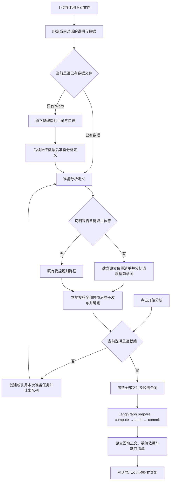

# 基于指标说明取数、计算与报告回填方案

更新日期：2026-10-30。本文对应已落地代码，区分已实现能力、真实资料缺口和后续工作。验收证据见 [本轮验收记录](acceptance-document-fill-2026-10-30.md)。

## 1. 业务目标与验收定义

以当前对话的指标说明 Word 为填报依据，从本次全部数据材料中核验已有汇总值或进行本地计算，再把结果填到说明原文的对应位置。交付物包含回填正文、缺口清单和取数依据。

分析链路为：

**读取原文 → 登记全部待填位置 → 识别各位置的业务含义 → 检查全部材料的用途与字段 → 逐项取数或计算 → 核对覆盖和证据 → 按原文回填 → 展示与导出。**

| 验收层次 | 完成条件 | 边界 |
| --- | --- | --- |
| 说明解析 | 原文节点及待填位置完整对账，结构和语义校验通过 | 不代表数据已满足计算条件 |
| 报告覆盖 | 每个位置恰好有一个数值或具体中文缺口，正文和规则保留 | 不代表所有位置已取得数值 |
| 业务数值 | 每个有值项目的实体、期间、维度、来源和算式可复核 | 不能用解析成功或诊断报告替代 |

保留 Python 3.11、在线模型、多套 LLM 连接、分析按钮、自然语言对话、Ctrl+V 上传和按轮次展示。当前对话使用一份指标说明，数据文件可多份。不恢复 document-parser 或任务工作台。

## 2. 当前执行链路

独立目录 catalog 负责理解说明，Word 即可运行；目录 READY 不等于可计算。含占位符的分析定义使用 document-fill/1.1，候选状态 REPORT 表示待填位置已登记，不冒充旧规则的 CLEAR。两条解析能力保持独立。

分析范围为 ALL_DATA。每份数据材料均进入用途检查，但只使用符合该项目口径的来源；退单、首台子集和全明细不能无差别相加。数量按材料中的手术日期逐日展示，不要求先选日期，也不把数月总量标成“昨日”。

## 3. 说明解析：原文定位与精简模型协议

### 3.1 原文与待填位置

本地保存原件哈希、原文节点及 locator。report_plan.template() 生成：

- paragraphs：原文顺序和全部文本，包含没有待填内容的规则段落。
- slots：稳定 ID、原文定位、起止字符位置、原占位文本、NUMBER/DATE/TEXT 类型、段落及继承上下文。
- semanticContext：适用章节、日期段、计划或接台组等上下文。相同“第一手术室X台”在不同时点下属于不同位置。

X台、XXX科、XX点和日期分别处理；x100%、20/30 分钟阈值和 Xray 不作为待填结果。回填按原文字符位置倒序替换，避免同段多个位置错位。当前自动登记上限为 200 个位置。

日期和科室/时间文字尚未开放自动取值，使用具体待补充提示。前1日、当日只是模板中的相对期间，未确定报告日期时不使用系统昨日填充。

### 3.2 八字段意图

每批最多四个数字位置，向模型发送说明全文的精简节点和目标位置。响应每项仅允许 slot、name、method、room、start、end、minutes、reason。

| method | 受控含义 |
| --- | --- |
| SURGERY_COUNT | 简单实际手术量，按明确手术唯一键计数 |
| EMERGENCY_COUNT | 简单实际急诊量，额外核验急诊分类 |
| DURATION_PATIENTS | 入室至麻醉、麻醉至开刀严格超过指定分钟的患者人数 |
| READ_SUMMARY | 查找口径一致、可以核验的结构化已有汇总值 |
| UNRESOLVED | 保留位置及具体未决事项，不生成猜测的可执行规则 |

模型不计算指标结果，不生成 Python/SQL/任意表达式。只有 DURATION_PATIENTS 可携带 start/end/minutes；其他方法两时间字段为空、minutes 为 0。UNRESOLVED 中已知阈值可保留在 reason。

本地校验位置集合、名称无残留占位、手术室、总量/急诊、时差方向、人数单位及严格大于阈值。计划、首台、连台、比率、接台和平均最晚等复合语义不能降为简单计数。模型输出不合法是技术失败，不能改成业务 SKIP 来绕过。

### 3.3 有预算的恢复

- 单次输出按连接配置，应用可配置上限为 1M（1,000,000）tokens，目录和回填不再固定封顶为 4096/2048。实际发送额度取配置、已知服务商上限及扣除输入预留后的剩余预算的最小值；官方 DeepSeek Flash/V4 Chat 最多为 393216。
- 输出截断或多项批次超时时只二分当前失败批次，已成功批次不重跑；单项失败则明确停止。
- 语义校验失败携带具体错误，同批最多纠正一次；再次失败保持失败。
- fill_attempt 在首个网络请求前持久化，每个成功批次单独保存。重试任务 ID 可以变化，同一指纹仍沿用原 budgetId。
- 指纹包含文档、节点、提示与纠正提示、Schema、运行清单和模型配置 revision。任一变化产生新代次，不把新旧结果混用。
- 默认累计上限为 30 次模型调用、1,000,000 tokens、900 秒，实际采用应用或冻结配置；拆分、纠正及失败请求全部记账。剩余输出额度不足 256 tokens 时明确停止，不用重试清零预算。
- 记录供应商结束原因、用量、响应字符数和耗时。用量总数与分项不一致时取较大值；缺 usage 保守保留预留，Anthropic 独立缓存用量计入输入。

全部节点、位置、候选及原文骨架核对后才保存和发布定义。自动发布仍检查租约、说明版本和当前对话绑定；取消、删除或替换说明后不得把旧结果发布到新上下文。

## 4. 从全部材料中取数

### 4.1 来源角色

surgery-excel-ingest.prepare_fill 读取冻结原件及快照，校验哈希和用途一致。当前通过受控表头识别 DETAIL、SUMMARY、CANCELLATION、UNRESOLVED，逐工作表记录用途与纳入/排除依据，不依赖文件名猜用途。

退单不加入实际手术量。非空未知来源会阻止输出未经证明完整的明细总量。该分类目前是明确表头规则，不是任意 Excel 结构都能自动理解；无法归类时必须补充字段或用途。

### 4.2 已有汇总值

当前支持结构化 Excel 汇总，至少包含“指标、数值、单位、统计日期”列。读取还必须验证：

1. 指标名称与本位置计划名称一致。
2. “口径”与完整 semanticContext 精确一致，包含章节和适用时点。
3. 手术室维度、单位、日期有效；同日同维度冲突值拒绝取用。
4. 同一段有多个数字位置时，“待填位置”列明确对应 slot ID，不能把一行数字复用于不同位置。

数值必须为有效非负数。保留文件快照、工作表、行列、slot 和口径哈希，不把多个汇总行相加，不与明细再次叠加。简单及复杂指标均可通过这条严格核验的汇总路径取数；任意历史 Word 报告中的数字尚不支持自动作为可信汇总。

### 4.3 本地计算

| 项目 | 已实现的核验与计算 |
| --- | --- |
| 实际手术量 | 明确手术唯一键、手术日期；核验已实施状态或完整实际手术事件时间；跨文件按实体去重 |
| 急诊手术量 | 实际量条件，加明确“急诊/择期”分类值；未知类别不静默纳入 |
| 手术室量 | 上述计数按原文明示的第一/第二/第三手术室筛选 |
| 时差人数 | 明确患者唯一键，使用完整日期时间，按手术日期逐日患者去重，严格大于阈值 |
| 数据冲突 | 同一手术键的日期或参与计算字段冲突、状态与实际事件冲突时保留缺口 |

住院号、行号和临时拼接键不冒充手术/患者唯一键。手术编号只能证明身份，不能单独证明已实施。计划、取消、未开始记录不混入实际手术量。完整 datetime 才能计算跨午夜时差，仅时分秒不自动补日期；非法、缺失和时区混用明确报缺口。

明细确已核验且某天无符合项时可以得到 0；来源为空、实体不明、字段缺失时不能填 0。

## 5. LangGraph 与四个 Skill

| Skill | 当前受信 Python 接口 | 职责 |
| --- | --- | --- |
| surgery-word-spec | parse / catalog / extract | 本地读 Word、整理目录、建立并校验报告位置计划 |
| surgery-excel-ingest | parse / prepare_fill / materialize | 读取 Excel，检查来源、字段与冻结快照 |
| surgery-metric-calc | calculate_fill / calculate | 受控本地取数与确定性计算 |
| surgery-word-report | render_fill / export | 全位置对账、按原文回填与导出 |

Skill 通过 insight_agent/skills.py 固定注册执行，Markdown 只作为工程说明，不动态执行上传文档中的命令、宏或模型代码。document-parser 保持废弃。

LangGraph 固定为 prepare → compute → audit → commit。图状态只保存运行 ID 及产物哈希；持久化检查点、冻结输入、取消检查及租约保护约束恢复。提交前每个 slot 必须恰好有一个 VALUE 或带中文原因的 SKIP，遗漏、多余、重复结果均阻止回填。

运行清单包含图、状态结构、回填结构及提示、来源政策、四个 Skill 和旧规则 Schema；模型配置 revision、说明及文件快照冻结进分析合同。旧冻结环境不匹配时不得静默重算。

含占位符报告采用本地核验策略，不要求模型再次生成或改写数值。在线模型只接收经白名单允许并脱敏的说明等信息，患者明细不出站。

## 6. 对话与报告

上传记录显示本次读取、识别、批次提取、拆分/纠正、校验、就绪或失败进度。分析轮次显示 prepare、逐项取数、audit、commit 及原因。界面显示可核实的处理步骤，不展示模型内部思考。

侧边显示“待填位置数”，避免把 REPORT 清单误展示为“0 项可计算”。结果正文与原文顺序一致，规则、阈值和非占位文字保留；每个无值位置填入【待补充：具体原因】，并汇总缺口清单。

全部有值为 SUCCEEDED，部分有值为 SUCCEEDED_WITH_SKIPS；全部缺口为 NO_ELIGIBLE_METRICS，界面显示“待补充资料”，允许导出诊断报告。技术失败不冒充该状态。

DOCX、XLSX、CSV、JSON、ZIP 均包含回填正文及缺口，内容校验通过后生成。数值保留来源、口径和运行依据。旧 DOC 的 TEXT_ONLY 能力只保证已提取文本顺序，不保证原字体、表格和分页。DOCX 无渲染器标记“版面未核验”；PDF 仍需可用渲染器，不重新强制安装 LibreOffice。

清除对话移除用户问题、Agent 回复与草稿，已上传资料和分析结果仍保留；旧处理记录和结果折叠到历史区，不重新成为当前轮次。

## 7. 当前真实资料的验证结论

2026-10-30 使用正式库的只读备份，在隔离目录用当前 Deepseek / deepseek-flash 重放。正式连接配置、Key 和业务记录未修改。

| 项目 | 验证结果 |
| --- | --- |
| Word | 46 个原文节点、47 个位置，其中 33 个数字、14 个日期/文字 |
| 解析 | 81.125 秒，11 次请求，36712 tokens，1 次截断后受控拆分，最终 PUBLISHED |
| 分析 | prepare → compute → audit → commit 完成，47/47 位置有明确结论 |
| 真实数值 | 0 处，47 处缺口；不能宣称真实指标数值验收完成 |
| 导出 | JSON / DOCX / XLSX / CSV / ZIP 内容检查全部通过；DOCX 版面未核验 |
| 隔离性 | 正式业务记录未变，重放期间应用代码未变 |

七份 Excel 共 31364 行，行数不是手术台次。其中三张表头包含退单时间，首台子集与明细存在重叠；当前未提供本地取数策略要求的明确手术/患者唯一键。计划快照、首台/连台识别、接台时点和平均最晚口径也尚不能完整确认。

合成端到端验收已验证：总手术量 2、急诊量 1、时差患者 1、计划快照缺口 1，并将三处数值和一处缺口填回正确位置。这证明已实现算子的取数回填行为，不替代真实资料的数值验收。

证据：[真实隔离重放](../artifacts/simulations/20261030-latest-analysis/20261030-100856/report.json)。早先失败记录保留供比较，不覆盖为成功。

## 8. 明确的后续范围与解除条件

| 尚未覆盖为自动数值的内容 | 下一步条件与实现 |
| --- | --- |
| 真实资料中的简单数量与时差人数 | 提供有业务依据的手术/患者唯一键、字段语义和完整时间，再按人工金标准验收；不能自动把住院号视为唯一键 |
| 首台/连台及延误、停台比率 | 明确识别对象、阈值例外、移植排除、计划分母与退单关联后，新增受控算子及边界测试；当前回填路径不从明细自动计算这些复杂项 |
| 当日16:00计划量 | 提供当时排程历史快照及归属规则，不以最终实际量反推 |
| 16/18/20时接台与平均最晚时间 | 明确时点/区间含义、去重范围、两层聚合集合及跨日政策，再扩展算子 |
| 日期、科室及时间文字自动填充 | 明确报告日期和文字取值规则，建立对应本地算子；当前保留缺口 |
| 非标准汇总材料与模糊字段 | 当前仅接受明确别名和严格结构化汇总，不进行无依据的模糊匹配 |
| 旧DOC原样式、分页及无渲染器PDF | 当前完成内容回填；需要可靠模板或渲染能力后另验版面 |

已有汇总值满足严格合同的复杂指标可直接取数，其余复杂指标当前明确保留缺口。完整覆盖的含义是每个位置均有可核实结论；真实数值完成率需要另行跟踪，不通过降低校验要求制造表面成功。

分析准备现已支持自动接续：排队请求绑定具体 extract 依赖，单 Worker 先完成准备，同一 turn 再继续分析。自动绑定只推进本次准备对应的会话版本；取消、附件变更或其他版本变化不能被忽略。本次依赖失败会停止该轮并显示具体错误，不引用早先超时，也不无限重新提交模型请求。

## 9. 主要实现位置

| 文件 | 作用 |
| --- | --- |
| insight_agent/report_plan.py | 原文位置、精简协议、分批恢复、来源核验、本地算子与回填 |
| insight_agent/definitions.py / worker.py | 解析分流、完整性校验、自动发布与绑定保护 |
| insight_agent/service.py | 当前对话入口、ALL_DATA 冻结合同与状态诊断 |
| insight_agent/agent.py / skills.py | 固定图及四个受信 Skill 适配器 |
| insight_agent/models.py | 白名单、即时连接测试、冻结配置、用量与累计预算 |
| insight_agent/reports.py | 正文、缺口、证据及多格式导出 |
| insight_agent/web/app.js / styles.css | 上传/对话轮次、过程进度、回填正文与缺口展示 |

本轮交付为当前源码与方案/验收记录，没有重新构建旧 dist 中的可执行文件。
