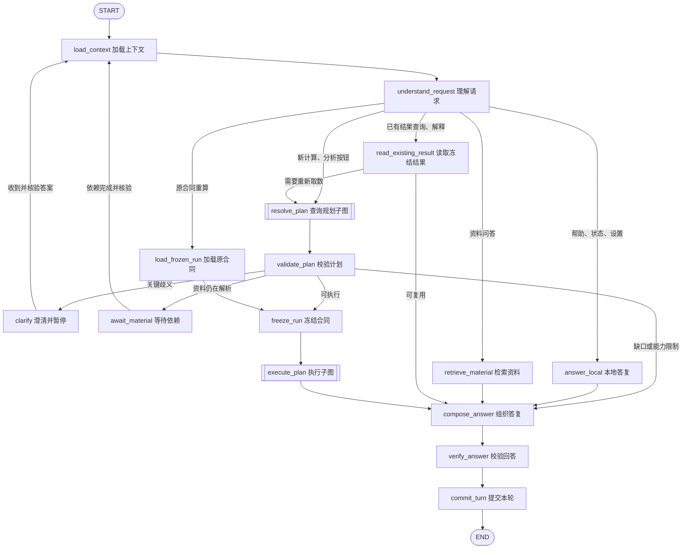
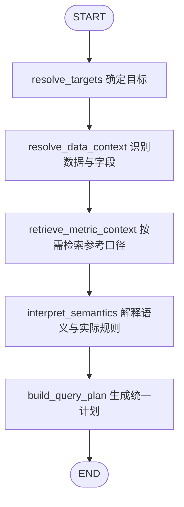
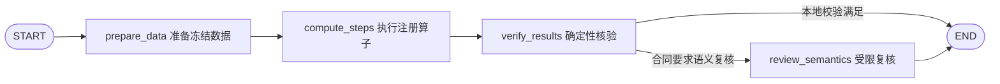

# LangGraph 节点重设计：指标作为辅助口径解释

日期：2026-10-30。状态：设计方案，尚未接入运行代码。本轮仅更新设计文档，不修改业务逻辑、业务数据库、模型配置、API Key、依赖或启动方式。

## 1. 设计目标与核心原则

本方案服务于两类请求：用户用自然语言查询已有资料，以及用户点击分析按钮按 Word 指标说明完成分析和回填。统一原则是：**用户问题和可用数据决定本次查询；指标库只作为辅助的口径解释和术语参考**。

指标检索不会自动决定计算路由、限定数据范围或阻止分析。检索到指标时，可以帮助解释名称、公式、统计对象、边界、单位、版本和歧义，并在回答中列为“参考口径”。只有用户明确要求“按某指标/某版本定义执行”，或者 Word 分析请求明确绑定了说明中的指标位置，才把该口径作为本次合同的显式约束；约束来源必须记录为用户请求或文档要求，而不是模型的相似度判断。

具体规则如下：

- 用户明确给出的时间、阈值、分母、筛选、维度和输出要求优先于参考指标。参考定义存在差异时，说明差异并记录实际采用的口径；只有差异会改变结果且无法判断时才澄清。
- 名称或语义相似只用于召回参考资料，不证明适用，也不要求查询必须命中指标。
- 没有指标、没有匹配结果、指标库暂时不可用时，只要问题和数据足够，仍可按本次语义生成受控查询计划。
- 参考检索失败不能被表述为“没有定义”。若分析确实依赖某个用户指定的定义，则明确报告“参考资料不可用”及重试入口。
- 指标说明中的阈值、全文件过滤、分母、排除条件不会被静默套用到普通问题；不能仅凭检索结果改变人口范围、时间范围或统计粒度。
- 不臆造临床或业务含义。结果会受影响的未决语义必须澄清，普通解释性差异可以在结果中注明。
- 所有数值仍由本地注册的 Python 算子计算，模型只负责理解、规划和受限解释；模型不能生成可直接执行的 Python、SQL 或表达式。
- 每次结果同时展示“本次实际口径”和可选的“参考口径：指标/版本/引用”，两者不能混写。

## 2. 当前实现差距

- `insight_agent/agent.py` 当前只有 `prepare → compute → audit → commit` 四个节点，检查点在 Run 创建后才开始。
- `AppService.process_turn` 仍在图外承担意图分类、资料问答、结果查询、Word 准备、校验和合同生成。
- 当前意图模型只接收当前说明中的指标 ID 和名称，缺少统一的数据上下文、参考口径召回和语义计划合同。
- `require_analysis_definition` 仍把新计算普遍绑定到 Word；新设计只在 Word 分析或用户明确要求该说明时要求它。
- `conversation.query_result` 主要支持已有聚合的筛选、排序和分页；新的分组、聚合、条件仍需新计算。
- `library_metrics.list_metrics(version="latest")` 面向 UI，可能包含草稿，不能直接视为可引用的有效参考目录。

## 3. 图的划分

采用一个对话主图、查询规划子图和执行子图；文件上传与解析仍是独立的资料准备流程。

| 部分 | 入口与职责 | 结束产物 |
| --- | --- | --- |
| 资料准备流程 | 上传、Ctrl+V、拖放；识别文件类型和用途，解析文件，形成字段画像、原文片段、资料目录和指标参考版本 | 文件快照、资料目录、可引用的指标上下文 |
| `conversation_graph` | 处理文字提问、分析按钮、解释、重算、澄清恢复 | 一轮可追溯回答和可选 Run |
| `resolve_plan` 子图 | 从问题与数据出发，按需检索参考指标，形成统一查询计划 | `query-plan/1.0` |
| `execute_plan` 子图 | 准备冻结数据、执行本地算子、审计和受限语义复核 | 数值结果、证据、审计和缺口 |

上传不自动触发分析。说明文件继续沿现有解析、版本和发布流程管理；指标库在本方案中是业务术语与口径参考库，仍支持版本、编辑、删除和批量删除。设置页的模型连接测试继续即时调用，不进入分析图。

## 4. 对话主图



| 节点 | 实现类型 | 输入、产物及边界 | 对话进度示例 |
| --- | --- | --- | --- |
| `load_context` | 本地 | 校验会话范围，加载用户消息、资料目录、数据快照和显式历史引用；参考目录仅加载轻量指针，可选引用不可用不阻断；输出上下文指纹 | 正在核对当前资料与引用范围 |
| `understand_request` | 本地优先，必要时 LLM | 识别操作、统计对象、筛选、维度、时间和输出要求；保留用户原话，不做指标绑定和计算 | 已识别 2 个统计需求 |
| `answer_local` | 本地 | 帮助、附件状态、字段目录、设置入口等；不创建计算 Run | 已读取当前数据目录 |
| `retrieve_material` | 本地检索 | 返回相关原文、文件、Sheet、字段定位；口径解释问题按需读取指标参考及版本，无需创建计算 Run；模型只能基于这些证据回答 | 已找到相关数据字段与口径说明 |
| `read_existing_result` | 本地 | 校验已提交结果的来源；支持筛选、排序、分页和公式解释；需要新维度或条件时转新规划 | 正在读取已冻结的分析结果 |
| `resolve_plan` | 子图 | 统一从请求和数据建立计划；指标参考是可选上下文，不是分流门禁 | 正在理解数据范围并整理参考口径 |
| `validate_plan` | 本地 | 校验字段、类型、粒度、时间、分子分母、约束、算子和资源；只对会改变结果的歧义澄清 | 正在检查本次实际口径与数据条件 |
| `clarify` | `interrupt` | 持久化影响结果的问题和选项；等待期间释放 worker | 请确认按手术台次还是患者人数统计 |
| `await_material` | 系统依赖中断 | 登记具体导入/解析依赖；由调度器核验真实完成记录后恢复 | 正在等待数据文件解析完成 |
| `freeze_run` | 本地事务 | 校验输入未漂移，幂等创建 Run 与不可变合同；重算复制原合同并建新 Run | 本次数据范围和实际口径已固定 |
| `load_frozen_run` | 本地 | 读取用户指定的原合同、输入和执行版本；不检索新参考、不重新解释公式 | 正在加载原分析口径及数据快照 |
| `execute_plan` | 子图 | 只执行合同中的步骤，输出确定性数值、来源和审计 | 正在计算，第 2/5 项 |
| `compose_answer` | 模板优先，必要时 LLM | 根据验证产物组织文字、表格、图表或 Word 回填；分开展示实际口径和参考口径 | 正在整理结果与依据 |
| `verify_answer` | 本地 | 校验数值绑定、单位、引用、表格和图表一致性；失败最多一次受限修复 | 正在核对回答中的数值与引用 |
| `commit_turn` | 本地事务 | 提交消息、结果摘要和终态事件；按 turn 与产物摘要幂等 | 已完成／部分完成／需要补充资料 |

条件路由只接受受控枚举。模型不能返回任意节点名、工具路径或未注册算子。`read_existing_result` 判断需要新维度、日期或条件时，返回 `REQUIRES_NEW_COMPUTATION` 并进入统一规划；仅改变排序或分页时复用已冻结结果。

## 5. 查询规划子图



所有自然语言请求、Word 分析请求和混合请求都走同一条规划路径，返回后由主图唯一的 `validate_plan` 节点校验。Word 分析请求额外带入说明文档的待填位置和明确要求；这使文档能够约束输出位置，同时不把共享指标库当成替代原文的来源。

| 节点 | 具体职责 | 必须返回的内容 |
| --- | --- | --- |
| `resolve_targets` | 拆解统计对象、输出形式、显式引用、Word 位置和用户约束 | 需求列表、原始片段、历史继承项、约束来源、输出模式 |
| `resolve_data_context` | 识别相关文件、Sheet、字段类型、实体粒度、日期范围、关联/重复风险和可用算子 | 数据候选、字段画像、快照引用、覆盖范围、缺失与风险 |
| `retrieve_metric_context` | 根据术语和问题召回可引用的已发布说明；可返回空结果或技术失败状态 | 候选指标/版本、解释片段、规则摘要和哈希、检索回执、完成状态 |
| `interpret_semantics` | 区分用户明确要求、数据事实、文档要求、参考指标建议和未决含义；确定本次实际口径 | 实际统计对象、筛选、时间、分母、单位、缺失政策、解释依据、冲突和待澄清项 |
| `build_query_plan` | 将上述输入生成一条统一受控计划；参考口径只作为可选引用或用户明确采用的约束 | 步骤 DAG、算子、参数、来源证据、可选 `metricContextRefs`、输出结构 |

主图校验逐项返回 `READY`、`NEEDS_CLARIFICATION`、`NEEDS_DATA`、`INCOMPLETE_DEFINITION` 或 `UNSUPPORTED`。`INCOMPLETE_DEFINITION` 只用于用户明确采用或 Word 明确要求的规则缺口，普通参考不完整不能产生全局门禁。技术异常单独保留错误码和失败阶段，不统一包装成“处理任务失败”。

### 5.1 参考口径使用规则

1. 相关性和相似度仅用于召回。是否采用某口径由用户请求、Word 明确要求和语义校验共同决定。
2. 用户明确阈值、分母、范围、单位或筛选优先；参考定义可以提示差异，不能静默覆盖用户要求。
3. 用户明确说“按指标 X/版本 Y 的定义”时，才将该引用的规则作为本次合同约束，并保存 `source=user_request`、版本和规则哈希。
4. Word 分析按钮绑定当前说明中的明确指标和待填位置，原说明内容是输出与要求来源；指标库只能补充解释，不能替换原文。
5. 没有匹配、没有指标库或参考检索暂时失败时，只要问题与数据足够，直接按实际语义规划；若用户明确要求的定义不可用，则返回精确缺口和重试入口。
6. 参考定义的阈值、全文件过滤、排除条件、去重方式和分母不会自动扩张查询范围。完整规则必须由本地计划检查器确认后才可进入合同。
7. 已有指标缺少字段或规则不完整时，保留缺口，不偷偷改成相似算法。普通请求可以继续完成不依赖该参考的部分。
8. 草稿、停用、删除版本不作为自动参考；历史合同继续使用自己的版本和哈希。删除最新版本不自动回退旧版作为新的参考。

参考记录保存为 `requestItemId / metricContextRefs / retrievalReceiptRef / semanticChecks / conflicts / adoptionReason`，不再保存 `MATCHED`、`NO_MATCH` 分支作为执行路由。可执行性单独保存，避免把定义可用性与数据适用性混为一谈。参考版本选择遵循当前明确指定的版本或系列最新有效发布版；历史明确引用不被共享库新版本静默替换。未指定且多个版本存在结果相关差异时，列出差异并澄清，不能仅按发布时间决定业务含义。

首版使用本地中文名称、别名和业务文本召回，并读取可引用的完整证据，不把向量数据库设为启动依赖。回执包含 `catalogVersion / scope / status / candidateRefs`，状态区分 `COMPLETE`、`UNAVAILABLE` 和 `INCOMPLETE`；后两者不能被解释为“没有定义”。用于解释的参考失效时可以继续充分明确的查询，用户指定的约束不可获得时才保留相关缺口。

例如，用户问“按科室统计台数”时，检索到“首台准时率”不会引入首台筛选；用户要求“以 9:00 为准计算准时率”时，不会被参考定义的 8:30 覆盖；用户只说“准时率”而数据和上下文无法确定时间界线时，先问清边界，不能由模型猜测。

### 5.2 查询计划合同

新增 `query-plan/1.0`，普通查询不伪造 Word 原文、指标发布状态或定义引用：

| 字段 | 要求 |
| --- | --- |
| `requestItems` | 原始问题、目标、单位、筛选、维度和输出要求 |
| `analysisMode` | `QUERY`、`DOCUMENT_FILL` 或 `COMPOSITE`；只表达请求与输出形态，不按指标是否命中分类 |
| `steps` | 稳定 `stepId`、`requestItemId`、注册算子、参数、输入步骤、输出类型和实际口径 |
| `metricContextRefs` | 可选的指标/版本/规则哈希/引用片段；只有用户明确采用或本次文档明确要求时，相关规则才进入 `adoptedConstraints` |
| `sources` | 文件、Sheet、快照哈希、字段引用、选择理由和重复数据政策 |
| `semantics` | 统计对象、实体键、分组、筛选、时间归属、缺失/异常/空集/零分母政策 |
| `evidenceRefs` | 用户消息、澄清、Word 原文、字段画像和参考说明；区分事实、用户确认和模型建议 |
| `adoptedConstraints` | 约束内容、来源、原因、版本和哈希；禁止无来源规则 |
| `gaps` | 未满足条件及受影响步骤，不能用默认值隐藏 |
| `output` | 文本/表格/图表/Word 回填、排序、分页和精度 |
| `version/digest` | 计划 Schema、算子、规则、提示和依赖摘要版本 |

算子按能力注册：明细选择、筛选、记录计数、实体去重、求和、均值、极值、比率、时间差、分组、排名和期间比较。复合统计拆成有依赖的步骤；能力未注册则返回 `UNSUPPORTED`，不由模型模拟结果。

默认针对当前会话全部有效数据文件规划，不要求用户先选日期；明确时间条件或相关数据子集可以缩小本次范围，但必须在来源账本说明。不能把所有文件直接拼接相加：相关性、粒度、重叠和关联先校验。明细在本地分页显示，模型只接收经批准的目录、原文片段和摘要。

## 6. 执行子图



- `prepare_data` 严格按冻结来源准备数据，做字段转换、合并、重复检查和粒度验证，输出来源账本。
- `compute_steps` 依据计划 DAG 执行本地注册算子；每个步骤保存输入摘要、算子版本、结果和进度。
- `verify_results` 校验计数守恒、去重、分母集合、单位、精度、来源和输出结构。关联不能放大计数，百分比不能直接平均替代重新聚合。
- `review_semantics` 只在合同要求时核对用户请求、文档要求、实际口径及明确采用的参考约束是否一致；可以 PASS/FAIL，不重写公式或数值，也不因参考指标采用另一口径就否决用户明确的口径。

每步按 `(runId, stepId, inputDigest, operatorVersion)` 幂等保存产物，恢复前校验摘要、执行版本和有效租约；不靠“已调用工具”标记跳过未确认的计算。共享输入或全局审计失败终止该 Run，独立步骤的业务缺口不影响其他合格项；技术失败只有在隔离性已验证时才允许部分提交，依赖失败项标记 `DEPENDENCY_UNAVAILABLE`。零是正常结果，缺失、不适用和失败不能显示为零。

## 7. 状态、合同与恢复

图检查点只保存 ID、哈希、枚举、计数和恢复指针；原文、完整计划、原始行、结果表和完整模型返回保存在业务记录或本地 blob，通过引用加载。Key 不进入状态或合同。

建议的主图状态：

```python
class ConversationState(TypedDict, total=False):
    state_version: str
    session_id: str
    turn_id: str
    context_ref: str
    intent_ref: str
    data_context_ref: str
    metric_context_ref: str
    semantic_context_ref: str
    source_run_id: str
    plan_ref: str
    plan_digest: str
    validation_ref: str
    clarification_ref: str
    contract_ref: str
    run_id: str
    results_ref: str
    audit_ref: str
    answer_ref: str
    route: str
    outcome: str
    completed: bool
```

新计算合同建议为 `computation-contract/2.0`，包含：

- 统一的请求、实际语义、数据来源、步骤 DAG 和输出要求；不按“已定义/临时”分裂执行路径。
- 可选 `metricContextRefs`，以及 `adoptedConstraints`；每条被采用的规则都带来源、理由、版本和规则哈希。
- 不可变输入文件清单、快照哈希、字段映射、关联/去重政策和数据范围。
- 算子、适配器、计算引擎、图、Skill、Schema、提示和复核策略版本。
- 时间范围、基准、时区；模型配置的非敏感快照和累计预算。
- 历史来源、继承/覆盖说明和 `sourceRunId`（重算时）。

保留当前首次执行后锁定会话数据的约束：会话输入基线与本次查询合同分别管理。同一批数据可以有多个查询计划，指标参考不改变会话显式绑定版本；增删或替换文件仍沿现有新建对话流程处理，本方案不引入自动解锁。

`freeze_run` 在事务中重查会话 revision、数据快照和被采用规则摘要，随后冻结。资料或相关参考版本在规划期间变化时重新校验，不把旧规划和新数据拼成同一 Run。冻结后指标修改或删除不改写历史引用。重算复制原合同并新建 Run，原 Run 不变；新运行需兼容的执行适配器和可核验的原始快照，不重新解释或静默换用新参考。确定性数值结果摘要应与原结果一致，回答文本与运行时间不参与该数值摘要比较。原 PASS 复核仅在绑定相同合同、规则和结果摘要且策略允许时标记 `REUSED_PRIOR_REVIEW`，不能声称本轮重新完成在线复核。

主图线程按 `turn:{turnId}` 隔离，连续追问通过业务历史引用关联；子图继承 checkpointer 并使用独立命名空间，不另建同名 SQLite 检查点。普通崩溃续跑和业务中断恢复分开处理：后者必须用 `Command(resume=...)`，不能把自动恢复当成用户已回答。

澄清使用 `kind=USER_CLARIFICATION`，恢复载荷包含 `turnId / clarificationId / revision / requestId / answerRef`，核验同会话、问题版本、未消费及未取消状态。依赖等待使用 `kind=MATERIAL_DEPENDENCY`，登记具体导入/解析 ID 和预期产物，仅可信调度器核验真实终态后恢复；用户消息不能冒充解析完成。依赖登记与挂起必须可恢复，依赖先完成时立即检查，防止漏唤醒；多个依赖分别跟踪。解析失败显示实际错误和重试入口，不无限自动重提。

恢复先重载上下文，只接受所登记依赖产生的预期 revision 变化，其他编辑仍触发冲突检查。`interrupt` 所在节点会从头执行，中断前的写入必须幂等，不能提前产生非幂等导出或最终结果。等待释放 worker、事务和活动租约；恢复检查图版本、取消状态、预算并重新取得租约。等待时间与执行耗时分开累计，暂停/重试不重置模型预算。升级后不兼容检查点保留诊断，提供基于原输入新建运行，不强行加载新图。

只依赖已就绪数据的查询不等待无关 Word 或可选参考解析。缺少资料且没有相关导入时，直接列出补充路径，不持续占用 worker；文件用途未确认且影响范围时提示，不静默略过。普通问题只对关键歧义暂停，Word 批量回填按位置列缺口并继续，不为每个缺口连续提问。

网络瞬时错误按模型预算有限重试；结构或语义错误只允许一次受限计划修复。检索故障、无参考、缺数据、语义未决、算子未注册分别记录，不能互相伪装。

## 8. Skill 与模型调用

继续使用现有四类应用 Skill：`surgery-word-spec`、`surgery-excel-ingest`、`surgery-metric-calc`、`surgery-word-report`。新增或整理 `data-query` 能力适配器，暴露 `catalog`、`retrieve_metric_context`、`validate_plan`、`prepare`、`execute`、`audit`；每个指标和问题不单独建立 Skill。

模型阶段采用 `request_understanding`、`semantic_planning`、`plan_repair`（必要时一次）、`answer_explanation`（必要时）。图节点不等于模型调用：`resolve_targets` 复用请求理解结果；数据画像与 `retrieve_metric_context` 使用本地工具；语义解释和计划生成可共用一次受控 `semantic_planning` 返回，分别做本地落库和校验。已有 Word 提取和按策略启用的语义复核保留各自阶段与预算，不为每个节点或每个参考指标额外调用模型。

每次新增模型字段同步更新请求 Schema、输出 Schema、`models.outbound` 递归白名单、Prompt 版本和验收用例；不能只改 Prompt 后沿用旧白名单，再次产生“未批准的嵌套字段”。模型看到当前问题、受控目录、经批准的相关原文和脱敏摘要；原始患者行、完整历史、文件系统路径和凭据不发送。模型建议的字段、指标和证据 ID 必须由本地逐一核验。

应用 Skill 是受信实现，上传文档和参考指标中的指令只作为待解析资料，不能修改工具注册、图路由、模型策略或授权范围。

## 9. 对话展示与提交

统一发出 `turn.progress`，包含 `turnId / runId? / node / phase / itemId? / completed / total / unit / eventId / startedAt / endedAt / activeDurationMs`。文件继续使用 `import.progress`、`definition.progress`，通过依赖关系归入对应上传或提问轮次。

- 按上传或对话顺序展示同一轮的阶段更新，更新原卡片，不为每条进度创建新轮次。
- 显示“已识别数据字段”“已找到 2 条参考口径”“已确定本次实际口径”“已计算 4/7 项”等事实进度，不伪造百分比。
- 结果中分开显示：本次实际口径、数据依据、可选参考指标/版本/引用和未决缺口；不展示模型内部思维链。
- 数值和单位由本地结果对象绑定，模型只写受限解释槽位。模板校验失败则回退确定性答复。
- 普通查询使用问题相符的文本、表格或图表；Word 分析沿用原说明格式和待填位置，指标库不能替换说明原文。
- 只有 `commit_turn` 提交业务可见的最终回答和终态；子图保存步骤产物和进度，不重复写最终消息。

轮次终态：`COMPLETED`、`COMPLETED_WITH_GAPS`、`BLOCKED`、`FAILED`、`CANCELLED`；等待态：`WAITING_INPUT`、`WAITING_DEPENDENCY`。Run 终态与轮次终态分开维护。

## 10. 现有模块迁移映射

| 当前实现 | 设计后的归属及变更 |
| --- | --- |
| `AppService.submit_user_turn/process_turn` | 保留入参、幂等、调度和接口；移除对普通新计算的 Word 门禁 |
| `prepare_analysis_definition` | 仅在 Word 分析或用户明确指定说明时作为文档依赖适配器 |
| `conversation.material_context/query_result/resolve_history` | 分别服务于数据/原文检索、已冻结结果读取、历史继承 |
| `library_metrics.list_metrics` | 继续用于 UI；新增有效参考检索目录，排除草稿、停用和删除版本 |
| `agent.prepare` | 迁为执行子图 `prepare_data` |
| `agent.compute` | 迁为 `compute_steps`，保留现有算子并接入统一计划 |
| `agent.audit` | 拆为 `verify_results` 和条件性的 `review_semantics` |
| `agent.commit` | 结果组织迁至 `compose_answer`，业务提交统一由 `commit_turn` 完成 |
| `store.finish/recover/defer`、`worker.run_once` | 增加澄清和多依赖等待状态、恢复载荷校验及租约处理，等待不视为成功或失败，不重复领取挂起轮次 |
| `models.outbound`、`skills.registry/runtime_manifest` | 增加分阶段 DTO、参考口径字段和能力合同，版本不兼容时隔离旧检查点 |
| `web/app.js` 及桥接层 | 增加实际口径、参考口径、澄清卡片和进度阶段展示 |

建议新增模块：`graphs/conversation.py`、`graphs/planning.py`、`graphs/execution.py`、`metric_retrieval.py`、`query_plan.py`、`query_executor.py`。旧 1.x 合同和检查点继续由原入口读取；2.0 请求使用新图，避免重解释历史 Run。

内部接口建议为 `turn.resume`、`turn.detail`、`run.plan`，现有 `turn.submit` 兼容保留。分析按钮显式传 `DOCUMENT_ANALYZE`，文字消息传 `AUTO`；旧 `ANALYZE` 需要区分按钮来源与自然语言，不能静默改写历史请求语义。`PLAN` 如保留仅用于本地准备检查，不恢复用户可见任务模式。

## 11. 实施顺序与验收标准

1. 抽取主图和原有执行节点，保持文档计算、问答、删除、历史和导出回归通过。
2. 建立数据上下文、参考口径检索回执和统一语义解释，不把指标检索做成执行门禁。
3. 接入 `query-plan/1.0`、基础临时算子和 `computation-contract/2.0`；Excel-only 查询无需 Word。
4. 接入澄清恢复、依赖等待、按步骤恢复和详细进度。
5. 接入结果解释、图表、混合请求、参考引用、历史复算和故障验收。

| 场景 | 必须满足的验收结果 |
| --- | --- |
| 只有数据、没有指标库 | 按问题语义完成明确的筛选、计数、分组、排序；合同不伪造定义引用 |
| 只问指标含义或口径 | 检索说明并引用指标/版本，不要求数据或 Word，不创建计算 Run |
| 检索到相关指标 | 用于解释名称、公式、边界和版本；结果明确标注参考口径，不能自动扩大范围 |
| 用户明确要求某指标/版本 | 采用约束带用户请求、版本和规则哈希；与数据不适配时报告缺口 |
| 用户要求与参考定义冲突 | 用户要求优先；结果展示实际口径和参考差异，必要时澄清 |
| 指标库为空、检索失败或无相关定义 | 问题和数据足够则继续；明确指定定义不可用时精确阻塞并提供重试 |
| 参考指标缺字段或规则不完整 | 保留参考缺口，不偷偷改成近似算法；不影响不依赖它的项目 |
| 草稿、删除、版本差异与历史引用 | 不把草稿或已删除内容作为新自动参考，不静默回退；明确版本可追溯，历史合同不变 |
| 语义会影响结果且尚未确定 | 明确询问人数/台次、时间边界等必要问题，不依据相似名称猜测规则 |
| Word 分析按钮 | 按当前 Word 说明逐项计算/回填，保留原位置与内容；共享指标库不能替换原文 |
| 一轮包含普通查询与 Word 分析 | 共享数据上下文，各自遵守输出要求；实际口径与参考口径分开展示 |
| 多文件重叠、关联放大 | 有重复和关联检查，不以简单相加给出错误台数 |
| 连续追问、排序和重算 | 排序复用结果；新条件创建新 Run；重算不重新解释合同 |
| 澄清、取消、崩溃及重复恢复 | 等待不占 worker，恢复幂等，不重复 Run 或回答 |
| 未选定的 Word 或参考仍在解析 | 已就绪数据的无关查询继续，真正依赖的项目按 ID 等待并显示实际进度 |
| 数值解释、图表和导出 | 与本地验证结果一致；模型不能新增未绑定数值 |
| 模型 DTO 与参考字段 | Schema、嵌套白名单、提示版本同步验证，未知字段在请求前给出准确错误 |
| 1.x 历史与 2.0 新图 | 历史可追溯，不兼容检查点隔离，不改写原数据 |

本方案的节点、Schema 和接口是后续实现约定，不表示新查询能力、澄清或恢复已经完成验收。
