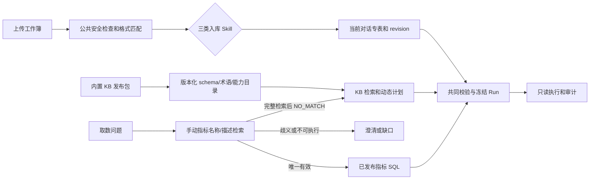

# DataMind 三类手术数据与指标查询完整方案

日期：2026-10-30。状态：实施方案，尚未接入运行代码。本文是新流程的主方案，覆盖数据入库、表结构、内置知识库、手动指标管理、无向量库语义检索、意图路由、LangGraph、界面及验收。逐字段注释以[SQLite 表结构合同](contracts/three-source-storage-v2.sql)为准；[格式合同](contracts/three-source-layouts-v1.json)、[查询知识库种子](contracts/three-source-query-kb-v1.json)、[退单归属合同](contracts/cancellation-unit-routing-v1.json)是版本化输入。`templet/` 七份样例只证明格式和观察到的值，不自动证明医疗业务口径。

## 1. 目标和工程边界

新流程只接收首台手术信息、手术室退单信息、手术明细查询三类固定 Excel。上传后按当前对话入库，补传形成新 `data_revision`；查询默认只读本对话当前 revision。手动指标库可供不同对话复用定义，但指标 SQL 每次仅查询发起对话的数据。用户只需填写名称和自然语言描述，可一键让 AI 提议查询计划与 SQL，再查看和发布本地编译的参数化 SQL。取数先检索手动指标；只有明确 `NO_MATCH` 才用表结构知识库生成动态 SQL。新界面不提供 Word 指标说明导入或自动生成指标；旧 Word 运行仅保留历史只读入口。DOCX 报告仍可作为查询输出。

当前工程尚无三源运行时表、入库 Skill 或新查询图。`insight_agent/store.py` 只接受 schema 1；`insight_agent/skills.py` 注册的是旧 `surgery-excel-ingest`，其 `prepare_fill/materialize` 面向 Word/document-fill 合同；`insight_agent/files.py` 的 XLSX 解析会丢掉前置标题证据并把整张表载入内存；`InsightAgent.spec` 只打包 `insight_agent/resources`，不打包 `docs/contracts`。当前模型网关只有文本 LLM 调用，没有 embedding 接口，出站白名单和系统提示也尚未开放新 KB 规划与 AI SQL 草稿阶段。因此以下节点和 Skill 均需新实现，不能把设计草案误认为已上线。

## 2. 数据格式、存储和版本

| 数据类 | 格式证据 | 来源列数 / 样例行数 | 存储粒度与已知边界 |
| --- | --- | ---: | --- |
| 首台手术信息 `FIRST_SURGERY` | 标题“每日首台手术查询”，第 3 行精确表头 | 14 / 474 | 一条系统导出的首台行；缺少首台筛选算法与明确已实施状态 |
| 手术室退单信息 `CANCELLATION` | 标题“退单手术信息查询”，第 2 行精确表头 | 16 / 150 | 一条退单来源行；不等于唯一退单事件或手术台次。来源手术室不在表内，必须从文件名判定或人工选定 |
| 手术明细查询 `SURGERY_DETAIL` | 标题“手术明细查询”，第 3 行精确表头 | 29 / 30,740 | 一条明细来源行；无共享手术唯一键或明确已实施状态 |

三类业务表保留 Excel 原字段及 `sheet_id/excel_row/row_sha256`，患者标识按文本保存以保留前导零；业务日期用合法 ISO 日期文本，只有 `HH:MM` 的时刻另存解析后的分钟值，不能自行推断跨午夜日期。退单“日期”与“退单时间”是两列；多值退单类别另拆 `cancellation_tag`，保留原文。明细与首台、退单可能重叠或重复，禁止简单相加；住院号、姓名、手术间、台次都不是已经证实的跨表手术键。

数据库沿用本地 `datamind.sqlite3`、WAL 和按 SHA-256 存放的原件 Blob。下表列出 schema 2 的 22 张业务与目录表；**每列的类型、注释、CHECK、外键与索引以 SQL 合同为唯一详细定义**。现有 `objects/jobs/events` 继续保存会话、作业及运行元数据。

| 表 | 主键/关键字段 | 职责与约束 |
| --- | --- | --- |
| `data_space` | `session_id` | 一个对话一个逻辑数据空间；应用核对现有 session |
| `data_source` | `id`, `session_id`, `file_sha256`, `source_type`, `state` | 上传来源及格式、解析器、入库 Skill、退单归属的版本/hash；仅 READY 可进入 revision |
| `data_sheet` | `id`, `source_id`, `sheet_name`, `header_sha256` | Sheet、表头行及原件定位；`(source_id,sheet_name)` 唯一 |
| `data_revision` | `id`, `session_id`, `revision_no`, `manifest_sha256` | 当前对话的不可变来源清单版本；补传、更正和移除均创建新版本 |
| `data_revision_source` | `(revision_id,source_id)`, `session_id` | 复合外键阻止跨对话纳入；触发器拒绝非 READY 和同字节重复来源 |
| `first_surgery_row` | `id`, `sheet_id`, `excel_row` | 14 源列、三个时分的原文/分钟、行哈希；`(sheet_id,excel_row)` 唯一 |
| `cancellation_row` | `id`, `sheet_id`, `excel_row` | 16 源列；日期与退单时间分开，不内嵌手术室大区域 |
| `cancellation_tag` | `(cancellation_row_id,position)`, `tag` | 退单多标签拆分，同一行同一标签唯一 |
| `surgery_detail_row` | `id`, `sheet_id`, `excel_row` | 29 源列、年龄原文、各时间节点原文/分钟及行哈希 |
| `data_issue` | `id`, `source_id`, `sheet_id`, `excel_row`, `code` | 文件/Sheet/单元格质量问题，不把患者值写进普通诊断 |
| `kb_release` | `id`, 三份合同 hash, `content_sha256`, `state` | 知识库发布包；PUBLISHED 不可原地修改 |
| `kb_active_release` | 单行 `singleton=1`, `release_id` | 新导入与查询使用的唯一生效 KB release |
| `kb_layout` | `(release_id,layout_id)` | 三类固定标题、表头顺序和解析政策 |
| `kb_entity` | `(release_id,entity_id)` | 逻辑实体、物理基表、单行粒度和默认日期字段 |
| `kb_query_capability` | `(release_id,capability_id)` | 动态计划可用的聚合能力、单位与去重政策 |
| `kb_field` | `(release_id,entity_id,field_id)` | 字段含义、物理列、类型、空值、过滤/分组/聚合权限及敏感级别 |
| `kb_relation` | `(release_id,relation_id)` | 跨实体连接审批、基数与未匹配政策；首版全部禁用 |
| `kb_relation_key` | `(release_id,relation_id,position)` | 已批准关系的复合键字段 |
| `manual_metric` | `id`, `active_version_id`, `deleted_at` | 人工指标稳定身份、当前发布版本、软删除 |
| `manual_metric_version` | `id`, `metric_id`, `version_no`, `draft_revision` | 人工名称/描述/别名、AI 草稿、本地 SQL 模板、参数/KB 依赖与审计；发布版不可变 |
| `kb_term` | `(release_id,term,target_kind,entity_id,target_id)` | 中文术语和别名；同词多义保留多个候选 |
| `kb_query_example` | `(release_id,example_id)` | 问题与预期闭合计划，用于回归，不授予执行权限 |

查询必须先通过 `data_revision_source` 将业务行的 `sheet_id -> source_id` 限定在服务端提供的 `session_id + revision_id`，然后才能过滤、分组或连接；两者不能来自用户问题或模型输出。READY 来源被更正时建新的逻辑来源和 revision，旧来源供历史 Run 使用。同一个原件改文件名不能在一个 revision 中算两遍。默认当前 revision 由创建 Run 的事务读取并 CAS 核验，历史 Run 固定旧 revision、manifest hash、KB release/hash 和 SQL hash。

## 3. 内置知识库的搭建与发布

知识库不是患者数据索引，而是可审查的查询权限目录。发布包由固定格式合同、查询语义合同、退单文件名归属合同组成；三者各自有 canonical JSON SHA-256，包 manifest 再绑定三个哈希、存储 schema 版本、编译器版本、术语归一化版本和发布者。现有 JSON 是维护源，构建阶段应验证后复制到 `insight_agent/resources/three_source_kb/`，使源码运行与 PyInstaller 安装包加载同一内容；运行时不从用户上传文件或 `docs/` 临时读取可执行政策。哈希规范沿用工程已有的 RFC 8785 canonical JSON 能力。

| 层 | 主要内容 | 数据库投影 | 允许 LLM 使用的方式 |
| --- | --- | --- | --- |
| 格式层 | 三类标题、表头行、精确列序、类型、Sheet 和解析政策 | `kb_layout` | 只提供非敏感格式说明，不让模型改写格式判定 |
| 实体层 | 首台/退单/明细的单行粒度、来源表、日期字段 | `kb_entity` | 候选实体 ID、语义限制 |
| 字段层 | 59 个来源字段和受控派生字段、含义、类型、可过滤/分组/聚合范围、敏感级别 | `kb_field` | 字段 ID 与描述；不提供患者行 |
| 术语层 | 中文名称、别名、多义词和值字典 | `kb_term`、`kb_field.value_dictionary_json` | 召回候选，不能凭同义词自动赋权 |
| 能力层 | 如 `COUNT_SOURCE_ROWS` 的单位、粒度、去重政策和启停 | `kb_query_capability` | 动态计划只能选已启用能力 |
| 关系层 | 跨实体键、基数、未匹配政策、批准证据 | `kb_relation`、`kb_relation_key` | 只有 `APPROVED` 关系可进入计划；目前两条样例关系禁用 |
| 示例层 | 问题与预期闭合计划、拒绝原因 | `kb_query_example` | 检索/回归辅助，不授予字段或关系权限 |
| 手动指标层 | 人工名称、自然语言描述、版本、可执行模板与审核记录 | `manual_metric`、`manual_metric_version` | 先于 schema KB 检索；不是自动从文件生成的知识条目 |

构建工具先用封闭 JSON Schema 验证三个输入，再做交叉检查：三种 layout 的 14/16/29 列必须与业务表、KB 字段一一对应；类型、原始表头、列序及敏感级别一致；术语目标、派生字段访问路径、查询示例与能力 ID 都存在；关系键对应实体端点，未批准关系不能出现在可执行示例里。只从结构推导列存在性，不从样例频数推导合法枚举或医学口径。`退单日期` 同时指向来源日期和退单发生时间，保留两个候选并要求消歧。完整 schema、术语与能力说明见[现有存储设计](three-source-storage-kb-design-2026-10-30.md)。

数据库 schema 2 迁移应先用 SQLite backup API 备份 schema 1，事务中建[草案表结构](contracts/three-source-storage-v2.sql)并执行 `foreign_key_check`。首次启动从内置包导入 `kb_release` 和全部 `kb_*` 行，校验数据库投影哈希后将 release 发布，再以单行 `kb_active_release` 指针做 CAS 激活。若包内容未变，启动操作幂等；哈希不符、缺字段或版本不兼容时拒绝新查询，保留旧库与历史 Run 可读。后续更新建立新 release，绝不原地改写已发布行；旧 Run 固定 `releaseId/contentSha256`，新导入使用激活包的 layout/routing 政策。`data_source` 同时记录 layout、解析器、入库 Skill 和退单归属策略的 ID/版本/hash，便于复现。

知识库维护入口首期只随应用发版，不开放对话内自由编辑表结构。发布者若要批准跨表关系，必须提交稳定业务键、基数和冲突样例；没有共同手术唯一编号时持续拒绝连接。一个 release 可以描述“来源记录行数”，但不能把它包装成“手术台次”“已实施台次”或“退单事件数”。

## 4. 三类数据入库 Skill

Skill 在本工程中是 `insight_agent/skills.py` 注册的受信 Python adapter 与严格输入输出合同，配套 `skills/<id>/SKILL.md` 说明；上传工作簿里的文本绝不作为 Skill 指令。建议保留旧 `surgery-excel-ingest` 给历史合同，新建一个内部 `workbook_inspect` 公共组件和三个类型专属 Skill：

| Skill ID | 格式识别 | 类型专属入库和门禁 |
| --- | --- | --- |
| `surgery-first-ingest` | “每日首台手术查询”、第 3 行、14 列精确表头 | 写 `first_surgery_row`；保留 `HH:MM` 原文和解析分钟，不能推断首台筛选规则或已实施状态 |
| `surgery-cancellation-ingest` | “退单手术信息查询”、第 2 行、16 列精确表头 | 写 `cancellation_row` 和拆分去重的 `cancellation_tag`；“日期”与“退单时间”分别保存；文件名解析 `OR_1/2/3`，不确定则等待用户选择 |
| `surgery-detail-ingest` | “手术明细查询”、第 3 行、29 列精确表头 | 写 `surgery_detail_row`；年龄保留原文，各时间节点保留原文/分钟，不从手术类型或起始时分推断已实施 |

公共组件负责真实 XLSX/ZIP 检查、宏/公式/错误格处理、文件与 Sheet 限额、可见 Sheet 政策、标题及表头证据、原始行号和行流读取。类型判定只看标题加精确表头，文件名只用于已识别退单文件的来源手术室归属。当前解析器可复用安全检查，但新路径必须保留标题/前置行，按批写 SQLite，不再用全量内存行对象作为入库结果。隐藏或额外非空 Sheet 不能静默混入；与合同不一致时记录明确阻断问题。

三个 Skill 使用同一闭合接口：`match_layout(inspectRef, layoutRelease) -> match evidence`，`stage_rows(sourceId, cursor, batchLimit) -> next cursor/row counts`，`validate_source(sourceId) -> READY_CANDIDATE | BLOCKED | NEEDS_UNIT_CONFIRMATION`。输出只含 `sourceId/sourceType/layoutVersion/parserVersion/skillVersion/skillHash/fileHash/headerHash/rowCount/observedRange/issueCounts/locators` 和退单归属证据，不返回全部患者行。`sourceId + sheetId + excelRow` 唯一保证分批恢复不重复写；各批记录稳定 cursor、原行哈希和质量问题。Skill 不能自行将来源置 READY，也不能发布 revision；统一 `publish_revision` 事务核验会话、来源状态、哈希与重复原件后写入完整来源清单。

退单文件名先做全半角、空格、日期区间和“副本”等规范化，再查唯一别名；“一手/二手/三手”等短语走精确别名。其余名称可以交给 LLM 在三个固定手术室中做语义比较，返回候选 ID、原文件名中的证据和冲突项。只有明确序号证据且经负例校准的规则可自动发布；无法唯一确定、含多个手术室线索或只有模型猜测时写 `NEEDS_UNIT_CONFIRMATION`，用户手选后从原上传线程恢复。[退单策略合同](contracts/cancellation-unit-routing-v1.json)已将受限文本 LLM 设为首版语义判断器，embedding 适配器默认关闭；当前 Gateway 没有 embedding 接口，不能假称已有余弦分数。未来若接入 embedding API，三组候选向量可直接驻内存比较，无需向量数据库，自动归属阈值和 top-two margin 仍须用标注文件名校准。

## 5. 手动指标管理

指标库是跨对话可复用的人工定义目录，和内置表结构知识库分开。只允许人通过界面新增指标，不从 Word、Excel 标题或历史问答自动创建指标。创建时必填**名称、自然语言描述**，可选填人工确认的别名；描述建议覆盖统计对象、来源、时间字段、窗口、筛选、去重、分母、分组、单位、空值与排除政策。缺少关键口径可保存草稿，但不能发布可执行 SQL。列表展示名称、发布状态、当前发布版本、最新草稿、更新时间；详情可看所有历史版本及其审计。

| 操作 | 入口输入与状态变更 | 并发与查询影响 |
| --- | --- | --- |
| 新增 | `name/description/aliases?` -> 新 `manual_metric` + `DRAFT` v1 | 只有草稿，取数命中时提示尚不可执行 |
| 查看/列表 | 稳定 ID 读取身份、active 发布版、最新草稿及历史版本 | 只读；软删除指标不进入新查询列表 |
| 编辑 | 带 `expectedDraftRevision`；编辑草稿时清除旧计划、SQL、hash 和校验回执；编辑发布版时新建 vN+1 草稿 | `draft_revision` CAS；发布版不可改，仍可按旧描述查询 |
| 删除 | 带 `requestId` 软删除 `manual_metric.deleted_at`，保留版本与 Run 引用 | 新路由不再召回；同名重建使用新 ID |
| 一键 AI 生成 SQL | 指定草稿 ID、revision、`generationId` 启动生成图 | 不自动发布；重复请求幂等，生成中编辑使结果过期 |
| 预览 | 可在当前对话已入库数据上运行本地模板，展示行数/单位/来源范围与质量问题 | 没有数据可跳过；预览结果不写入通用指标定义 |
| 发布 | 用户核对**最终本地编译 SQL**、字段、条件、参数和缺口后显式提交 | 重新校验 KB、SQL/hash、参数、回执与 revision；原子切换 active 指针 |

指标版本状态为 `DRAFT -> SQL_DRAFT -> VALIDATED -> PUBLISHED`。生成中若口径不完整或本地校验失败，持久化 AI 提议、错误码与待补充项为 `SQL_DRAFT`；静态校验通过后才是 `VALIDATED`。用户改名称、描述或参数即清除该草稿的旧 SQL 并回到 `DRAFT`。生成结果回写必须同时匹配 `draft_revision`、人工文本 hash、`generationId` 和所检索的 KB hash，避免将过期 SQL 安装到新描述上。发布事务再次校验，不依赖状态字段或非空列本身。已发布版本由数据库触发器禁止 UPDATE/DELETE；升级 KB 后依赖失效返回 `SQL_STALE`，需新草稿重新生成并发布，历史 Run 不变。

“一键 AI 生成 SQL”的具体合同是：模型只看到人工描述和已发布 KB 的非敏感实体、字段、术语、能力、批准关系及示例，提出闭合逻辑计划与**供对照的 AI SQL 草稿**；本地计划校验器逐项检查对象、粒度、时间、去重、单位、字段、关系和参数，再由固定编译器生成**唯一可执行的参数化 SQL 模板**。详情页主展示该模板和 SQL hash，AI 原文另标“提议，不执行”；失败原因必须明确到缺字段、口径或未批准关系。执行时 `session_id/revision_id` 只由服务端绑定，不能存成指标定义中的某个对话值。

默认查询以该指标的 active `PUBLISHED` 版本名称/描述匹配；同一 `metricId` 下未发布的编辑草稿只提示“有待发布修改”，不与旧发布版竞争。显式指定草稿或只命中草稿新描述时返回 `MATCH_UNAVAILABLE`；不同指标同名或语义接近则澄清。唯一已发布命中但 SQL 缺失、过期或参数不兼容时返回具体缺口，**不改走动态 SQL**。每个结果固定 `metricId/versionId/descriptionHash/sqlSha256/kbReleaseId`，可按原合同复算。

新界面用名称输入、自然语言描述编辑区和可选别名维护取代旧结构化算子表单；详情页提供保存、生成 SQL、只读预览、发布、删除及历史版本入口。服务层建议暴露 `metric.list/get/create/update/delete/generate_sql/preview/publish` 闭合动作，按现有 `AppService` 调用约定实现，不让自由聊天分类直接写库。每个写动作带 `requestId`，编辑/发布带 `expectedDraftRevision`；返回版本、状态、校验摘要与明确错误码（如 `REVISION_CONFLICT`、`DEFINITION_INCOMPLETE`、`SQL_STALE`），不在列表接口返回患者数据或模型原始响应。旧 `manual_metrics.py` 的结构化 `domain/entity/method` 合同和旧 `metric-library.js` 表单不能作为这个新 UI 原样复用。

## 6. 无向量库的语义检索

“无向量库”不等于“无法语义检索”。当前目录只有三个实体、59 个来源字段，第一版可对发布知识库全目录扫描；手动指标用 BM25 做词面候选排序，再让 LLM 判断语义。BM25 是倒排索引的相关性分数，不需要 embedding 或向量数据库；它不证明两个问题的统计口径相同。检索分为**候选召回**和**语义判定**两步，且检索结果不是 SQL 权限。固定的实体/字段/能力 ID 才能进入计划，值与日期只能作为绑定参数。

1. **规范化与精确层。** 对问题和指标名做 Unicode 宽度、空格、常见标点和数字写法归一；先匹配指标 ID、完整名称、人工维护的别名，以及 KB 术语和值字典。短别名必须精确查，不能靠三字片段索引。
2. **BM25 召回层。** 为当前发布版和最新草稿的指标名称、人工别名、自然语言描述建立派生的 SQLite FTS5 `trigram` 索引，按列给名称/别名/描述初始权重 `8/4/1`。将问题规范化为有界的三字以上短语，生成安全的 FTS 表达式并绑定参数；按 `bm25()` 升序取 top-K，默认 10 个，精确名称命中始终排在 BM25 前面。BM25 值通常是负数、越小越相关，不当作概率或执行阈值。当前本机 SQLite 3.51.0 已验证 FTS5/trigram 可创建；打包环境若缺 FTS5，则从指标目录构造内存中文二/三元组倒排并计算标准 BM25（初始 `k1=1.2, b=0.75`），仍保留相同的 LLM 判别和安全边界。三字以下别名与缩写走精确别名表。索引 DDL 与查询形态见[BM25 索引合同](contracts/manual-metric-fts-v1.sql)。
3. **LLM 判别层。** 对候选发送固定的 `id/name/description/状态/允许参数` 摘要及用户问题，要求闭合 JSON：`MATCH/AMBIGUOUS/NO_MATCH`、候选 ID、问题证据片段、口径冲突和待澄清槽位。模型不能自造候选 ID、SQL、字段权限或使用自报“置信度”作为自动执行依据；本地验证候选属于本次目录，证据确实出现在原话中。
4. **全目录排除层。** 若前几名未命中，分批把余下指标摘要交给模型判断；由本地程序核算覆盖的指标 ID 集合。只有未删除指标目录检查完整、没有草稿新定义命中且没有未解歧义，才能返回 `NO_MATCH` 并转表结构 KB。目录过大、模型失败、预算耗尽或批次覆盖不全返回 `RETRIEVAL_UNCERTAIN`，不得把“召回为空”误当无指标。
5. **兼容校验层。** 唯一候选还须逐项比较统计对象、来源粒度、时间字段、单位、去重、分组、用户过滤与已发布参数合同。同一指标的发布版与编辑草稿按 `metricId` 折叠；普通查询只按发布口径执行，显式指向草稿或仅匹配草稿新描述时报告不可执行。不同指标相近则澄清。只有通过全部校验的已发布模板才进入 `freeze_run`。

动态 SQL 分支对知识库也建立按 `release_id` 分区的派生 `kb_search_fts` 索引，将实体、字段、中文术语、能力和示例整理为 `title/aliases/description` 文档，用 BM25 排字段和术语候选；索引形式见[BM25 索引合同](contracts/manual-metric-fts-v1.sql)。三类实体概览始终提供给规划器，BM25 top-K 只压缩字段候选；短词、同义词和“退单日期”等一词多义项由精确 `kb_term` 补齐。当前目录很小，BM25 无命中、FTS5 不可用或候选语义不全时直接扫描完整已发布 KB；不能因为索引漏召回就放宽字段权限。模型只输出实体/字段/能力/关系 ID、过滤值、分组、排序和分页的闭合 JSON。`退单日期` 双义、手术室与手术间、来源行数与手术台次等冲突必须澄清或返回缺口。本地编译器校验 `kb_field` 操作权限、`kb_query_capability.allowed` 与关系状态，生成参数化只读 SQL；每个基础来源扫描注入服务端 `sessionId/dataRevisionId`，模型原始 SQL 永不执行。

BM25 索引只保存非患者的指标和知识库元数据，是 `manual_metric_version` 与已发布 `kb_*` 的可重建投影；指标新增、编辑、发布、软删除在同一业务事务更新指标索引，KB 发布时生成该 release 的知识库索引，启动时核对内容 hash 并可重建。用户原话不能直接作为 FTS `MATCH` 语法，应用只允许自己生成并绑定的短语查询。BM25 top-K 只是优先交给 LLM 的候选，未进入 top-K 的指标仍须按第 4 步检查后才能判 `NO_MATCH`。知识库字段权限始终以 `kb_field` 为准。

检索缓存只保存 KB 版本、指标版本、BM25 索引版本、归一化问题和候选 ID/理由，不保存患者明细；发布新指标、切换 KB release 或更改检索器版本即失效。每次路由记录候选全集/覆盖状态、精确别名、BM25 排名、LLM 输出、最终选择与否决原因。评测集至少包含同名不同指标、已发布版与同名草稿、“退单来源行数”与“退单台次”、“退单日期”双义、手术室/手术间混淆、三字以下别名，以及“一手/二手/三手”和模糊文件名；还需比较 FTS5 与内存 BM25 回退时的候选覆盖率。自动命中门槛以标注正负例的错误匹配率校准；校准前仅唯一精确名称和确定性别名可自动通过。

## 7. 顶层意图路由与 SQL 边界

上传属于文件接入事件，先识别固定格式并入库，不自动重跑上一个问题。消息路由先识别显式 UI 动作，再处理严格本地命令，其余由模型输出闭合 `intent/target/operation/reference/evidence`，本地检查目标、会话和版本。问“上传了几份、文件各有多少源行”属于来源画像；问“一号手术室本周退单有多少行”必须扫描当前对话业务行。

| 意图 | 输入例子 | 处理路径 |
| --- | --- | --- |
| `LOCAL_INFO` | “有哪些文件/字段”“这个指标如何定义” | 读取本对话来源目录、KB 和指标元数据，不扫患者行 |
| `DATA_QUERY` | “按日统计二号手术室退单来源行数” | 先匹配手动指标；仅完整 `NO_MATCH` 进入 KB 动态计划；固定 revision 后新建 Run |
| `RESULT_FOLLOWUP` | “刚才结果倒序”“解释已有分组” | 只操作同对话已提交结果；增加日期/维度/过滤需新查询 |
| `FROZEN_REPLAY` | “按原合同重算这份结果” | 使用原 Run 的 revision、KB release、参数和 SQL hash，不重新解释问题 |
| `REPORT_EXPORT` | “导出刚才的统计报告” | 从已提交结果生成 artifact；DOCX 是输出格式 |
| `DATA_MANAGEMENT` | “把这份退单归二号手术室”“移除来源” | 校验来源 ID 与 revision，变更产生后继 revision |
| `METRIC_MANAGEMENT` | “新增/编辑/删除指标”“一键生成 SQL” | 只打开表单或验证显式动作；模型分类不直接执行写操作 |

`DATA_QUERY` 的结果状态明确分为 `MATCHED/AMBIGUOUS/MATCH_UNAVAILABLE/NO_MATCH/RETRIEVAL_UNCERTAIN`；业务校验再区分 `READY/NEEDS_CLARIFICATION/NEEDS_DATA/UNSUPPORTED/SQL_STALE`。`AMBIGUOUS` 让用户选具体指标或日期含义；`MATCH_UNAVAILABLE` 说明草稿/SQL 缺口；`RETRIEVAL_UNCERTAIN` 可重试或澄清，不能当成 `NO_MATCH`。退单“日期”可能是来源日期或发生日期，不能自行选；来源行数不等于退单手术台次。查询“按住院号关联退单与明细”应拒绝未批准关系。

无指标匹配后，模型只生成闭合计划：`entityId, capabilityId, projectionFieldIds, filters, groupBy, orderBy, limit, approvedRelationIds`。本地编译器只使用发布 KB 的物理标识符，用户值全绑定，基础来源扫描先限定服务端 `session_id/revision_id`；执行连接设置 `query_only`、SQLite authorizer、进度/超时/返回行数限制。AI 提议的 SQL 和用户问题中的 SQL 片段都不能直接执行。回答必须展示实际覆盖的入库来源和日期，未上传期间不是零。Run 冻结路由分支、候选/选择、指标版本（若有）、KB 与数据 revision/hash、计划、SQL hash、参数、执行器版本和结果审计。

## 8. 三个持久化图与执行边界

沿用[已定义的三图](three-source-langgraph-orchestration-2026-10-30.md)：`source_import_graph` 编排公共检查、类型 Skill、退单待选和 revision 发布；`metric_sql_graph` 从人工草稿检索 KB、生成闭合计划和 AI SQL 提议、本地校验/编译、可选当前对话预览，最后由用户确认发布；`conversation_turn_graph` 路由意图、先匹配指标、无匹配再检索 KB，两路共享校验、冻结 Run、只读执行和审计。图状态只留 ID、版本、哈希和小型决策；原件、患者行、SQL 结果与模型原始响应留受控业务存储。

| 图与 thread ID | 主要节点顺序 | 人工等待、失败与幂等边界 |
| --- | --- | --- |
| `source_import_graph`, `upload:{uploadId}` | `register_source -> inspect_workbook -> match_layout -> create_staging_source -> stage_rows -> validate_source -> match_filename_unit(仅退单) -> publish_revision -> emit_import_result` | 退单归属不确定先持久化 `NEEDS_UNIT_CONFIRMATION`，`interrupt()` 等待 `OR_1/2/3`；重入时校验来源版本，批次行按 Sheet/Excel 行号唯一，发布事务按上传请求和来源 ID 幂等 |
| `metric_sql_graph`, `metric-sql:{versionId}:{generationId}` | `load_metric_draft -> retrieve_schema_kb -> interpret_description -> propose_plan_and_sql -> validate_metric_plan -> compile_parameterized_sql -> static_sql_guard -> optional_scoped_preview -> save_sql_draft` | 校验失败走 `save_generation_gap` 并落 `SQL_DRAFT`；成功且 KB、描述、revision 未变才落 `VALIDATED`；发布是独立人工事务 |
| `conversation_turn_graph`, `turn:{turnId}` | `load_turn_context -> route_intent -> resolve_request -> match_manual_metric -> (bind_metric_parameters | retrieve_schema_kb + draft_dynamic_plan) -> validate_plan -> (load_published_sql | compile_dynamic_sql) -> freeze_run -> execute_readonly -> audit_result -> compose_answer -> commit_turn` | 多候选 `await_clarification` 固定所选版本后重验；显式依赖导入时 `await_target_import`，完成后重载上下文；查询提交以 turn/run ID 幂等 |

人工待选不是技术失败，等待期间释放 worker 租约、数据库事务和模型预算；中断节点重入时不得重复产生业务副作用。若用户在等待期间补传文件，恢复后重新校验 data revision，不能沿用过期计划。并发上传发布时在单个 SQLite 事务重取来源清单、CAS 当前 revision、写 READY 来源与新 manifest；并发查询只绑定事务读取的一个 revision。业务库和 LangGraph checkpoint 库不是同一事务，崩溃恢复先查业务提交标记，再按原 thread/checkpoint 续跑；不兼容的旧图状态保留只读诊断。

模型网关需要增加独立的 `metric_match`、`schema_plan`、`metric_sql_proposal`、`filename_unit_judge` 阶段，每阶段有自己的闭合输出 Schema、出站字段白名单、预算、超时和审计。当前全局提示“不得生成代码”与“一键 AI 生成 SQL”冲突，应只在 `metric_sql_proposal` 阶段允许提出供审阅的 SQL 文本；最终执行始终使用本地编译模板。出站 DTO 只含已批准的表结构知识、人工指标描述和脱敏文件名，不含患者行、凭据、路径或跨对话数据。模型不可用时，确定性格式入库和精确指标匹配仍可工作；需要 LLM 判别的模糊项等待用户确认或返回可重试状态。

## 9. 工程接入与待确认业务事实

| 现有模块 | 接入任务 | 兼容要求 |
| --- | --- | --- |
| `insight_agent/store.py` | schema 1→2 备份迁移、22 张正表、KB 原子发布与 revision/指标事务 | 旧对象与历史 Run 可读；不能直接覆盖老库 |
| `insight_agent/files.py`、`excel_ingest.py` | 公共 XLSX 检查器保留标题/前置行、Sheet 可见性、公式/错误格和流式批次 | 旧导入解析路径只用于历史合同 |
| `insight_agent/skills.py`、`skills/` | 注册三种入库 Skill 的严格输入输出 Schema、版本与 hash | 不把旧 Word/document-fill `prepare_fill` 用于三源入库 |
| `insight_agent/resources`、`InsightAgent.spec` | 构建时复制并打包经过校验的 KB 发布包与词典 | 安装包和源码运行使用同一 release/hash |
| `insight_agent/models.py` | 增加四个受限阶段、出站 DTO、模型响应 JSON 校验与预算 | 只有 AI SQL 提议阶段允许返回 SQL 文本，不执行该文本 |
| `insight_agent/agent.py`、`worker.py` | 新三图、checkpoint、`WAITING_INPUT` 与恢复入口、业务提交幂等 | 旧四节点图和旧运行状态不被新图重新解释 |
| `insight_agent/service.py`、`conversation.py` | 新意图闭合枚举、来源/指标动作、指标优先路由、Run 冻结 | 显式 UI 动作优先；新旧合同按 schemaVersion 分发 |
| `insight_agent/web/` | 来源状态与归属选择、手动指标列表/详情/版本/SQL 预览、查询证据 | 新指标页不出现 Word 导入或结构化算子表单 |

还需业务确认的内容不阻止来源行入库，但会限制可发布指标和动态计划：固定样例是否代表长期导出格式；“每日首台”的生成规则；是否存在跨三类文件的唯一手术键；同一手术多次退单及去重政策；明细中哪些字段证明已实施；仅 `HH:MM` 的跨午夜归属；文件名自动归属的正负例与阈值；导出期间是否完整。首期仅批准有清楚语义的“来源记录行数”等能力，跨表关系保持 `DISABLED`；缺乏口径时明确返回缺口。

## 10. 实施顺序与验收门禁

| 阶段 | 交付物 | 通过条件 |
| --- | --- | --- |
| A. 基座 | schema 1→2 迁移/备份、内置 KB 构建和发布包、唯一 active release、合同交叉校验 | 三份 JSON 与 59 列一致；坏 hash/缺列/未知关系拒绝发布；旧运行仍可只读 |
| B. 入库 | 公共流式检查器、三个 Skill、分批暂存、退单归属中断与恢复、统一 revision 事务 | 七份样例分别识别；474/150/30,740 行可追溯；重复文件改名不重复计数；导入失败不进入 revision |
| C. 指标 | 手动 CRUD、自然语言描述、AI SQL 草稿/本地编译、预览和人工发布 | 编辑草稿使旧 SQL 失效；已发布版本不可变；用户看到的主 SQL 与实际执行模板一致 |
| D. 查询 | 指标优先检索、BM25 召回/LLM 判别、KB 动态计划、只读 SQL、审计 | 精确命中优先于 BM25；完整 `NO_MATCH` 才走动态 SQL；歧义/过期不暗中回退；只查本对话 revision |
| E. 兼容与发布 | 旧 Word 历史只读、安装包资源检查、恢复/备份回归 | 打包版能读内置 KB；无 FTS5/LLM 时按降级政策运行；旧 Run 结果不被新版本重写 |

每阶段均加入崩溃恢复和并发负例：上传等待人工选择不占 worker；补传与查询并发时固定一个 revision；不同对话的相同原件共享 Blob 但不共享逻辑行；模型幻造字段、关系、指标 ID 或 SQL 片段被本地拒绝。业务上尚未确认的首台筛选规则、退单去重键、已实施状态和跨午夜政策保持不可执行缺口，不为了演示动态 SQL 而补造口径。

| 验收请求/事件 | 必须观察到的结果 |
| --- | --- |
| 七份 `templet/` 样例导入 | 1 份首台、3 份退单、3 份明细识别正确；来源行分别为 474、150、30,740，行可回溯文件/Sheet/Excel 行号 |
| 上传“手术退单汇总.xlsx”或名称同时含“一手”“二手” | 文件类型仍按表头认出退单；手术室进入待人工选择，不把模型自报分数当依据 |
| 同一对话将原件改名重复上传、不同对话上传同一原件 | 前者同一 revision 不重复计数，后者仅共享物理 Blob、逻辑行和查询互相隔离 |
| 手动新增指标、编辑已发布指标、删除指标 | 草稿可保存；编辑建新版本且旧发布版不变；软删除后新查询不再命中，历史 Run 可读 |
| AI 生成 SQL 遇到缺去重键、未批准连接或用户同时改了描述 | 留具体 `SQL_DRAFT` 缺口或丢弃过期生成；不得发布/执行伪有效 SQL |
| 精确指标名称命中、描述唯一命中、同名不同指标 | 前两者经参数/口径校验走已发布模板；多指标澄清并固定用户选择，不反复提问 |
| 已发布版旁有同名草稿、指标 SQL 过期、条件超出参数合同 | 普通查询仍按旧发布描述；命中但不可执行时说明缺口，不改走动态 SQL |
| 无指标匹配但 BM25 top-K 漏掉候选、模型不可用 | 全目录检查补召回；检查不完整返回 `RETRIEVAL_UNCERTAIN`，不能冒称 `NO_MATCH` |
| 完整 `NO_MATCH` 后问“按日期统计退单来源行数” | KB 生成闭合计划，本地编译 SQL，只扫描当前对话 revision，结果标注“来源记录行数” |
| 问“退单台次”“按住院号连接三表”“退单日期” | 未批准口径/关联返回缺口；日期双义先澄清，不把来源行数或住院号冒充唯一手术 |
| 补传后原 Run 重算、跨对话查询、断电后重复恢复 | 原 Run 固定旧 revision/KB/SQL；跨对话拒绝；来源发布和 Run 提交恰好一次 |

交付时同时验证源码运行和打包运行的内置 KB hash、FTS5 能力探测及无 FTS5 回退。测得的 BM25 排名和 LLM 判别必须在标注正负例上报告候选召回率、错误自动匹配数和待澄清数；只有通过人工复核的阈值才可打开模糊自动命中。当前文档与合同是实现依据，不能代替实际迁移、Skill、服务命令和图的集成测试。
