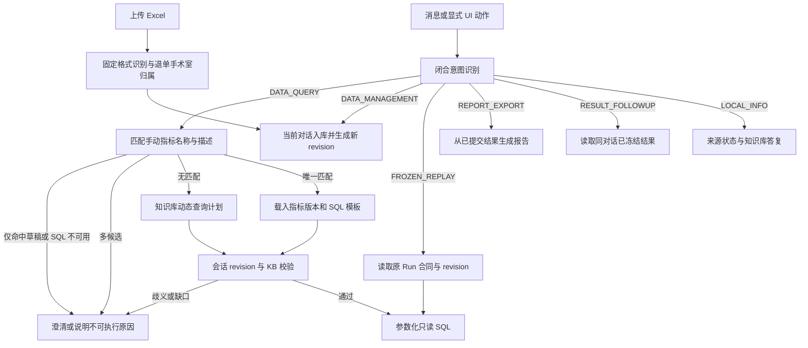

# 三类手术数据的新意图路由设计

日期：2026-10-30。状态：设计方案，尚未接入运行代码。本方案以三类固定 Excel、当前对话入库与表结构知识库为前提；新流程不再要求 Word 指标说明。旧 Word 合同只用于查看历史运行，不参与新会话路由。整体步骤见[完整方案](three-source-complete-plan-2026-10-30.md)，数据结构见 [三类数据存储与知识库设计](three-source-storage-kb-design-2026-10-30.md)，节点执行见 [LangGraph 编排设计](three-source-langgraph-orchestration-2026-10-30.md)。本文替代此前以 Word 指标说明为中心的路由方案中与新流程冲突的部分。

## 1. 当前实现的问题

- `files.classify()` 仅判断 `DATA_FILE / METRIC_DEFINITION / OTHER / MIXED / UNKNOWN`，没有首台、退单、明细三种固定格式。`parse_xlsx()` 的快照没有保留前置标题，无法用标题核验格式。
- `AppService.process_turn()` 将显式动作、本地命令、宽泛关键词和模型分类混合到一个 `action`。`infer_local_action()` 看见“行数”可直接转 `DATASET_INSPECT`，所以“一号手术室退单行数”会误答为文件目录，而不是查询业务行。
- 当前 `PLAN/ANALYZE` 需要 Word definition 和旧字段映射；`MATERIAL_QUERY` 只看附件/表头/摘要，不能读取新业务表；`RESULT_QUERY` 只能筛选、排序、分页已有结果。新的三源数据库查询没有入口。
- `PLAN` 是执行方式，“退单行数查询”才是业务请求；`SUMMARY/EXPLAIN` 既可能解释旧结果，也可能要求重新取数。不能让这些旧动作名承担语义识别。

## 2. 三层路由，职责分离

| 层 | 输入与输出 | 不负责的事 |
| --- | --- | --- |
| 文件接入路由 | 真实格式、标题、精确表头、格式版本 -> `FIRST_SURGERY / CANCELLATION / SURGERY_DETAIL / UNKNOWN`；退单另解出 `OR_1 / OR_2 / OR_3 / PENDING` | 不解释用户问题，不按文件名猜业务类型 |
| 对话意图路由 | 用户本轮文本、显式 UI 动作、当前对话目录、引用的结果 -> 闭合意图和目标 | 不决定物理表、SQL、跨表连接或指标口径 |
| 取数分流与计划校验 | 先匹配手动指标的已发布名称/描述；唯一命中走该指标 SQL，明确无匹配才用表结构 KB 生成动态计划；两路统一校验当前 revision | 不接受模型原始 SQL 直接执行，不跨对话找数据 |



粘贴或上传文件是接入事件，不是自然语言查询。文件入库后建立新 `data_revision`；它不会自动执行用户上一次的问题。退单文件的手术室归属依据文件名语义相似度；不能唯一判定时由用户手动选定。这一步独立于“退单”文件类型识别，匹配策略见 [cancellation-unit-routing-v1.json](contracts/cancellation-unit-routing-v1.json)；当前三份样例与空手术间处理见存储设计。

新对话不沿用旧版“首次分析后将会话置为 `LOCKED`、禁止再上传”的规则。冻结的是每个 Run 的输入合同，而不是整个对话：用户可在同一对话补传或移除来源，提交后产生新 revision；已创建 Run 继续引用其原 revision。上传和查询并发时，查询创建 Run 的事务必须核验预期 `data_revision`，若期间发生补传则重取上下文并重新校验计划，不能悄悄改用新数据。旧 `LOCKED` 会话和旧 Word 运行保持历史只读兼容。

## 3. 新对话意图

| 意图 | 典型问题 | 处理方式 | 是否读业务行 / 建 Run |
| --- | --- | --- | --- |
| `LOCAL_INFO` | “上传了哪些文件”“退单表有哪些字段”“这个指标怎么定义”“导入是否完成” | 从当前对话来源清单、已发布 KB 与手动指标库读取；可细分 `SOURCE_STATUS / SCHEMA_HELP / METRIC_DEFINITION / HELP / SETTINGS` | 否 / 否 |
| `DATA_QUERY` | “一号手术室本周退单行数”“按日期列出退单记录”“首台按科室统计” | 先匹配已发布手动指标名称/描述；无匹配再由 KB 规划动态 SQL，固定 revision 后执行 | 是 / 是 |
| `RESULT_FOLLOWUP` | “把刚才的结果降序排列”“解释这份结果”“只显示已有分组中的一号手术室” | 校验同对话已提交结果；仅复用已存在的字段、分组与数字 | 否 / 否；保存结果视图或解释记录 |
| `FROZEN_REPLAY` | “按原条件重新计算这份结果” | 显式引用原 Run，使用原 data revision、KB release 和查询合同 | 是 / 是 |
| `REPORT_EXPORT` | “导出刚才的统计报告” | 从已提交结果生成报告；DOCX 可作为输出，不需要 Word 输入 | 否 / 生成 artifact |
| `DATA_MANAGEMENT` | “把这份退单归为二号手术室”“移除这个上传文件” | 解析明确的当前对话来源 ID；对待定文件手动选定手术室，或更正已有归属并形成新来源/revision | 视操作而定 / 否 |
| `METRIC_MANAGEMENT` | “新增指标”“编辑指标描述”“一键 AI 生成 SQL”“删除指标” | 打开手动指标表单或处理显式 CRUD/生成动作；发布版本前核验 SQL，不由模型直接修改指标 | 否 / 生成作业可建独立记录 |

`UNKNOWN`、`NEEDS_CLARIFICATION`、`NEEDS_DATA`、`UNSUPPORTED` 是路由或校验结果，不是可执行意图。查询可以包含多个只读子问题，各自生成计划和结果；修改数据与查询混在同一条消息时先完成明确的修改事务，再由新的 turn 固定更新后的 revision，避免一条消息跨两个数据版本。

## 4. 路由优先级与判定

1. **显式动作优先。** UI 的“查看字段”“查询”“导出”“原合同重算”和上传/移除按钮提供明确动作，但仍校验目标、权限、会话与版本；模型不得覆盖显式动作。
2. **确定性本地意图。** 只对完整命令或可严格解析的问法直接路由，如“查看附件”“查看字段”。不能仅因出现“行数”“文件”“总结”“手术室”等词就决定动作。
3. **语义分类。** 其余文本由闭合分类器提取目标、操作和原话证据片段。模型只提议 `intent / target / operation / reference`，本地验证后执行；分类低置信或关键槽位冲突时澄清，不靠模型得分强行二选一。
4. **结果复用判断。** 只有明确引用同对话已提交结果，且仅要求排序、分页、已有分组筛选或对已冻结数值的解释，才走 `RESULT_FOLLOWUP`。新增日期、过滤条件、维度、指标或明细列一律转 `DATA_QUERY`；若用户明确指向旧 Run，则固定旧 revision 作为新查询来源，并在回答中说明。
5. **指标优先分流。** `DATA_QUERY` 先检索未删除手动指标的当前生效发布版本，按 `metricId` 折叠版本：明确指标名精确匹配优先，其次用名称/人工别名/自然语言描述的 BM25 排序召回，受限 LLM 对候选做语义判别。同指标的编辑草稿不与发布版争夺候选，也不能用草稿新描述解释旧 SQL；新建未发布指标、显式指定草稿或仅命中草稿新增描述时返回不可执行缺口。只有唯一、已发布、足够相关且统计对象/时间/单位/用户条件兼容的候选才走指标 SQL；多个不同指标候选先澄清，完成全目录检查后明确无匹配才调用表结构知识库生成动态 SQL。BM25 分数只是排序证据，不得让弱命中覆盖用户显式条件。匹配器版本、精确名称规则、BM25/LLM 候选覆盖和误匹配率须用正负例校准并随路由决策记录；门槛未校准时只自动采用精确且兼容的唯一名称命中。
6. **共同语义校验。** 命中指标但 SQL 缺失、依赖过期或参数不兼容时返回该指标的缺口，不能悄悄走动态 SQL。跨表关系、实际手术台次、退单手术台次或跨午夜时差若缺少已批准口径，返回缺口，不退化成 `COUNT(*)`。

判断“行数”的关键是统计对象：问“上传的文件有几份、每份有多少源行”可走 `LOCAL_INFO` 的来源画像；问“一号手术室退单有多少行”含业务筛选，必须走 `DATA_QUERY`，结果标为“来源记录行数”。“退单日期”可能指来源“日期”或“退单时间”的日期部分；结果会变化时先澄清。用户问题中的“一号/第一/一手”由 KB 值字典解析为 `OR_1`；文件名语义匹配是在入库阶段确定来源维度，不是在查询时重新猜测。

## 5. 请求合同与执行边界

意图分类器返回闭合 JSON，示意如下；`sessionId`、`dataRevisionId`、`kbReleaseId` 由服务端注入，绝不接受模型或用户文本提供。

```json
{
  "intent": "DATA_QUERY",
  "target": "cancellation",
  "operation": "AGGREGATE",
  "requestedMeasure": "COUNT_SOURCE_ROWS",
  "metricHint": null,
  "filters": [{"field": "origin_operating_unit", "operator": "eq", "value": "OR_1"}],
  "timePhrase": "本周",
  "groupBy": [],
  "resultRef": null,
  "evidence": ["一号手术室", "本周", "退单行数"]
}
```

此对象只是意图提议，不是可直接执行的查询计划。`DATA_QUERY` 的下一步由本地路由器优先检索手动指标；唯一匹配时绑定其当前已发布版本，明确无匹配时才进入 KB 动态计划。服务端解析相对时间时固定客户端时区、基准时刻和业务日期字段；“本周”若没有约定则按当前时区周一至周日解释，并把解析后的具体日期回显。然后固定当前对话的 `data_revision` 和已发布 `kb_release`，验证字段权限、类型、来源覆盖、退单手术室归属及指标 SQL 有效性。两路都只能执行本地编译的参数化只读 SQL；每次扫描都有服务端 `session_id` 与 revision 约束。模型不接收患者明细，也不能指定物理表、连接条件、函数名、会话或知识库版本。

时间短语不等于数据覆盖声明。若“本周”对应区间没有已确认的完整导出范围，仍可回答已上传来源的记录行数，但须明确结果仅覆盖当前入库文件；不得把未上传日期视为零。`DATA_QUERY` 若没有已入库数据返回 `NEEDS_DATA`；仅当用户明确指向正在导入的来源，才按其 import job ID 等待完成并重新核验 revision，无关 READY 来源的查询不等待。不能转去其他对话补数。文件类型或退单文件名语义归属未决时，查询返回具体待手动选择来源和可能影响的行数。

一次路由决策记录 `turnId / sessionId / routingVersion / metricMatcherVersion / bm25IndexVersion / explicitAction / proposedIntent / finalIntent / evidence / targetIds / resultRef / metricMatchStatus / candidateMetricIds / candidateBm25Ranks / searchCoverageComplete / selectedMetricVersionId / sqlSha256 / dataRevisionId / kbReleaseId / validationStatus / reasonCode`。模型分类与本地校验分开留痕；失败保留真实原因，不统称“意图识别失败”。新查询结果与报告固定使用的 revision、知识库 hash、计划、参数和来源问题摘要；补传只影响后续未固定的查询。

## 6. 旧动作迁移

| 当前动作/行为 | 新流程处理 |
| --- | --- |
| `DATA_FILE` | 改为三种固定格式路由；退单手术室另判定 |
| `METRIC_DEFINITION`、`METRIC_SPEC_PARSE` | 新会话不再接收 Word 指标说明；只保留历史只读路径 |
| `ATTACHMENT_STATUS`、`DATASET_INSPECT` | 合并到 `LOCAL_INFO` 的来源状态与结构问答；源行数和条件统计分开 |
| `DEFINITION_INSPECT`、`FORMULA_INSPECT` | 查看手动指标当前发布版本的自然语言描述、SQL 和参数合同，或明确引用的历史合同 |
| `MATERIAL_QUERY` | 结构/来源问题归 `LOCAL_INFO`；涉及业务行数值的问题归 `DATA_QUERY` |
| `PLAN`、`ANALYZE` | 作为 `DATA_QUERY` 的预览/执行模式，不作为语义意图 |
| `RESULT_QUERY`、`EXPLAIN`、`SUMMARY` | 无新数据条件且可复用时归 `RESULT_FOLLOWUP`；否则重新规划 `DATA_QUERY` |
| `RECALCULATE_FROZEN` | `FROZEN_REPLAY`；严格使用原冻结合同 |
| `REGENERATE` | 只重写已有结果的说明，不改数值与合同；属于 `RESULT_FOLLOWUP` |

当前 `conversation.resolve_history()` 的同对话历史引用校验可保留，但旧的 definitionId 继承检查应换成 data revision、KB release 和查询合同的兼容检查。旧运行不迁移为新合同；通过旧只读查看路径保留可追溯性。现有 `agent.py` 的 `prepare -> compute -> audit -> commit` 仅服务旧合同；新执行图需要在计划校验后使用三源 revision 与受控 SQL，不能把 Word 准备节点原样接入。

实现顺序建议为：先改附件快照和三类格式识别，再接入带 revision 的入库及来源状态；随后建立手动指标 CRUD/AI SQL 生成，再替换意图枚举并实现指标优先匹配、无匹配 KB 动态 SQL、共同校验与结果复用。新旧合同以 `schemaVersion` 分发，旧会话不被新路由重新解释。前端的新指标管理仅显示手动新增/编辑/删除/一键生成 SQL；旧 Word 导入和解析仅在历史只读界面保留。

## 7. 最小验收用例

| 输入 | 应有路由与结果 |
| --- | --- |
| 上传二手退单样例 | `CANCELLATION`；文件名唯一命中“二手”别名，归属 `OR_2` 后 READY；不自动计算 |
| 上传“手术退单汇总.xlsx” | `CANCELLATION`；文件名无法指向唯一手术室，进入 `NEEDS_UNIT_CONFIRMATION` 并让用户在三个手术室中选择 |
| “一号手术室退单行数” | `DATA_QUERY / AGGREGATE`；只统计当前对话已确认归属的来源行，并标注“行” |
| “退单表有哪些字段” | `LOCAL_INFO / SCHEMA_HELP`；读 KB，不读患者行 |
| “刚才结果倒序” | `RESULT_FOLLOWUP`；复用原结果，不再扫描业务表 |
| “刚才结果改按手术间统计” | `DATA_QUERY`；明确新维度并固定 revision，不冒充旧结果筛选 |
| “统计退单手术台次” | 因去重/关联口径未批准返回缺口，不把来源行数冒充台次 |
| “按住院号连接退单与手术明细” | 关系未批准，拒绝跨表 SQL |
| “按已发布的首台准时率指标查询” | 名称唯一匹配时使用其已发布 SQL/参数合同；不重新生成另一套口径 |
| “按科室统计退单来源行数”且无匹配指标 | 转 KB 动态 SQL；仍受字段、关系和会话限制 |
| 指标名称命中但 SQL 过期或本次条件不受支持 | 返回指标 SQL 缺口或澄清，不静默回退动态 SQL |
| “查另一个对话的退单” | 会话边界拒绝，不由模型改写查询范围 |

首阶段需完成固定格式接入、手动指标 CRUD/一键生成 SQL、`LOCAL_INFO`、指标优先匹配、单实体动态 `DATA_QUERY`、已有结果复用和明确缺口。跨表关系与复杂指标在知识库得到业务批准后再开放，不作为路由器的隐式能力。
