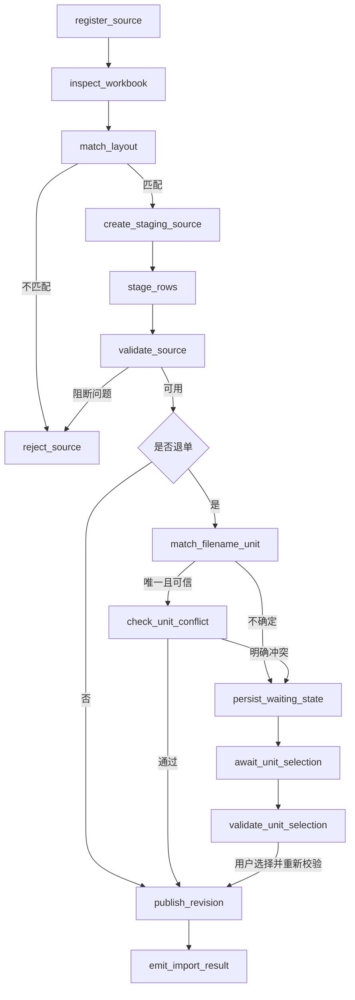
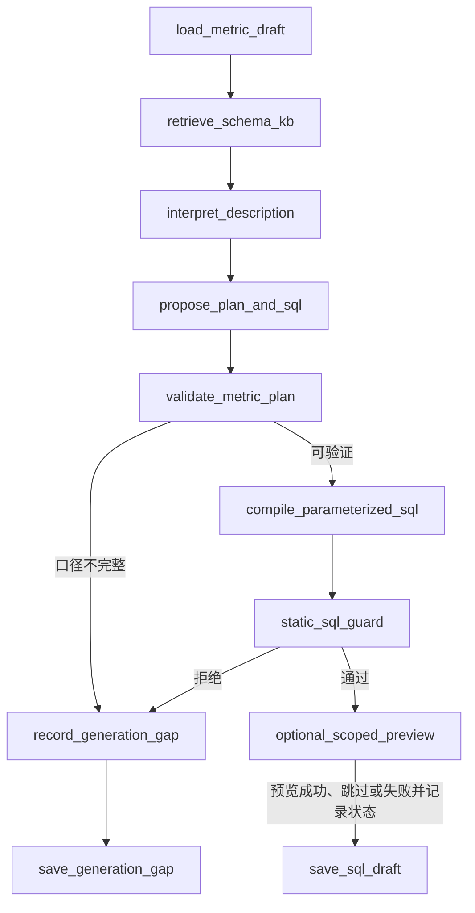
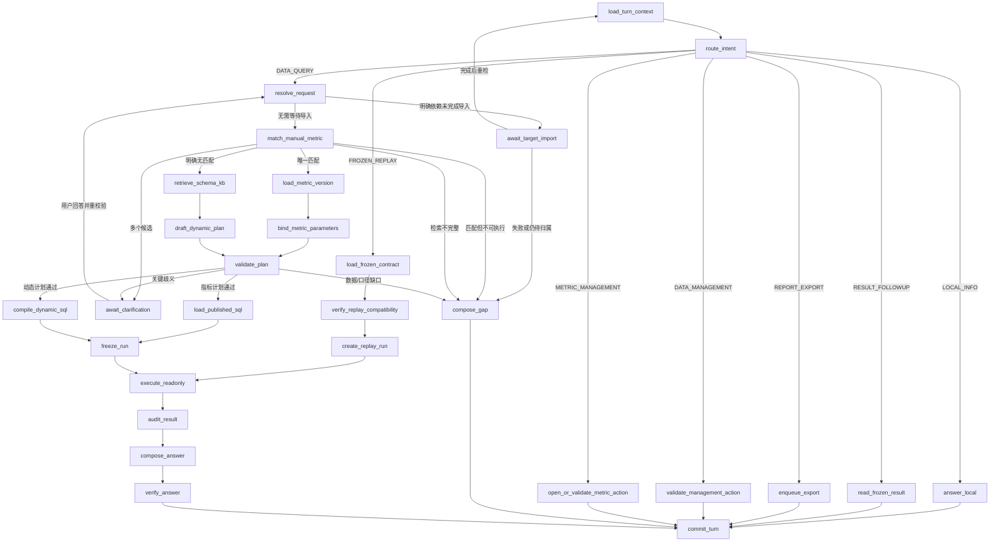

# 三类手术数据 LangGraph 编排设计

日期：2026-10-30。状态：方案讨论，尚未接入运行代码。新流程只接收首台手术信息、手术室退单信息、手术明细查询三类固定 Excel；不要求 Word 指标说明。本文与[完整方案](three-source-complete-plan-2026-10-30.md)、[意图路由](three-source-intent-routing-2026-10-30.md)、[存储和知识库](three-source-storage-kb-design-2026-10-30.md)配套；旧 Word 运行和旧四节点图只作历史兼容。

## 1. 划分原则

使用三个独立的持久化图，不把上传、指标 SQL 生成、聊天和执行塞进一条长期对话线程：

| 图 | 线程 ID | 触发 | 成功产物 |
| --- | --- | --- | --- |
| `source_import_graph` | `upload:{uploadId}` | 上传一个 Excel；待确认退单收到手术室选择后恢复 | 一个 READY 来源、Sheet/业务行、当前对话的新 `data_revision` |
| `metric_sql_graph` | `metric-sql:{metricVersionId}:{generationId}` | 用户在手动指标草稿上点击“一键 AI 生成 SQL” | 供审阅的 SQL 草稿、已验证逻辑计划及本地编译的参数化 SQL 模板 |
| `conversation_turn_graph` | `turn:{turnId}` | 一轮消息或显式 UI 动作 | 本地回答、查询 Run、报告任务，或可恢复的澄清状态 |

图用于需要路由、人工等待或多阶段恢复的流程。文件 Blob、批量行、SQL 结果、模型原始响应均保存在受控业务存储中；GraphState 仅保存 ID、版本、哈希、阶段状态和小型结构化决策。会话 ID、当前数据 revision 与 KB release 只能由服务端提供。每一轮新建线程；多轮上下文通过显式的同对话 Run 引用连接，不让一个图线程无限增长。

### 上传图

| 节点 | 输入与职责 | 输出或失败边界 |
| --- | --- | --- |
| `register_source` | 校验会话、文件大小和受控 Blob 引用；按 `requestId` 幂等登记上传请求，此时尚不写 `data_source` | `uploadId`、原件 SHA-256；重复内容须检测，不能因改名重复计数 |
| `inspect_workbook` | 校验真实 XLSX、Sheet 可见性、标题、行列上限和 Excel 错误；忽略退单样例错误的尺寸元数据，按实际行流扫描 | 安全的结构画像、标题和表头哈希；不执行公式 |
| `match_layout` | 按版本化格式合同匹配三类标题、表头行与精确列顺序；文件名不参与文件类型判定 | 唯一 `sourceType/layoutVersion` 或 `FORMAT_UNRECOGNIZED` |
| `create_staging_source` | 根据已识别格式创建 `STAGING` 的 `data_source` 和 `sourceId`；退单归属及最终 fingerprint 暂为空 | 只有格式已确认的来源进入业务表 |
| `stage_rows` | 按 Sheet/分批解析到专用行表，记录源 Excel 行号、原始哈希和质量问题；每批受取消/预算检查 | 分批进度和已写行数；以 `(sourceId,sheet,excelRow)` 保证恢复不重复插入 |
| `validate_source` | 核验行数、必需列、解析错误、覆盖范围、重复文件和来源质量门禁 | `READY_CANDIDATE` 或明确阻断原因；有问题的源行仍可追溯 |
| `match_filename_unit` | 仅对 `CANCELLATION`：规范化原始文件名，先查唯一别名，再用受限 LLM 比较三个候选的语义；保存匹配器/别名版本、原名证据及冲突，只有可选 embedding 适配器才记录余弦分数 | `OR_1/2/3` + `FILENAME_SEMANTIC`，或 `NEEDS_UNIT_CONFIRMATION`；无明确且已校准的归属证据不自动接受 |
| `check_unit_conflict` | 可选地用已审核手术间字典核对明显混合/冲突，不用房间编码替代文件名判定 | 冲突转人工；未知或空手术间不自动阻断 |
| `persist_waiting_state` / `await_unit_selection` / `validate_unit_selection` | 先持久化 `NEEDS_UNIT_CONFIRMATION` 与候选证据，再中断展示文件名、候选与原因；恢复后只接受本对话该来源的 `OR_1/2/3` 显式选择并复核版本 | `USER_CONFIRMED` 证据；等待不占用 worker、SQLite 事务或租约 |
| `publish_revision` | 同一业务事务计算最终 fingerprint，重核来源、会话与当前 revision，置 READY，写完整来源清单和事件；按原件 SHA-256 校验目标清单，同字节改名不能重复计数；独立上传并发发布时重取最新清单并有界重试 | 新 revision；重复恢复返回已提交结果，不再次创建版本 |
| `emit_import_result` | 输出已导入行数、来源类型、退单归属依据和问题摘要 | UI 可见状态；不触发分析 |

用户手动选择属于正常业务等待，不应使 import job 变成 FAILED。建议 `await_unit_selection` 使用 LangGraph `interrupt()`，持久化 `WAITING_INPUT` 及 `sourceId/expectedSourceVersion`，UI 通过专用选择动作提交后用原线程 `Command(resume=...)`。若暂不改 worker 的等待状态机，也可让图在 `NEEDS_UNIT_CONFIRMATION` 终止，由新的确认作业执行同样的 `publish_revision`；两种实现不能混用。当前 worker 会把非完成执行视为失败，实施前必须扩展等待态和恢复入口。中断节点会重入，写入副作用放在它之前或之后的幂等节点。

同一对话重复上传相同字节时先检查已有 READY 来源。即使新文件名导致不同归属候选，也不得自动把同一原件加入同一 revision 两次；应提示复用或显式更正归属，更正时保留旧来源供历史 Run 引用。待归属来源不进入当前 revision，其他 READY 来源仍可查询。

### 手动指标 SQL 生成图

指标的增、查、改、删是普通业务事务：用户手动输入名称与自然语言描述，已发布版本编辑时创建新草稿，删除为软删除。模型不能自行新建、修改或发布指标。只有“一键 AI 生成 SQL”需要图编排：

`load_metric_draft` 固定 `metricVersionId`、人工名称/描述的内容 hash 和草稿 revision。`retrieve_schema_kb` 只取当前发布的表、字段、术语、允许关系和查询能力，不取患者行。`interpret_description` 将统计对象、时间、过滤、分母、去重、分组和单位拆为结构化需求，未说明而会影响结果的条件不能臆造。`propose_plan_and_sql` 可产生 AI SQL 提议，但执行入口只接受 `validate_metric_plan` 通过的闭合逻辑计划；`compile_parameterized_sql` 从 KB 白名单生成真正可执行的 SQL 模板。UI 主展示并供用户发布复核的是该编译模板，AI 原文仅作对照诊断，并明确标为不可执行。`static_sql_guard` 核验只读、标识符/函数白名单、会话/revision 占位符、查询上限及关系批准状态。可选预览只在当前对话的受控只读连接运行，不能把该对话 ID 或样本数据写入通用指标版本；无数据、用户跳过或预览失败都记录状态后进入 `save_sql_draft`，预览失败不冒充成功，但不抹掉已通过静态校验的 SQL 草稿。

`save_sql_draft` 和 `save_generation_gap` 均以草稿 `draft_revision` CAS 写入 `last_generation_id`、KB release/hash 与校验回执，成功后递增 revision；前者保存可执行模板并进入 `VALIDATED`，后者只保存 AI 提议、具体缺口并进入 `SQL_DRAFT`，不能把未通过的 SQL 模板标成有效。生成期间用户编辑了名称或描述就丢弃过期产物并提示重新生成。预览状态单独记录。图完成后用户可查看最终可执行 SQL 和适用边界，再用独立的 `publish_metric_version` 事务重新校验并发布版本、更新当前生效版本。发布不由模型节点自动触发。描述修改、SQL 重新生成和 KB 依赖失效都需要重新验证；历史已发布版本及 Run 的 SQL hash 保持不变。

### 对话图

| 节点 | 关键职责与边界 |
| --- | --- |
| `load_turn_context` | 校验会话、turn 幂等键、显式 UI 动作和历史 Run 引用；读取当前来源目录、revision 与已发布 KB 元数据，不取患者明细 |
| `route_intent` | 显式动作优先；本地严格命令其次；其他问题由模型提出闭合意图，应用校验。区分“文件有多少行”的来源画像、“一号手术室退单行数”的业务聚合，以及指标管理动作 |
| `answer_local` / `read_frozen_result` / `enqueue_export` | 分别处理结构/状态、已有结果的排序/筛选/解释、从已提交结果导出；新增条件或维度必须转新查询 |
| `validate_management_action` | 对归属确认、移除来源等动作做来源 ID、会话和预期 revision 校验；变更后走来源发布事务，新数据查询另起一轮 |
| `open_or_validate_metric_action` | 只转到手动指标表单或验证显式 CRUD/生成/发布动作；一键生成调度独立 `metric_sql_graph`，模型分类本身不写指标 |
| `resolve_request` | 分解只读子问题、结果引用、时间表达与输出要求；固定相对时间的基准时刻、时区和业务日期字段，保留用户原话 |
| `match_manual_metric` | 在顶层取数路径先检索当前生效发布版本的名称、人工别名和自然语言描述，同一 `metricId` 的最新草稿仅提示未发布改动；新指标或只命中草稿新描述时为 `MATCH_UNAVAILABLE`。精确名称优先，BM25 对词面候选排序，受限 LLM 判别语义并检查全目录覆盖；BM25 分数不能作为自动执行阈值。输出 `MATCHED / AMBIGUOUS / NO_MATCH / MATCH_UNAVAILABLE / RETRIEVAL_UNCERTAIN`；只在完整检索后的 `NO_MATCH` 进入 KB 动态分支。恢复时用户明确选择的 `metricVersionId` 优先于重新召回，但必须重验兼容性 |
| `load_metric_version` / `bind_metric_parameters` | 固定命中的发布版本、逻辑计划、SQL hash 和声明参数；检验本次时间、维度、筛选、统计对象与描述是否兼容。命中草稿、SQL 过期或不兼容不自动兜底 |
| `retrieve_schema_kb` / `draft_dynamic_plan` | 明确无指标匹配时才召回实体、字段、术语、查询能力和已批准关系；模型仅提出闭合逻辑计划，不返回可执行 SQL、物理表名或会话 ID |
| `validate_plan` | 两路共用本地校验：字段/操作权限、指标参数、实体粒度、时间含义、来源质量、退单归属、覆盖、关系和知识库版本；区分 `READY / NEEDS_CLARIFICATION / NEEDS_DATA / UNSUPPORTED / SQL_STALE` |
| `await_clarification` | 只询问会改变结果的歧义，如多指标候选或“退单日期”的含义；明确选择指标时固定 `metricId/metricVersionId` 为恢复输入，不能再次对同一候选集循环提问；恢复后重检会话、revision、KB 和已登记问题 |
| `await_target_import` | 仅当用户明确指向仍在导入的目标来源时登记 import job ID 并中断；完成后重新读取上下文与 revision，失败或仍待归属返回缺口。其他 READY 数据查询不被无关导入阻塞 |
| `load_published_sql` / `compile_dynamic_sql` | 指标分支加载已验证模板并校验 hash；无指标分支从当前 KB 白名单编译参数化只读 SQL。两路源扫描均注入服务端 `sessionId/revisionId`，模型 SQL 不直接执行 |
| `freeze_run` | 一个业务事务固定路由分支、`metricVersionId`（若有）、data revision/manifest、KB release/hash、计划、SQL 模板/hash、参数、权限和算子版本。默认查询以当前 revision 做 CAS；明确引用旧 Run 并要求新条件时使用其旧 revision，显示这个选择 |
| `load_frozen_contract` / `verify_replay_compatibility` / `create_replay_run` | 原合同重算只读取同对话指定 Run 的原 revision、KB、已编译模板与参数，验证旧执行版本/Blob 仍可用后创建新 Run；不调用新意图、不用当前 revision 或新版 KB 解释原计划。版本不兼容返回明确缺口，不声称已按原合同重算 |
| `execute_readonly` | `query_only`、authorizer、进度处理器、超时与行数限制下执行；结果写受控存储，GraphState 仅留结果引用/哈希 |
| `audit_result` / `compose_answer` / `verify_answer` / `commit_turn` | 核对结果粒度、单位、来源行数与“台次”区别、质量缺口；重算结果比较原合同摘要；回答引用实际来源并验证文字中的数字、单位与查询结果一致；消息、Run 终态和事件按 turn/run ID 幂等提交 |

`DATA_QUERY` 有多个独立只读子问题时，可在 `validate_plan` 后按子计划执行并分别审计，最终汇总；第一版保持串行，避免共享 SQLite 写锁和跨子问题的归因混乱。一个问题同时要求修改来源与查询时要求拆成两轮，保证每个 Run 只有一个 data revision。

## 2. 状态、恢复与数据库边界

建议的上传状态只包含 `uploadId, sourceId?, sessionId, originalSha256, layoutVersion?, matcherVersion, unitDecisionRef, stageCursor, expectedRevision, status`；指标生成状态只包含 `metricVersionId, generationId, descriptionHash, draftRevision, kbReleaseId, planRef, sqlDraftRef, validationRef, previewStatus, status`；对话状态只包含 `turnId, sessionId, intentDecisionRef, metricMatchRef, selectedMetricVersionId?, targetImportJobId?, kbReleaseId, dataRevisionId, planRef, compiledSqlRef, runId, resultRef, status`。病人行、原件、完整 SQL 参数和模型原始响应不进入 LangGraph 检查点或普通日志。输出到模型的仅为批准的 schema、术语和非敏感来源摘要。

现有业务库 `datamind.sqlite3` 与 `checkpoints.sqlite3` 分开，跨库无法原子提交。`publish_revision`、`freeze_run`、`commit_turn` 必须以业务库唯一键和提交标记防重；崩溃恢复先查业务提交记录，再依据检查点续跑，不能仅凭图节点是否完成判断。检查点按图版本保存；不兼容时保留旧状态和诊断，基于原冻结输入新建 Run，不能把旧合同套到新代码直接重放。

人工待选与技术失败、取消、缺少数据是四种状态。`interrupt()` 恢复需要原 `thread_id`，且节点会从头运行；恢复值必须校验当前用户、来源/turn ID、候选枚举、预期版本和取消状态。等待期间释放 worker 租约；超时不代表用户同意。查询若在等待澄清时发生补传，恢复后重新规划并显示新 revision，或要求用户重新提交，不沿用过期计划。已冻结 Run 即使会话后来补传，仍只读自己的旧 revision。

## 3. 实施顺序与验收

1. 先完成三类格式识别、来源行入库和 revision 事务；上传图能处理退单文件名自动归属、手动选择和重复上传。
2. 再建立独立的手动指标 CRUD 与 `metric_sql_graph`；以一个“退单来源记录行数”指标验证名称/描述、AI 生成、校验和发布全链路。
3. 接入对话图的指标优先匹配和 `NO_MATCH` 动态 SQL 分支，两路共享校验、冻结、执行和审计；最后增加报告导出和复杂问题。跨表关系在业务键获得批准之前持续拒绝。

最小回归覆盖：三类样例各自入库、退单模糊文件名进入等待、手动选择恢复不重复发布、同文件改名后同一 revision 不能重复计数；指标名称精确命中和描述唯一命中走已发布 SQL，无匹配才走 KB 动态 SQL，多候选选择后不循环澄清，同一指标已发布版加同名编辑草稿仍可按已发布口径查询，命中但 SQL 过期不兜底；描述编辑后旧 SQL 不能在新版本发布，补传后旧 Run 数值不变，未批准跨表连接被拒绝，崩溃后来源发布/Run 提交恰好一次，另一个对话的数据永远不进入 SQL 扫描。
